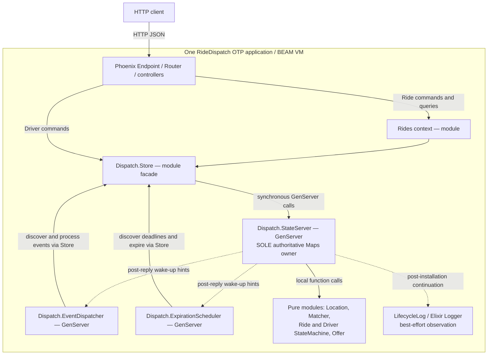

# Architecture and scalability

This API-only ride dispatch application implements Ride creation, nearest-Driver
matching, Offer acceptance/rejection/expiration, rematching, cancellation and
completion. It is a **modular monolith in one BEAM VM**, with volatile in-memory
state. The following architecture is implemented; the scaling proposals at the
end are not. See the [executable demo](../README.md#local-opt-in-demo-and-lifecycle-logs-r2),
[six sequences](sequence-diagram.md) and [AC evidence](ac-traceability.md).

## Component view — current implementation

Solid arrows are synchronous requests/function calls; dotted arrows are
nonauthoritative hints or observations. Only the outer HTTP edge is a network
API. Contexts, Store and pure modules are code boundaries, not extra servers.
The three dispatch GenServers are supervised processes, not microservices.
The Owner's Maps hold business records; Logger holds no business authority.
Wake-up publication occurs in a separate notification callback initiated by
Store after a command reply, not within atomic business mutation.

## Responsibilities and supervision

| Component | Implemented responsibility |
|---|---|
| [Endpoint](../lib/ride_dispatch_web/endpoint.ex), [router](../lib/ride_dispatch_web/router.ex), controllers | Parse JSON, validate request shape, map domain results to sanitized HTTP envelopes. No reservation transaction in a controller. |
| [Rides](../lib/ride_dispatch/rides.ex) | Small application context delegating Ride operations to Store. DriverController uses Store directly; there is no additional Driver context process. |
| [Store](../lib/ride_dispatch/dispatch/store.ex) | Public command/query facade, notification hints and uncertain-call diagnostics. Callers cannot install arbitrary state. |
| [StateServer](../lib/ride_dispatch/dispatch/state_server.ex) | Owns all records, validates cross-record ownership and installs complete multi-entity transitions in one callback. Queries share its mailbox. |
| [Location](../lib/ride_dispatch/location.ex), [Matcher](../lib/ride_dispatch/dispatch/matcher.ex) | Coordinate validation, Haversine distance and nearest eligible candidate with radius and lexicographic ID tie-breaking. Candidate selection alone does not reserve. |
| [Ride StateMachine](../lib/ride_dispatch/rides/state_machine.ex), [Driver StateMachine](../lib/ride_dispatch/drivers/state_machine.ex), [Offer](../lib/ride_dispatch/dispatch/offer.ex) | Pure transition rules and expiration predicate; no HTTP, logging, tasks or external I/O. |
| [EventDispatcher](../lib/ride_dispatch/dispatch/event_dispatcher.ex) | Discovers supported pending events and asks Store to process them; bounded failure accounting and recovery scanning. |
| [ExpirationScheduler](../lib/ride_dispatch/dispatch/expiration_scheduler.ex) | Discovers deadlines, schedules wake-ups and submits exact-Offer expiration commands. It never owns reservation eligibility. |

[Application](../lib/ride_dispatch/application.ex) starts Telemetry, DNSCluster,
Phoenix.PubSub, StateServer, EventDispatcher, ExpirationScheduler and Endpoint,
in that order, under **`:one_for_one`** supervision. Children use permanent restart
behavior. PubSub and DNSCluster are framework infrastructure, not the business
event queue or a distributed ownership mechanism. A StateServer crash does not
restart both workers automatically. The named owner is rediscovered; the scheduler
monitors/pins the observed PID and invalidates old-owner work, timers and local
retry/diagnostic bookkeeping on replacement. Scheduler restart with a surviving
owner reconstructs work from retained Offers. Neither restart restores records
lost with the owner/VM.

## Authoritative records and atomic operations

The owner keeps Maps of Drivers, Passengers, Rides, Offers, creation-idempotency
entries and events (the `pending_events` map retains processed/failed history too).
Other state includes trusted clock/configuration and notification subscribers.

| Record | Identity and relevant state |
|---|---|
| Passenger / Driver | String ID; seeded through validation. Drivers have latest coordinates and OFFLINE / AVAILABLE / OFFERED / BUSY state. Initial seeds cannot claim active ownership. |
| Ride | Independent ID, passenger, pickup/destination, status, `assignedDriverId`, private `currentOfferId`; both assignment pointers clear on rejection, expiration and terminal closure. |
| Offer | Independent ID, `rideId`, `driverId`, status, `created_at_ms`, `expires_at_ms`. PENDING, ACCEPTED, REJECTED, EXPIRED, CANCELLED and COMPLETED are distinct statuses. |
| Event | ID, type, Ride association, pending/processed/failed status, attempts, retry eligibility and result/error. Retention supports duplicate detection. |
| Creation entry | Idempotency key, canonical request, original REQUESTED Ride result and original event ID. Same payload/key replays that result; different payload conflicts. |
| Operation evidence | Offer acceptance timestamp/result; rejection or expiration receipt with exact identities and redispatch link; Ride-bound terminal receipt with operation, source status, historical Offer/Driver and original result. |

Generated IDs are independent within the running owner/VM; they are not durable
cross-restart identifiers. There is no history TTL, pagination or persistence.
Snapshots retained in receipts are immutable results, not commands to restore old
state. GET Ride returns current state; replay returns the original operation result.

| Atomic command through Store | Installed together, or not installed |
|---|---|
| `create_ride/3` | REQUESTED Ride, RideCreated event and creation entry. |
| `process_event/2` for RideCreated | Ride MATCHING, original event PROCESSED, one pending `dispatch-<rideId>` DispatchRequested. |
| `process_event/2` for DispatchRequested | Latest location/availability matching, exact ownership validation, Driver OFFERED, Ride DRIVER_ASSIGNED, new PENDING Offer and processed event. No candidate instead acknowledges with `no_candidate`, leaves MATCHING/unassigned and creates nothing. |
| `accept_offer/3` | Exact current Offer ACCEPTED with receipt, Ride DRIVER_ACCEPTED and Driver BUSY; no new event. |
| `reject_offer/3` | Offer REJECTED with receipt, Driver AVAILABLE, Ride MATCHING/unassigned and pending `redispatch-<offerId>` event. |
| `expire_offer/2` | Exact due Offer EXPIRED with receipt, Driver AVAILABLE, Ride MATCHING/unassigned and pending `redispatch-expired-<offerId>` event. Collision checks precede installation. |
| `cancel_ride/2` | Any supported active Ride becomes CANCELLED; current pending/accepted Offer becomes CANCELLED and its Driver is released if present; pointers clear and terminal receipt retained. |
| `complete_ride/2` | Only DRIVER_ACCEPTED becomes COMPLETED; accepted Offer becomes COMPLETED, Driver AVAILABLE, pointers clear, terminal receipt retained. |

All APIs above take the server as their first argument. Store also exposes
read-only queries; see source for return contracts. Matching and reservation use
the **same authoritative state in one callback**. No public find-then-reserve
workflow, task spawning, external publication or I/O occurs inside that atomic
business transition. The scope is the owned Maps on one process/node, not external
side effects or cross-node transactions.

### Identity, exclusivity and reuse

Availability alone is insufficient: the owner checks active Rides, Offers,
current pointers and immutable history for contradictory ownership. At most one
active Offer/Ride owns a Driver; two competing calls cannot both install a
reservation. Rejected/expired Offer history excludes that Driver permanently for
that Ride, but permits reuse by other Rides.

Accept/reject routes identify Ride and Driver, not Offer ID. A new operation uses
the exact current Offer; retained evidence can prove historical replay. Multiple
Offers for the same Ride/Driver pair make the route ambiguous and are rejected
conservatively. Status alone is never successful-operation evidence. Valid
replays do not reapply transitions or release a Driver now serving another Ride.

Terminal CANCELLED/COMPLETED Offers preserve successful acceptance evidence when
applicable. Validators distinguish active ownership from **proved historical
closure** using the Ride terminal receipt, Offer identity, original acceptance
and current cross-record consistency. A terminal status is not a blanket bypass.
Creation, acceptance, rejection, expiration and terminal replay contracts survive
legitimate terminal progression and Driver reuse.

## Asynchronous delivery, clocks and failure boundaries

The event Map is the in-memory asynchronous queue. EventDispatcher uses startup
discovery, wake-up hints and recovery scans (default 1,000 ms). One supported event
is processed per worker turn. Supported old pending work remains discoverable;
unknown types remain pending without consuming attempts. Business processing and
acknowledgement happen atomically in StateServer, so duplicate delivery cannot
repeat reservation. Different dispatch IDs for an already assigned Ride validate
the existing assignment and acknowledge safely.

No-candidate is successful processing, not a technical retry or continuous search.
A later legitimate redispatch event can try again; location/availability updates
do not themselves start a continuous search loop. Rejection and expiration do
create fresh redispatch events, processed with the newest authoritative candidates.

| Situation | Actual behavior / boundary |
|---|---|
| Event transient processing failure | Existing failure command uses attempt fencing; up to three attempts, with 1 s / 2 s retry backoff, then retained FAILED. Attempts count processing, not only failures. Permanent business inconsistencies fail without partial business mutation. |
| Store call timeout | Outcome uncertain: timeout does not cancel queued work. Workers reread authoritative event/Offer evidence; never equate timeout with definite failure or fabricate no-candidate. |
| Scheduler | Next-deadline timer plus hints and bounded recovery scanning (default 1,000 ms, configurable). One due candidate per turn. Timers merely prompt a Store check. |
| Deadline | Trusted monotonic milliseconds read inside the authoritative callback after mailbox waiting. Default timeout 30,000 ms; expired iff `now_ms >= expires_at_ms`. Negative monotonic values are valid. |
| Delayed scheduler | PENDING Offer still owns its OFFERED Driver after the deadline. First acceptance fails at equality; explicit rejection remains allowed. Only a successful close command releases ownership. |
| Early/stale timer | Early returns `{:error, {:not_due, deadline}}`; valid closed work is ignored or proved expiration replay returns `:already_expired`. Corrupt history returns a controlled error, not guessed success. |
| Scheduler technical failure | Local 1 s / 2 s backoff, then bounded reminder/recheck pacing; uncertain timeouts reconcile against the observed owner. Offer failures do not enter EventDispatcher's event-attempt accounting. |
| Malformed Offer / clock | Discovery reports malformed records explicitly; bounded fingerprint/reminder diagnostics isolate them while valid work continues. Invalid global clock suspends processing with bounded retry, not an empty-work result. |
| Terminal stale work | Valid pending RideCreated/DispatchRequested is acknowledged safely without reopening a terminal Ride. Old expiration commands validate terminal closure and cannot release a reused Driver. Corrupt terminal evidence remains an error. |
| Worker / owner loss | Worker restart recovers from surviving owner; StateServer/VM loss discards Rides, Offers, events and receipts. Monotonic deadlines cannot be restored across VM restarts. No hard real-time scheduling SLA. |

## Demo and observability

[`Demo`](../lib/ride_dispatch/demo.ex) supplies validated deterministic Drivers
only when `RIDE_DISPATCH_DEMO=true` and `MIX_ENV=dev`; invalid values or enabling it
in test/production fail startup. Default Driver seeds are empty; P001 exists.
D001 is at the documented pickup, D002 about 0.56 km away, D003 about 4.45 km away
(outside the default 2 km radius). Restart recreates seeds, not prior rides.

[`LifecycleLog`](../lib/ride_dispatch/dispatch/lifecycle_log.ex) observes command
results through StateServer `handle_continue` **after OTP installs the new state**.
Semantic names distinguish `ride.created`, `event.enqueued`, `event.processed`,
`dispatch.requested`, `offer.reserved`, lifecycle closes, replay, conflict, failure
and uncertainty. Explicit `rideId`, `driverId`, `offerId`, `eventId` metadata crosses
worker boundaries; `causedByEventId` disambiguates a predecessor event. No caller
metadata propagation is assumed. Formatters print correlation fields. Recovery
scans are quiet and malformed-record diagnostics are suppressed/bounded.

Logs are best effort, not durable/exactly-once. A crash can lose a post-installation
record; a reply can precede its log; Logger backpressure adds owner latency. No
secret, full request or internal Map is needed to reconstruct a lifecycle.
HTTP Driver identity is not authentication; this challenge implements no caller
identity/authorization infrastructure.

## Decisions, evidence and reconsideration

Accepted [ADR-001](adr/ADR-001-matching.md), [ADR-002](adr/ADR-002-concurrency.md)
and [ADR-003](adr/ADR-003-event-processing.md) record decisions at their historical
feature checkpoints. Later implemented handlers/lifecycle operations extend them;
historical statements about then-pending features are not current capability lists.

| Decision | Benefit and correctness implication | Cost / limit; reconsider when |
|---|---|---|
| Pure matching inside reservation | Testable deterministic rules; selection uses current state and installation is atomic. | Scan/validation holds owner mailbox; reconsider on measured callback latency, preserving authoritative revalidation. |
| GenServer + Maps | Simple multi-record rollback-by-not-installing; no distributed locking or database dependency. | One mailbox, volatile failure domain; reconsider when durability, throughput or multiple writers become requirements. ETS alone does not supply multi-record transactions. |
| One dispatcher, atomic ack | Small recovery protocol and duplicate-safe effects without leased claims. | Scan cost, serial delivery and volatile events; revisit for durable external side effects/independent workers with an outbox and delivery protocol. |
| Hybrid expiration wake-ups | Prompt deadlines with lost-hint/restart recovery; eligibility stays authoritative. | Scans, timer bookkeeping and late execution; revisit on measured backlog or hard operational requirements, not by treating timers as truth. |
| Immutable history and receipts | Exact replay and safe released-Driver reuse; corruption remains detectable. | Memory and validation grow; retention changes must preserve exclusion and replay proofs or explicitly change the contract. |

Executed evidence is catalogued in [traceability](ac-traceability.md), with
historical counts labelled by checkpoint. Pure tests cover Location/Matcher/state
machines. Store/concurrency tests include [reservation](../test/ride_dispatch/dispatch/reservation_test.exs),
[terminal reuse](../test/ride_dispatch/dispatch/terminal_lifecycle_test.exs) and
[terminal races](../test/ride_dispatch/dispatch/terminal_concurrency_test.exs).
Real workers exercise [expiration/rematching](../test/ride_dispatch/dispatch/expiration_rematching_test.exs),
[scheduler recovery](../test/ride_dispatch/dispatch/expiration_scheduler_test.exs)
and [terminal event safety](../test/ride_dispatch/dispatch/terminal_dispatch_test.exs).
Corrupt-state callback fixtures demonstrate rejection of invalid histories, not
live user workflows. README distinguishes the R2 external HTTP demo from those
fixtures. Passing tests are not throughput measurements or distributed proofs.

## Scalability and performance design

The specification requires analysis at **1k, 100k and 1m Drivers**, at least
**three bottlenecks, three strategies and two trade-offs**. This section supplies
that analysis; no benchmark, ETS index, database or broker is implemented.

### Current implementation: costs and bottlenecks

Let D = stored Drivers, R = Rides, O = retained Offers, E = retained events,
X = Ride exclusions, K = actionable events, P = pending Offers, I = invalid Offers.
These are analytical costs, not measured latency or capacity estimates.

1. **Matching CPU/allocation.** `Matcher.nearest/3` builds an exclusion MapSet,
   filters availability/valid coordinates, computes Haversine distances, filters
   radius and uses `Enum.min_by({distance, id})`. It does **not sort all candidates**.
   With fixed-size IDs, this is O(D + X) time and intermediate allocation, with
   trigonometry per eligible Driver. Geographic distance is not road travel time.
2. **One mailbox and validation work.** All state reads and mutations serialize.
   Full-list queries copy/allocate results and block commands. Reservation also
   scans Offer exclusions, active Offers and Rides. Terminal-closure/receipt checks
   can themselves scan retained relationships; nested validation makes the whole
   command potentially superlinear in history, not merely O(D). Late command
   processing can make an otherwise timely acceptance miss its deadline.
3. **Repeated work discovery.** Actionable-event discovery scans E and sorts K by
   ID: O(E + K log K); next-event delay scans E. Each worker turn discovers again.
   Expiration discovery traverses O and sorts P deadlines / I diagnostics:
   O(O + P log P + I log I) **before nested evidence-validation costs**. Due bursts
   amplify these scans. Listing all events/Offers additionally sorts their lists.
4. **History/memory/failure domain.** Rides, Offers, events, idempotency keys and
   result snapshots grow without bound. Immutable Maps share structure, but retained
   data, query messages and garbage collection still cost memory/CPU. One node's
   loss discards the entire business history. Adding worker processes alone does
   not parallelize the authoritative mailbox.

### Approximately 1,000 Drivers — current design

The simple scan and single owner may suit a small challenge workload, but Driver
count alone says nothing about request rate or accumulated history. Before claiming
capacity, measure callback duration, end-to-end p50/p95/p99 latency, owner mailbox
length, event age, deadline-to-expiration lag, scan cardinalities, memory and GC.
Exercise location-update bursts, simultaneous Ride requests, a hot Driver and long
history, not only an empty-system happy path. The current concurrency tests are
the correctness baseline. Sustained queue growth or missed latency objectives
would trigger optimization; no throughput/latency targets or measurements are
claimed here.

### Approximately 100,000 Drivers — proposed optimizations

| Strategy / problem | Mechanism and benefit | Correctness, new failure modes and operational cost | Reconsideration trigger |
|---|---|---|---|
| Spatial preselection / D scans | Geographic cells or spatial index, optionally an ETS read projection, reduce exact Haversine calculations to nearby candidates; pure Matcher remains final ordering logic. | Projection is advisory. Owner revalidates latest location, AVAILABLE state, exclusions and all ownership before reserving. Availability revalidation alone does not prove nearest: missing a newly nearby Driver can change the winner. Use a version-consistent candidate snapshot with completeness checks/dirty-region fallback to authoritative scan, or explicitly revise freshness semantics. Projection rebuilds, cell boundaries and moving Drivers add complexity. | Measured scan CPU dominates and freshness-preserving fallback is rare enough to help. |
| Read/work indexes / mailbox scans | Read-only query projections; owner-maintained actionable-event and deadline indexes avoid scanning closed history every turn. | Only StateServer commits business state; indexes must update with authoritative records or be rebuildable and conservatively revalidated. Stale indexes must not lose work; keep recovery discovery. Adds memory, versioning, rebuild and corrupt-record diagnostic responsibilities. | Query/discovery cost dominates owner latency or due-event backlog. |
| Retention / history growth | Archive history and retain compact lookup evidence for replay, exclusions and closed ownership; paginate large queries. | Cannot simply delete rejected Drivers, receipts or old event IDs: that changes permanent exclusions/idempotency. Durable archive lookup or an explicitly agreed retention contract is necessary. Archive outages/partial moves need recovery; operational storage/backup cost appears. | History/GC rather than live Driver count dominates cost. |

These are single-owner optimizations, not multi-node ownership strategies. ETS
can improve reads but cannot independently atomically update Ride, Driver, Offer,
receipt and event records. Selecting outside StateServer must carry freshness
information and retry/fallback on revalidation failure; a candidate list is never
a reservation. Parallel dispatch workers without these changes may just increase
mailbox pressure. Geographic partitioning becomes relevant only after measuring
these limits and designing the ownership protocol below.

### Approximately 1,000,000 Drivers — future distributed design

**Concrete proposed authority:** partition geographic candidate reads and dispatch
worker routing, but put each Driver's reservation row under one authoritative
transactional database write authority. Ride/Driver/Offer/receipt/event changes
must share a serializable transaction domain. Workers on different nodes are not
independent reservation authorities. A shared transactional store is a deliberate
new coordination bottleneck, not an assertion that the present GenServer scales
to this workload.

For R001 and R002 on different worker partitions both selecting D001, each attempts
an atomic transaction that locks/validates its Ride and D001 (consistent lock
ordering), checks current location/availability/exclusions, conditionally changes
D001 from AVAILABLE at the expected version, creates the Offer and updates Ride,
receipt and outbox. A unique active-Driver ownership constraint, plus one current
active Offer per Ride, backs application validation. **D001's authoritative row
arbitrates: only one transaction commits.** The loser retries selection or records
no-candidate according to an authoritative snapshot. A stale projection cannot
write over the winner.

| Distributed correctness question | Proposed answer / new mechanism |
|---|---|
| Who owns reservation state? | The authoritative Driver row/active-ownership constraint in the transactional write domain; geographic caches and workers do not. One fenced write authority per row, never independent active-active copies. |
| How are competing partitions arbitrated? | Conditional version/state update, transaction isolation and uniqueness constraints. Retry serialization conflicts using the same command identity; do not infer success from cached availability. |
| What if candidate/location data is stale? | Validate latest authoritative location and eligibility; recompute on failure. Preserve exact nearest semantics through a consistent authoritative candidate query or version/completeness protocol. Cross-region read lag cannot silently redefine the matching contract. |
| How do Ride, Driver and Offer agree? | Commit their state changes, exact ownership references and immutable receipt in one transaction; rollback on any failed constraint. Terminal release is conditional on the exact current Offer/token, not just Driver ID. |
| When are events emitted? | Write a transactional outbox with the business change, and atomically acknowledge an input event with its effects. A separate publisher delivers committed entries at least once. Broker acceptance is not the transaction boundary. |
| How are retries duplicate-safe? | Durable command receipts, unique Offer/event IDs and input-event deduplication. Re-read the original receipt after lost responses; consumers validate exact Offer/version before effects. Broker duplicates cannot create a second Offer. |
| What happens on failures? | Before commit: rollback/retry. After commit but before reply/publication: receipt/outbox recover. Network uncertainty: query by operation identity, never unconditional release/compensation. No authoritative store/quorum means stop new reservations, not fail open. |
| Which guarantees carry over? | Exclusive active ownership, exact-Offer lifecycle, immutable replay, no terminal resurrection and commit-before-event effects, provided the above constraints and transaction boundaries are implemented/tested. |
| Which require new mechanisms? | Durability, failover fencing, cross-node arbitration, outbox/inbox recovery and distributed nearest-query freshness. Monotonic VM deadlines must be replaced by a deliberately specified durable time contract (e.g. authoritative database time), not copied across VMs. |
| What complexity/bottleneck appears? | Hot Driver rows serialize, transaction retries/deadlocks, database capacity, replication latency, outbox lag, backups and regional failover. Partitioning workers does not remove write coordination. |

Geographic routing can move frequently as Drivers cross cells; authoritative Driver
identity must remain stable. A cross-region Ride still routes reservation to that
Driver's authority. Regional read projections improve discovery, not permission
to reserve. Persistent location storage may separate high-rate telemetry from the
latest authoritative matching coordinates, but version/freshness semantics must
be explicit.

If physical sharding splits a Ride and Driver across transaction domains, the
transaction above no longer exists automatically. Either keep participating
records within a coordinated transaction domain (including a database with the
required cross-shard transactions) or design a new durable reservation protocol
with fenced ownership, pending states and reconciliation. Merely sharding by Ride
ID, or adding Kafka/Redis, cannot preserve atomic Ride/Driver/Offer updates. Such a
protocol would change current failure/visibility guarantees and needs a new ADR
and tests before migration; it is **not another implemented or proven strategy**.
Regional failover likewise requires fencing the old writer before a new one can
reserve. Avoid global writes during a partition if exclusivity cannot be proved.

#### Proposed broker scaling and recovery

This future design would replace the current in-memory EventDispatcher delivery
mechanism with a durable broker. Partition events by `rideId` when per-Ride
ordering is needed. Preserve the Ride's committed event sequence through outbox
publication and sequential processing within its partition; broker ordering alone
does not reconstruct causal order across multiple publishers. Ordering applies
within a partition, not across partitions. In a consumer group, one active
consumer owns each partition, so partition count limits parallelism; hot Rides
can still bottleneck a partition. Additional groups receive independent deliveries
and must not become independent reservation authorities.

Monitor consumer lag, oldest unprocessed event age, outbox backlog and processing
failures. Scale consumers within the partition limit, but throttle intake or pause
consumption when the authoritative store is overloaded. Bound in-flight work and
retries, retain failed events for controlled recovery, and drain backlog after
capacity returns rather than discard committed work. Rebalancing and crashes can
redeliver unacknowledged events: commit business effects and input deduplication
together before acknowledging. Retry with stable event/operation identities and
validate current Offer/version evidence. The durable outbox publisher resumes
unpublished entries after failure; a lost publish acknowledgement can cause a
duplicate, which consumers must handle idempotently.

Two consumers handling different Rides can both select D001 regardless of broker
ordering. Both must use the shared transactional or conditional-update authority
described above: D001's ownership constraint arbitrates reservation, with the
Ride/Driver/Offer/receipt/outbox changes committed together. Consumer assignment
and partition keys grant no Driver ownership. These are proposed mechanisms with
new operational costs, not implemented distributed guarantees or measured capacity.

### Trade-offs and migration gates

- **Serialization versus coordination:** one owner makes correctness inspectable;
  distributed transactions increase throughput options and durability at the cost
  of contention, retries, latency and operational complexity.
- **Fresh exact nearest versus fast cached reads:** smaller candidate sets reduce
  CPU, but stale/incomplete projections can choose the wrong Driver. Version checks,
  authoritative fallback and consistent reads trade some speed for the current rule.
- **Complete history versus bounded memory:** immutable replay/exclusions support
  safety; retention/archiving adds lookup failures and changes the evidence model.
- **Durability versus simplicity/availability:** a database/outbox survives process
  loss, but adds infrastructure and failure handling; refusing writes without an
  authoritative quorum preserves exclusivity at the cost of availability.

Measure first, introduce one optimization with the existing concurrency/lifecycle
suite as a baseline, then add fault-injection and multi-node tests for each new
failure boundary. No benchmark or distributed guarantee is established by this
analysis. The implemented scope remains one volatile StateServer.
