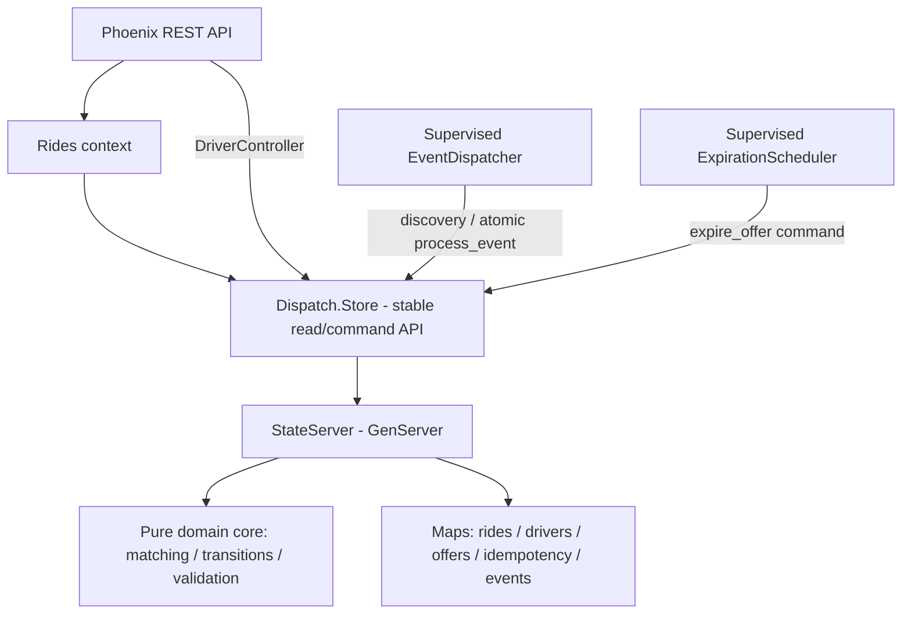

# Coding Challenge #3 — Hướng dẫn triển khai chuẩn TDD và Git

> **Bản thiết kế đề xuất:** Elixir + Phoenix API-only + một GenServer làm nguồn state có thẩm quyền + in-memory event queue/dispatcher; **không bắt buộc PostgreSQL, ETS, Docker**. Đây là giải pháp cho phạm vi cuộc thi, không phải kiến trúc production đa node.
>
> **Mục tiêu:** Đạt toàn bộ AC-01…AC-10, các yêu cầu testing, architecture, scalability, observability và documentation. Không dùng timebox để cắt bỏ AC.

## A. Phân biệt yêu cầu đề và quyết định thiết kế

**Trạng thái tài liệu:** Đây là kế hoạch triển khai đang phát triển, không phải bằng chứng hoàn thành AC. **IMPLEMENTED** = có code; **PLANNED** = chưa triển khai; **VERIFIED** chỉ áp dụng cho hành vi có tests đã chạy, không tự động cho toàn bộ AC. Đối chiếu tiến độ và các khoảng trống tại [AC traceability](ac-traceability.md).

**IMPLEMENTED hiện tại:** `Location.valid?/1`, `Location.distance_km/2`, `Dispatch.Matcher.nearest/3`, `Drivers.StateMachine.transition/2`, `Rides.StateMachine.transition/2`, Driver HTTP và Ride POST/GET. Store/StateServer giữ Driver, seeded Passenger, Ride, Offer, creation idempotency và retained events. **IMPLEMENTED 10A/10B:** supervised EventDispatcher xử lý RideCreated rồi DispatchRequested; matching/reservation/acknowledgement nguyên tử, với bounded retries. **IMPLEMENTED 11/12:** atomic Offer acceptance/rejection, identity-aware original-result replay và rejection-triggered asynchronous rematching. **IMPLEMENTED 13:** atomic expiration, supervised timeout scheduler và expiration-triggered rematching. **IMPLEMENTED 14:** atomic cancel/complete, terminal receipts và live Driver reuse. Phoenix.PubSub không phải transport của consumer này.

**Đề bắt buộc:** API Ride và Driver; trạng thái Driver (`OFFLINE`, `AVAILABLE`, `OFFERED`, `BUSY`), trạng thái Ride (`REQUESTED`, `MATCHING`, `DRIVER_ASSIGNED`, `DRIVER_ACCEPTED`, `CANCELLED`, `COMPLETED`); tọa độ hợp lệ; nearest available trong bán kính 2 km, tie-break theo `driverId`; pending offer và timeout mặc định 30 giây; accept/reject/cancel/complete; loại tài xế đã từ chối/hết hạn khỏi các lần matching sau của cùng Ride; `Idempotency-Key` và duplicate-safe transitions; concurrency test với **hai rides khác nhau** tranh một driver; event-driven dispatch; automated tests; logs với `rideId`, `driverId`, `eventId`; README, architecture diagram, sequence diagram, hai ADR; scaling 1k/100k/1m drivers, tối thiểu 3 bottlenecks/3 strategies/2 trade-offs.

**Đề cho phép, không bắt buộc:** in-memory repository và event bus; real DB và message broker; Docker. Nếu dùng external infrastructure phải hướng dẫn khởi chạy.

**Chúng ta chọn:** `Dispatch.Store` là API ổn định cho application layer; bản đầu dùng `GenServer + Map` làm nguồn state có thẩm quyền, state transitions qua pure functions, hàng đợi event trong RAM được dispatcher tiêu thụ bất đồng bộ, Phoenix JSON API. **Chưa thêm ETS**; giữ khả năng bổ sung ETS làm read projection khi đo được read bottleneck. PostgreSQL là phương án evolution khác, không phải yêu cầu của đề.

**Cảnh báo:** In-memory state **không bền vững sau khi state owner/application chết**; không được quảng cáo là crash-durable hoặc multi-node safe. Sự kiện chờ xử lý cũng mất nếu chính state owner mất. Đây là known limitation cần ghi rõ. Khi event worker chết nhưng state owner còn sống, event chờ xử lý có thể được retry.

## B. Đánh giá kiến trúc và trade-offs

| Phương án | Lợi ích | Chi phí và giới hạn | Kết luận |
|---|---|---|---|
| PostgreSQL + Ecto | Transaction, constraints, dữ liệu bền | Cần server, cấu hình DB, test setup, I/O/lock contention | Hợp lệ, không cần cho bản hiện tại |
| **Một GenServer sở hữu toàn bộ state** | Atomic multi-object mutation trong một callback; không cần external DB | Mailbox tập trung, mất state khi process chết, chưa multi-node | **Chọn** |
| ETS + coordinator | Read/write concurrency cao hơn ở một số workload | Khó giữ invariant xuyên nhiều object, phải tự phối hợp | Chỉ thêm khi có benchmark |
| GenServer/Driver | Parallelism theo driver | Routing, multi-actor consistency, lifecycle, multi-node | Future scaling |

**Nguyên tắc kiến trúc:** application/controllers/workers gọi `Dispatch.Store`, không gọi trực tiếp `GenServer.call` hoặc truy cập Maps nội bộ. Chỉ state owner được cập nhật các Maps/Offer; về sau nếu thêm ETS read projection thì chỉ owner được ghi vào projection. Chức năng thuần (`Matcher`, `StateMachine`, `Domain`) kiểm tra và tính trạng thái mới; `StateServer` là nơi chấp nhận lệnh và áp dụng một snapshot mới nguyên tử. Không gọi external HTTP hay chạy công việc chờ lâu trong callback của GenServer. Việc xử lý message của một server tuần tự không biến **toàn bộ cluster** thành một transaction.

### Sơ đồ logic — reservation/acceptance/rejection/timeout/cancel/complete IMPLEMENTED

Hiện tại: `DriverController → Dispatch.Store → Dispatch.StateServer`; Ride HTTP dùng `RideController → Rides → Dispatch.Store → Dispatch.StateServer`; `Location`, `Drivers.StateMachine` và `Dispatch.Matcher` là functional core. StateServer gọi Matcher và hai State Machines trong atomic event callback. Timeout scheduler và cancellation/completion trong sơ đồ đã IMPLEMENTED.



**IMPLEMENTED:** `CreateRide` tạo Ride, idempotency record và pending `RideCreated` trong cùng một lần đổi state. **IMPLEMENTED 10A:** EventDispatcher tiêu thụ RideCreated bất đồng bộ qua Store. **IMPLEMENTED 10B:** DispatchRequested consumption, nearest matching và pending Offer reservation; POST chỉ tạo pending work.

## C. Git và cài môi trường — từng lệnh

Các lệnh bootstrap dưới đây là hướng dẫn lịch sử cho project mới, không phải yêu cầu chạy lại trên repo hiện tại. Chỉ commit khi task hiện hành cho phép; push và thay đổi lịch sử cần phê duyệt riêng theo `AGENTS.md`. Khi có thay đổi không liên quan, stage từng file cụ thể của task, không dùng lệnh stage rộng trong các ví dụ.

### C1. Chuẩn bị

Cài Git, Erlang/OTP và Elixir theo hướng dẫn chính thức; ưu tiên phiên bản được hỗ trợ bởi Phoenix generator. Kiểm tra:

```bash
elixir --version
mix --version
git --version
mix archive.install hex phx_new
mix phx.new --version
```

Tài liệu Phoenix 1.8.16 xác nhận có `--no-ecto`; app không dùng Ecto **không chạy** `mix ecto.create` hoặc `mix ecto.migrate`.

### C2. Fork và clone **đúng repo cuộc thi**

1. Fork official repository trên GitHub bằng giao diện web (theo chính sách repo).
2. Copy URL **của fork**, không phải official repo.
3. Thực hiện:

```bash
git clone https://github.com/YOUR_USERNAME/REPO_NAME.git
cd REPO_NAME
git remote -v
git remote add upstream https://github.com/ORGANIZER/REPO_NAME.git
git remote -v
git status
```

`origin` phải là fork; `upstream` phải là official repository. Nếu `upstream` đã tồn tại, kiểm tra trước khi thêm. Nếu official default branch không phải `main`, dùng tên branch thực tế.

**Cảnh báo công khai:** Fork của public repository cũng public; không thể đổi riêng fork thành private. Nếu muốn bảo mật bài trước deadline, hỏi organizer phương án private workspace hợp lệ. Đề nói mở PR *sau deadline*, và chỉ commits trước deadline được tính.

### C3. Working branch và project path

Từ **root fork**:

```bash
git switch main
git pull --ff-only origin main
git switch -c coding-challenge-3/my-team
mix phx.new coding-challenge-3/my-team \
  --app ride_dispatch \
  --module RideDispatch \
  --no-ecto --no-html --no-assets \
  --no-dashboard --no-mailer --no-gettext
cd coding-challenge-3/my-team
mix deps.get
mix test
mix phx.server
```

Thay `my-team` bằng tên nhóm thực tế, đảm bảo đường dẫn chưa chứa app khác. Tên branch có `/` là hợp lệ và **khác** tên thư mục team dù cùng chuỗi. `--no-ecto` làm các Ecto-centric generator không phù hợp; viết API/controller/context thủ công. Root `/` có thể 404 khi chưa khai báo route; điều đó không chứng minh server lỗi.

**Chỉ lúc baseline tests chạy được mới commit:**

```bash
git status
git add -A
git diff --cached --name-only
git diff --cached --stat
git diff --cached
git commit -m "chore: bootstrap Phoenix API-only app without Ecto"
```

`git add -A` không có pathspec sẽ stage các thay đổi trong toàn bộ repository, kể cả khi chạy từ thư mục Phoenix hiện tại. Nếu chỉ muốn stage các thay đổi trong thư mục hiện tại và các thư mục con, dùng `git add -- .`; **kiểm tra danh sách staged files trước khi commit**. Không được đưa credentials, `.env`, tokens hoặc private keys vào Git.

### C4. Công thức Git cố định cho từng vòng TDD

**RED**: viết *một* behavior test, chạy `mix test path/to/test.exs`; xác nhận thất bại đúng vì behavior chưa có:

```bash
git status
git add test/path/to/test.exs
git diff --cached
git commit -m "test(matching): nearest available driver - RED"
```

**GREEN**: code tối thiểu để pass:

```bash
mix test path/to/test.exs
mix test
git add lib/path/to/implementation.ex
git commit -m "feat(matching): choose nearest available driver - GREEN"
```

**REFACTOR**: chỉnh code, không đổi behavior, chạy tests lại:

```bash
mix format
mix test
git add lib test
git commit -m "refactor(matching): extract distance calculator"
```

Một số vòng không cần refactor commit nếu không có thay đổi. Giữ các commit RED thực tế để hỗ trợ xét **TDD Bonus +5**; đừng tạo giả RED sau khi đã implement và đừng squash mọi commit trước khi nộp.

**Lệnh cứu hộ:** `git status`, `git diff`, `git diff --cached`, `git restore --staged FILE`, `git log --oneline --graph -20`, `git branch --show-current`. Không dùng `reset --hard` hoặc `push --force` như giải pháp mặc định.

## D. Domain model, state owner và invariants

### D1. Model

**IMPLEMENTED:** Driver dùng string `:id`, atom `:status` (`:offline`, `:available`, `:offered`, `:busy`) và atom keys `:latitude`/`:longitude`; Location nhận coordinate maps. StateServer giữ maps `drivers`, `passengers`, `rides`, `offers`, `idempotency`, `pending_events`. Pending reservation, acceptance, rejection/expiration và rematching, cancellation/completion đã IMPLEMENTED.

- `Passenger`: `id` (seeded; registration out of scope).
- `Driver`: `id`, `status`, `latitude`, `longitude`.
- `Ride`: `id`, `passengerId`, `pickup`, `destination`, `status`, `assignedDriverId`; reservation thêm `currentOfferId` (missing được hiểu là nil trước assignment). Original creation result và HTTP schema không đổi.
- `RideOffer` IMPLEMENTED: `id`, `rideId`, `driverId`, `status: :pending | :accepted | :rejected | :expired | :cancelled | :completed`, `created_at_ms`, `expires_at_ms`. Accepted Offer giữ immutable `accepted_at_ms` và `acceptance_result` (original accepted Ride snapshot); rejected Offer giữ `rejection_receipt` như section H; expired Offer giữ immutable `expiration_receipt` như G2. Các status `:cancelled`, `:completed` đã IMPLEMENTED; immutable acceptance evidence vẫn được giữ khi đóng Offer. Terminal replay có live Store/HTTP và callback corruption evidence từ Feature #14.
- `Location`: value object, validate latitude [-90,90], longitude [-180,180].

`RideOffer` fields/statuses là **lựa chọn implementation**, không phải status list được đề áp đặt. Một Ride có thể có nhiều offers lịch sử, nhưng chỉ một current offer. `assignedDriverId` của Ride phản ánh current offer/accepted ride; xóa khi rejection và timeout.

**IMPLEMENTED — pure contracts:**

- `Location.valid?(coordinate_map)` trả boolean; thiếu/invalid coordinates trả `false`, không ép numeric strings thành số.
- `Location.distance_km(from, to)` trả float km cho tọa độ hợp lệ, hoặc `{:error, :invalid_coordinates}`; Haversine dùng Earth radius 6,371 km.
- `Dispatch.Matcher.nearest(pickup, drivers, opts \\ [])` trả `{:ok, driver}`, `:none`, `{:error, :invalid_pickup}` hoặc `{:error, :invalid_radius}`. Options: `radius_km: 2.0` (inclusive), `excluded_driver_ids: []`. Chỉ chọn `:available` có tọa độ hợp lệ; bỏ qua malformed drivers; exact-distance ties chọn string ID nhỏ nhất theo lexicographic order. Caller phải cung cấp unique IDs và exclusion history của từng Ride; hàm không reserve hoặc lưu history.

### D2. Quy tắc state

**IMPLEMENTED:** `Drivers.StateMachine.transition(driver_map, action)` trả `{:ok, updated_driver}`, `{:error, :invalid_transition}` hoặc `{:error, :invalid_state}`; giữ nguyên các field khác. Public availability actions là `:enable_availability`/`:disable_availability`. Lặp lại availability đã thỏa mãn thành successful no-op là quyết định thiết kế, không phải response contract do đề bắt buộc. Internal actions (`:reserve_for_offer`, `:accept_offer`, `:reject_offer`, `:expire_offer`, `:cancel_offer`, `:complete_ride`, `:cancel_accepted_ride`) chỉ kiểm tra source state; không xác thực offer/deadline/ownership/idempotency hoặc tạo reservation. **IMPLEMENTED:** `Rides.StateMachine.transition(ride_map, action)` trả `{:ok, updated_ride}` hoặc `{:error, :invalid_state | :invalid_transition}`. Chỉ đổi status; các action là `:start_matching`, `:create_offer`, `:accept_offer`, `:reject_offer`, `:expire_offer`, `:complete_ride`, `:cancel_ride`. Terminal states không có outgoing transitions; repeated action bị từ chối nếu source state không còn phù hợp. Field khác được giữ nguyên, kể cả assignment. **IMPLEMENTED 10A/10B:** REQUESTED → MATCHING, rồi MATCHING → DRIVER_ASSIGNED và AVAILABLE → OFFERED được persist cùng event acknowledgement và Offer. **IMPLEMENTED 11:** Store persist DRIVER_ASSIGNED → DRIVER_ACCEPTED, OFFERED → BUSY và Offer ACCEPTED cùng receipt; replay ở Store không gọi lại pure transitions. **IMPLEMENTED 12/13:** rejection và expiration persist DRIVER_ASSIGNED → MATCHING, OFFERED → AVAILABLE, clear assignment/current Offer và enqueue đúng một redispatch event cùng receipt. Ownership/deadline validation ở Store; **IMPLEMENTED 14:** cancel/complete dùng existing state actions, atomic release và terminal receipt.

```text
Ride: REQUESTED -> MATCHING -> DRIVER_ASSIGNED -> DRIVER_ACCEPTED -> COMPLETED
                           ^           |
                           +-- Reject/Timeout
Cancellation: REQUESTED, MATCHING, DRIVER_ASSIGNED, DRIVER_ACCEPTED -> CANCELLED
CANCELLED và COMPLETED là terminal.

Driver: OFFLINE <-> AVAILABLE -> OFFERED -> BUSY
                         ^         |         |
                         +---------+---------+
                         Reject/Timeout/Cancel/Complete tùy trạng thái
```

`OFFERED` và `BUSY` **không** được chuyển trực tiếp thành `OFFLINE` qua availability API. Mặc dù đoạn mô tả caller ở AC-05 không nhất quán hoàn toàn, AC-06 cho phép `DRIVER_ACCEPTED -> CANCELLED`, nên phải hỗ trợ trường hợp này và giải phóng Driver.

### D3. Invariants

Reservation, acceptance và rejection/rematching invariants đã IMPLEMENTED với live competing callers và final-state assertions. Cancel/complete invariants bên dưới có live Store/HTTP và ordered/barrier-released tests từ #14; expiration/rejection races đã có live tests. Accepted ownership có test riêng; không suy ra từ pending-offer tests.

- Mỗi Driver chiếm tối đa một Ride đang `DRIVER_ASSIGNED` hoặc `DRIVER_ACCEPTED`.
- Mỗi Ride có tối đa một active `RideOffer`.
- First acceptance chỉ áp dụng exact current pending Offer đúng Driver và phải **trước** deadline; successful receipt replay được xét trước fresh deadline checks. Explicit rejection cho phép current pending Offer dù deadline đã qua, với valid ownership/time.
- Driver đã REJECT/EXPIRED bị loại vĩnh viễn khỏi việc matching **cùng Ride**, nhưng vẫn nhận Ride khác.
- Hai terminal states không thể được mở lại.
- Duplicate create (cùng key/payload), accept, reject và transitions không tạo side effects mới.
- Khi hết eligible drivers: Ride giữ `MATCHING`, `assignedDriverId = nil`.

### D4. `Dispatch.Store` interface, StateServer và trách nhiệm

Application layer chỉ phụ thuộc API `Dispatch.Store`; implementation ban đầu ủy quyền cho một `StateServer` (GenServer) giữ Maps. `server` là PID/name được inject để test từng instance độc lập.

```text
IMPLEMENTED — queries
Dispatch.Store.get_driver(server, driver_id)              # {:ok, driver} | :not_found
Dispatch.Store.list_available_drivers(server)             # list, lexicographic ID order
Dispatch.Store.get_ride(server, ride_id)                  # {:ok, current_ride} | :not_found
Dispatch.Store.get_offer(server, offer_id)                # {:ok, offer} | :not_found
Dispatch.Store.list_offers(server)                        # retained Offers, sorted by ID
Dispatch.Store.list_events(server)                       # all retained records, sorted by eventId
Dispatch.Store.get_event(server, event_id)               # {:ok, event} | :not_found
Dispatch.Store.list_actionable_events(server)            # due RideCreated / DispatchRequested
Dispatch.Store.next_event_delay(server)                  # milliseconds until due, or nil
Dispatch.Store.expiration_schedule(server)               # owner time, pending deadlines, diagnostics

IMPLEMENTED — atomic commands
Dispatch.Store.set_driver_availability(server, driver_id, available?)
Dispatch.Store.update_driver_location(server, driver_id, location)
Dispatch.Store.create_ride(server, key, request)           # strict string-keyed request
Dispatch.Store.process_event(server, event_id)            # RideCreated or atomic matching/reservation + ack
Dispatch.Store.accept_offer(server, ride_id, driver_id)   # {:ok, original_accepted_ride} | :not_found | {:error, reason}
Dispatch.Store.reject_offer(server, ride_id, driver_id)   # {:ok, original_matching_ride} | :not_found | {:error, reason}
Dispatch.Store.expire_offer(server, offer_id)              # expired / already_expired / ignored / structured error
Dispatch.Store.fail_event(server, event_id, attempts, :processing_failed)
Dispatch.Store.subscribe_events(server)                  # calling dispatcher receives wake hints

IMPLEMENTED — terminal commands, no caller timestamp
# Reservation uses process_event/2; no separate dispatch_ride command.
Dispatch.Store.cancel_ride(server, ride_id)                # original terminal result / not_found / structured error
Dispatch.Store.complete_ride(server, ride_id)
# No claim/lease or separate acknowledgement API; future event handlers extend process_event/2.
```

Hai Driver command **IMPLEMENTED** trả `{:ok, updated_driver}` hoặc `:not_found`; unknown ID được ưu tiên trước payload validation. Availability chỉ nhận boolean, input khác trả `{:error, :invalid_availability}`; lỗi State Machine (`:invalid_transition`/`:invalid_state`) được truyền nguyên trạng. Location nhận atom-key coordinate map, lỗi trả `{:error, :invalid_coordinates}`, extra fields bị bỏ qua. Lỗi không đổi state. Mỗi command đọc, validate và cập nhật trong một callback; không compose public reads/writes.

Lifecycle dùng `StateServer.start_link(opts)` và OTP child spec; Store không có lifecycle wrappers. Application supervise một owner tên `RideDispatch.Dispatch.StateServer`, mặc định với Passenger `P001` và Driver seeds rỗng (development opt-in demo: D5). EventDispatcher được supervise kế tiếp, dùng cùng registered owner; không tạo owner theo HTTP request. `drivers: [...]` khi khởi tạo instance nhận unique nonempty string IDs, coordinates hợp lệ, status `:offline`/`:available`; duplicate IDs và malformed seeds bị từ chối. `passengers: [...]` nhận records có unique nonempty string `id`, giữ unrelated fields; malformed/duplicate seeds bị từ chối. Không có public generic state setter. RAM mất khi owner chết; call timeout không hủy command đang chờ.

Terminal commands ở trên đã có code/tests; không có generic get/put workflow. Các hàm `get/list` là *queries*; `set/update/create/dispatch/accept/reject/...` là *atomic business commands*. **Không** hiện thực `accept_offer` bằng chuỗi lời gọi công khai `get_driver → update_driver → update_ride` vì các command khác có thể chen giữa. Multi-entity commands tương lai phải tạo snapshot mới nguyên tử trong **một** `handle_call`. `{result, new_state, emitted_events}` là đề xuất cho functional core tương lai, không phải contract hiện tại của `Drivers.StateMachine`. Callback chỉ serialize owned state, không tạo transaction cho external side effects.

**Lộ trình thêm ETS mà không phá domain contract:**

```text
Hiện tại:  Phoenix → Application → Dispatch.Store → GenServer + Map
Sau này:   Phoenix → Application → Dispatch.Store ─┬→ GenServer: writes / critical transitions
                                                  └→ ETS: read-only projection
```

- ETS chỉ là **read projection/cache**, không phải nguồn sự thật thứ hai. GenServer tiếp tục là authoritative owner của Ride/Driver/Offer và các invariants.
- Khi đọc từ ETS, dữ liệu có thể stale hoặc được thấy giữa các lần cập nhật projection. Matcher có thể lấy *candidate* từ ETS, nhưng lệnh `dispatch_ride` vẫn phải kiểm tra lại availability, vị trí cần thiết, exclusion và reserve tại coordinator **nguyên tử**. Không coi một danh sách đọc từ ETS là snapshot transactionally consistent.
- Nếu bổ sung ETS, ưu tiên bảng `:protected` để các process khác chỉ đọc; GenServer sở hữu bảng và là writer duy nhất. `read_concurrency: true` chỉ bật sau khi workload đo được phù hợp; có overhead và không luôn nhanh hơn.
- ETS gắn với lifecycle của owner; ETS cũng không tự cung cấp durability hay coordination đa node. Đổi Map sang ETS hoặc thêm cache không tự giải quyết matching O(n), bottleneck writes hay multi-node consistency.
- Bổ sung tests cho kết quả đọc và invariants khi chuyển backend/projection, đặc biệt: stale candidate bị từ chối khi reserve, updates phản ánh trong projection và không có hai nguồn ghi state.

**Độ khó ước tính (đánh giá thiết kế, không phải benchmark):** Map → ETS để lưu/đọc: thấp–trung bình nếu giữ ownership; thêm read cache/đưa reads khỏi GenServer: trung bình do cache consistency; chia GenServer theo driver: cao hơn vì multi-actor invariants; chuyển multi-node: cao và cần coordination/durability riêng. ETS không giải quyết hai thay đổi cuối.

### D5. ID và dữ liệu khởi tạo

**IMPLEMENTED:** Production seed Passenger `P001`; Drivers rỗng. Ride IDs `ride-N` và Event IDs `event-N` dùng `System.unique_integer([:positive, :monotonic])` trong callback: unique toàn VM, distinct prefixes, không bảo đảm uniqueness qua VM restart. Không có restored state hoặc distributed identity. Offer IDs dùng independent prefix `offer-` và cùng VM-wide counter; không phục hồi state qua VM restart. **IMPLEMENTED R2 demo:** `RIDE_DISPATCH_DEMO=true MIX_ENV=dev mix phx.server` seeds AVAILABLE `D001`/`D002`/`D003` through existing validation. Runtime config rejects other enabled environments and invalid values; unset/`false` keeps Drivers empty. Deterministic coordinates, external HTTP workflow, restart instructions and read-only Offer inspection are in README’s local demo section.

**IMPLEMENTED R2 observability:** Store lifecycle commands use an internal observation envelope; public signatures/results are unchanged. Business updates remain one atomic callback. Logger runs in `StateServer.handle_continue` after OTP installs state, using explicit `rideId`, `driverId`, `eventId`, `offerId` and outcome metadata. Pending event creation is distinct from processing; `causedByEventId` identifies the predecessor when enqueueing a successor. Proven replay emits `operation.replayed`, ordinary conflicts `operation.rejected`, clock/invariant failures `operation.failed`; technical retry/timeout diagnostics remain distinct from no-candidate. No Logger calls enter pure Matcher/state machines or atomic business logic. Worker identity is explicit, not inherited from HTTP. Scheduler bounded diagnostics remain intact. Logging is best effort, may be lost after commit or delayed under backpressure, and is not a durable/exactly-once audit trail. README contains the executed network demo and focused evidence; no business AC statuses change in R2.

## E. Lộ trình triển khai **TDD-first** (kế hoạch ban đầu, không phải tiến độ)

Thứ tự bảng này là kế hoạch ban đầu. Thực tế đã làm Location validation, Haversine, Matcher, Store foundation, Driver State Machine, availability Store integration và Driver HTTP. Pure Ride State Machine và Ride creation/retrieval/idempotency đã triển khai; RideCreated/DispatchRequested consumption và atomic reservation đã IMPLEMENTED. Xem `ac-traceability.md` để đánh giá AC thay vì suy ra từ thứ tự slice.

Mỗi mục bắt buộc đi theo: **RED test → GREEN implementation → REFACTOR → commit evidence → chạy full suite**.

| Thứ tự | RED test đầu tiên | GREEN cần tạo | Các tests tiếp theo | AC |
|---|---|---|---|---|
| 1. Ride State Machine | `REQUESTED + start_matching -> MATCHING` | `Rides.StateMachine` | accept/reject/cancel/complete, invalid/duplicate, terminal | 06 |
| 2. Driver State Machine | `OFFLINE -> AVAILABLE` | `Drivers.StateMachine` | `AVAILABLE->OFFERED->BUSY`, release, invalid offline | 02 |
| 3. Location | same points -> 0 km | `Location.valid?/distance_km` | boundary latitude/longitude, missing/nonfinite, Haversine | 01,03,04 |
| 4. Matcher | nearest AVAILABLE chosen | `Dispatch.Matcher` | 2 km boundary, OFFLINE/OFFERED/BUSY excluded, tie `driverId`, no candidates, rejected IDs | 04,07 |
| 5. Store API + state owner | read seeded driver qua `Dispatch.Store` | `Dispatch.Store` façade + `StateServer` Maps + per-test fixtures | invalid command unchanged state, compound atomic mutation; không bypass store | nền tảng |
| 6. Driver API | `PUT availability` returns expected state | Driver context/controller/router | location, latest position, invalid state transitions | 02,03 |
| 7. Ride creation | `POST /rides` creates REQUESTED | Ride context/controller + idempotency | key required, same key/same payload, same key/different payload, passenger unknown, GET Ride | 01,08 |
| 8. Event-driven | create Ride enqueues exactly one `RideCreated` | EventBus interface + dispatcher | asynchronous consumption, duplicates, handler failure/retry | 10 |
| 9. Assignment | one `MATCHING` Ride gets closest driver PENDING offer | `StateServer.dispatch_ride` | two different rides compete for same driver; two events same ride; all invariants | 04,05,09 |
| 10. Accept | current driver accept -> BUSY | `AcceptOffer` command + route | wrong driver, duplicate, expired/stale offer | 05,06,08 |
| 11. Reject/rematch | reject A -> MATCHING + A AVAILABLE | `RejectOffer` and enqueue `DispatchRequested` | selects B, A permanently excluded from same Ride, none eligible | 05,07 |
| 12. Timeout | expired pending offer -> rejected-equivalent | injectable Clock + scheduler + `ExpireOffer` | expire before/at deadline, stale timers, rematch | 05,06,07 |
| 13. Cancel/complete | cancel pending frees OFFERED driver | `CancelRide` / `CompleteRide` routes | cancel accepted frees BUSY, complete only accepted, terminal immutable | 05,06 |
| 14. Reliability | duplicate event can't create new active offer | processed-event IDs, retry policy | accept vs reject/timeout/cancel, two rides same driver, worker retry | 08,09,10 |
| 15. Observability | operation emits correlated event log | structured Logger metadata | trace R001 by `rideId`, `driverId`, `eventId` | extra |
| 16. E2E + docs | Phoenix API scenario exercises A reject → B accept → complete | automated end-to-end test + README/ADRs | all required tests & diagrams | all |

**Đặc biệt khi code matching:** Hàm pure trả về *candidate*, không phải driver đã reserve. Matcher hiện dùng Haversine và `Enum.min_by` theo `{distance, driver.id}`, không sort toàn bộ candidates. **IMPLEMENTED reservation:** Việc chọn và reserve nằm trong cùng **một StateServer event command**. Tính từ current state **ngay trong callback**, rồi cập nhật Ride, Driver, Offer trong một return mới. O(n) matching có thể giữ mailbox lâu khi tập driver lớn — cần đo trước khi tối ưu.

### E1. Ví dụ TDD lịch sử — không phải API hiện tại

Đây là ví dụ scalar API từ kế hoạch ban đầu, không phải API hiện tại hoặc lịch sử cycle thực tế. Module/test hiện đã tồn tại và nhận Ride map; xem D2. Không tạo lại các file chỉ vì chúng xuất hiện trong ví dụ này.

Từ thư mục Phoenix project, tạo `test/ride_dispatch/rides/state_machine_test.exs`:

```elixir
defmodule RideDispatch.Rides.StateMachineTest do
  use ExUnit.Case, async: true

  alias RideDispatch.Rides.StateMachine

  test "REQUESTED can transition to MATCHING" do
    assert {:ok, :matching} =
             StateMachine.transition(:requested, :start_matching)
  end
end
```

Chạy `mix test test/ride_dispatch/rides/state_machine_test.exs`. Lúc đầu chưa có module `StateMachine`, test phải báo failure do module/function chưa implement (**RED**); lỗi syntax hoặc config không được tính là RED nghiệp vụ. Commit file test trước.

Tạo `lib/ride_dispatch/rides/state_machine.ex` với implementation tối thiểu:

```elixir
defmodule RideDispatch.Rides.StateMachine do
  def transition(:requested, :start_matching), do: {:ok, :matching}
  def transition(_, _), do: {:error, :invalid_transition}
end
```

Chạy lại `mix test test/ride_dispatch/rides/state_machine_test.exs`; khi pass mới commit **GREEN**. Đây **chỉ là vòng đầu tiên**, chưa đủ toàn bộ transitions; các vòng tiếp theo phải viết test trước rồi phát triển code.

**Giải thích:** Dùng atoms lowercase bên trong Elixir và ánh xạ chúng sang trạng thái API uppercase. Sự chuyển trạng thái thuần túy không sửa StateServer; application command chịu trách nhiệm kiểm tra và áp dụng `new_state` nguyên tử. **Trade-off:** Thêm một module pure logic, đổi lại dễ test các invalid transitions và giảm code nghiệp vụ trong GenServer callback.

## F. Chống concurrency bằng TDD, không suy diễn từ công nghệ

### F1. Test bắt buộc: hai rides cạnh tranh cùng driver

**VERIFIED pending reservation:** `reservation_test.exs` dùng hai barrier-released Store callers, chạy 20 lần; `reservation_dispatcher_test.exs` cho real dispatcher cạnh tranh Store caller. Assert final state của cả Rides, Driver, Offers và Events. Feature #11 bổ sung 10 live race runs tiếp tục qua acceptance, accept-versus-dispatch contention và real dispatcher BUSY exclusion; AC-09 VERIFIED cho required assignment behavior. Feature #12 thêm competing Accept/Reject, duplicate Reject và hai unrelated Rides tranh Driver vừa release; Expire/Accept, Expire/Reject và Expire/Expire có tests từ #13; cancel/complete races có ordered/barrier-released tests ở #14.

```text
Given: D001 AVAILABLE; R001 MATCHING; R002 MATCHING
When: hai Task khác nhau đồng thời gọi process_event(server, event_id của R001/R002)
Then: không quá một offer ACTIVE cho D001;
      không quá một Ride có assignedDriverId = D001;
      Ride còn lại MATCHING/nil hoặc chọn driver khác.
```

Dùng hai `Task.async`, có thể thêm start barrier để hai task gửi gần cùng lúc, cùng hướng tới **một** StateServer test instance. Bằng chứng đúng không phải chỉ có hai Tasks, mà assert **final state của cả rides, driver và offers**. Lặp nhiều lần để tăng cơ hội phát hiện implementation sai; không gọi hai request tuần tự rồi gọi đó là concurrency test.

### F2. Test nâng cao: cùng ride, hai dispatch events

Khi hai event cùng `rideId`, tối đa một current offer. Event đã xử lý hoặc Ride không còn ở trạng thái matching thích hợp phải thành no-op/rejected an toàn.

### F3. Trade-off chính

- **GenServer đơn**: dễ bảo vệ multi-object invariants, nhưng mọi write và phép matching O(n) dùng một mailbox. Tránh gọi HTTP, sleep, file I/O trong callback.
- **GenServer/driver**: phân tán mailbox nhưng cần coordination khi Ride/Offer thay đổi ở nhiều actor.
- **ETS read projection**: có thể chuyển nhiều reads khỏi mailbox; GenServer vẫn sở hữu mutations và phải revalidate trước reserve. Cache stale, O(n) scan và vòng đời ETS là những trade-offs cần test/đo.
- **PostgreSQL**: cung cấp row locking/transaction/durability nhưng thêm infrastructure và test setup.

## G. Asynchronous matching/reservation và timeout processing IMPLEMENTED

### G1. Event contract và processing — IMPLEMENTED 10A/10B

CreateRide vẫn atomically tạo Ride REQUESTED, original idempotency result và pending RideCreated. Sau create/process-event/reject/expire reply thành công, Store wrapper gửi notification request; owner chuyển wake hint cho subscribed dispatcher ngoài business callback. Hint không phải nguồn chân lý. Một supervised EventDispatcher khởi động độc lập HTTP, scan lúc startup, nhận hints và recovery scan tối đa mỗi 1000ms. Mỗi lượt xử lý một supported due event; một timer được thay thế khi cần, obsolete timer messages bị bỏ qua.

`Store.process_event(server, event_id)` atomically dùng `Rides.StateMachine.transition/2` cho REQUESTED → MATCHING, đánh dấu RideCreated PROCESSED và tạo đúng một `%{eventId: "dispatch-" <> ride.id, rideId: ride.id, type: :dispatch_requested, status: :pending}`. Không publish, spawn task hoặc external I/O trong callback. Không claim/lease hoặc separate acknowledgement. `pending_events` giữ cả pending, processed và failed history.

Kết quả: `{:ok, :processed}`, `{:ok, :already_processed}`, `{:ok, :ignored}`, `:not_found`, hoặc `{:error, reason}`. Reason gồm `:unsupported_event`, `:failed`, `:invalid_clock`, `{:retry_at, deadline}` hoặc `{:permanent, reason}` (`:ride_not_found`, `:invalid_state`, `:invalid_pickup`, `:invalid_event`, `:inconsistent_ownership`). Repeated processed event không đổi state. Distinct duplicate RideCreated gặp MATCHING hoặc trạng thái known later/terminal được ack ignored, không đổi Ride hoặc tạo successor khác. Missing/invalid Ride bị failed permanently, không retry.

DispatchRequested đã actionable, kể cả pending records tạo từ 10A. Callback đọc Ride MATCHING và latest Drivers, lấy Ride-scoped exclusions từ retained rejected/expired Offers, gọi Matcher với owner radius, kiểm tra conflicting active Ride/Offer ownership rồi dùng hai State Machines. Một snapshot mới ghi Ride DRIVER_ASSIGNED (`assignedDriverId`/`currentOfferId`), Driver OFFERED, Offer PENDING và processed Event (`outcome: :offer_created`). Không dùng public get-then-reserve hoặc separate ack; không reopen RideCreated.

No candidate là processed `:no_candidate`: Ride MATCHING/nil, không tạo Offer/event mới, không charge retry failure. `attempts` vẫn đếm lần processing thành công. Rejection/expiration tạo fresh Offer-derived redispatch event; chưa tự tìm liên tục khi Driver available/di chuyển. Pending Offer vẫn giữ Driver dù deadline đã qua, cho tới khi atomic rejection, expiration hoặc cancellation command commit. Distinct dispatch event cho consistent assigned Ride được ack ignored; terminal Ride không mở lại. Contradictory ownership fail permanently, giữ nguyên business records. Unknown event types vẫn pending, không vào actionable scan/retry accounting.

Definite worker exceptions/retryable results được ghi bằng `fail_event(server, id, observed_attempts, :processing_failed)`. Atomic version check chống duplicate failure reports; malformed versions trả `:invalid_attempt`, stale versions trả `:stale_attempt`, unsupported/nonpending records trả `:not_actionable`. Tối đa 3 attempts; backoff 1000ms rồi 2000ms, sau đó FAILED retained. Retry eligibility dùng owner monotonic clock, injectable tại startup cho tests bằng nonblocking fake clock. Metadata defaults: attempts 0, next_attempt_at nil (immediate). Processed records có outcome; failed records có last_error. Event không cần timestamp.

Timeout là uncertain: reread authoritative record trước retry, không ghi definite failure vì timeout. Dispatcher crash trước commit để lại pending work; crash sau commit không lặp transition hoặc successor. Dispatcher monitor owner và reconnect registered name sau restart; owner crash làm mất toàn bộ RAM. Không claim durable/exactly-once delivery. Production dispatcher gọi Store; optional worker processing function ở dispatcher chỉ là fault-injection seam, không phải mutation callback của owner.

AC-10 VERIFIED theo flow Ride Created → async Dispatch Event → matching cùng README giải thích async/duplicates/failure. Riêng evidence #10A/#10B không hoàn tất AC-05 lifecycle; các Feature #11–#14 bổ sung lifecycle evidence, và AC-09 có acceptance concurrency evidence riêng từ Feature #11. ADR-001/002/003 giữ nguyên quyết định Accepted; mô tả scope 10A là lịch sử. Trade-offs: một mailbox, O(n) Driver scan, thêm Ride/Offer/history scans, retained memory và volatile single-node state; chưa có benchmark.

### G2. Timeout và đồng hồ giả lập

**IMPLEMENTED application config:** `:ride_dispatch, :matching_radius_km` default 2.0 (nonnegative number), `:offer_timeout_ms` default 30_000 (positive integer). Application truyền vào StateServer; tests truyền startup options riêng. Invalid policy/clock results bị từ chối lúc startup. Trusted nonblocking `clock:` trả monotonic integer milliseconds, negative values hợp lệ. Clock lỗi runtime không đổi business state; event discovery trả []/nil, còn expiration discovery trả `{:error, :invalid_clock}` để scheduler report và retry có giới hạn tần suất.

Ngay trước Offer construction sau matching/validation, owner đọc `reservation_now_ms` rồi tính `expires_at_ms = reservation_now_ms + offer_timeout_ms`; không dùng event creation time hoặc caller timestamp. `Dispatch.Offer.expired?/2` dùng `now_ms >= expires_at_ms`, đã test before/at/after deadline và delayed pending work. Integer arithmetic không bị fixed-width overflow; monotonic values không có ý nghĩa qua VM restart. Expiration command và supervised scheduler đã IMPLEMENTED ở Feature #13.

**IMPLEMENTED lifecycle:** timer (`Process.send_after`) chỉ là trigger; owner phải kiểm tra Offer ID vẫn current, status pending và `now_ms >= expires_at_ms` trước expiration. AcceptOffer đã kiểm tra trusted processing time ngay trong callback; proven replay dùng immutable evidence, không đọc fresh clock. Deadline qua không tự giải phóng Driver.

Dùng owner `clock:` injection và fake monotonic time trong tests; **không sleep 30 giây**. Timer cũ cho Offer ACCEPTED/REJECTED chỉ ignored sau evidence validation; EXPIRED cần receipt để trả `:already_expired`. Stale timer sau cancellation/completion được kiểm tra bằng live owner/scheduler tests và terminal receipt validation ở #14.

**IMPLEMENTED:** Khi expire, đóng Offer, Driver `OFFERED->AVAILABLE`, Ride `DRIVER_ASSIGNED->MATCHING`, xóa assignment/current Offer, giữ exclusion history và enqueue DispatchRequested có identity mới. Xem contract Feature #13 bên dưới.

**IMPLEMENTED Feature #13:** `Store.expire_offer(server, offer_id)` không nhận caller time và không có HTTP endpoint. Kết quả: `{:ok, :expired | :already_expired | :ignored}`, `:not_found`, `{:error, {:not_due, deadline}}`, hoặc controlled `:invalid_request`/`:invalid_clock`/`:inconsistent_ownership`. Exact Offer key/ID, currentOfferId, assignedDriverId, Ride/Driver ownership và active uniqueness được kiểm tra cùng timestamp/evidence. Clock đọc trong callback sau mailbox waiting. Một snapshot install Offer EXPIRED, Driver AVAILABLE, Ride MATCHING/nil và đúng một pending event ID `"redispatch-expired-" <> offer.id`; collision fail unchanged, không overwrite. Không publication/I/O/task trong callback.

Offer giữ immutable `expiration_receipt` gồm `offerId`, `rideId`, `driverId`, `expired_at_ms`, `redispatch_event_id`. Replay cần receipt hợp lệ, linked DispatchRequested đúng ID/Ride/type, status PENDING/PROCESSED/FAILED và không có contradictory acceptance/rejection evidence. Không đọc fresh clock hoặc đổi replacement/reused Driver. Closed ACCEPTED/REJECTED chỉ ignored sau proof; stale PENDING có thể là corruption. Acceptance/rejection cũng kiểm tra contradictory expiration evidence. Pending reservation quá hạn vẫn giữ Driver; late Reject có thể thắng trước Expire. Không resurrect terminal Ride.

`Store.expiration_schedule/1` trả `{:ok, %{now_ms, pending, invalid_offers}}` hoặc `{:error, :invalid_clock}`. Pending entries: `offer_id`, `expires_at_ms`, diagnostic `fingerprint`; invalid entries: `offer_id`, `reason`, `fingerprint`. Read-only, không claim/update. Fingerprint `phash2` chỉ là change hint, không phải identity proof; reminder đảm bảo rediscovery dù fingerprint không thay đổi.

Một `ExpirationScheduler` được supervise sau owner/EventDispatcher, trước Endpoint. **Giữ `:one_for_one`**, cả ba workers permanent; owner crash không restart siblings. Scheduler monitor/pin owner PID, xóa old timer generation/retry/diagnostic state khi owner đổi, rồi reconnect và discover lại. Scheduler restart phục hồi từ Offers còn trong owner; owner/VM loss mất runtime state, không rebuild Offers từ timers cũ.

Scheduler dùng một next-deadline timer, hints và recovery scan. Application config `:offer_expiration_scan_interval_ms` default 1000, integer 1..60_000; `diagnostic_reminder_ms` child option default 60_000, positive integer. Store wrapper gửi hints sau successful reservation processing/expiration; không publish trong business callback. Early/obsolete ticks recheck authority; mỗi lượt xử lý một command, không busy-loop. Không hard real-time SLA.

Malformed Offers được report với structured `offer_id`/`error_category`; healthy unrelated Offers tiếp tục expire. Diagnostic entry theo Offer/category/fingerprint, chỉ log khi đổi hoặc tới reminder; restart/owner replacement reset suppression. Permanent ownership errors được recheck theo reminder hoặc fingerprint change, không retry mỗi scan. Invalid global clock report riêng và bounded recheck. Đây không phải corruption repair. Transient scheduler failures backoff 1000/2000ms; sau ba failures log exhaustion, cooldown reminder rồi có thể bắt đầu bounded round mới. Local bookkeeping không durable. Timeout uncertain: reread exact owner, validate receipt khi đã closed; không charge failure attempt hoặc gọi `fail_event` với Offer ID.

Sau commit, dispatcher cũ rematch từ latest locations/availability và Ride-scoped expired/rejected history. `no_candidate` PROCESSED không retry/search loop; technical failures giữ existing event backoff/FAILED semantics. Atomic tests không chạy consumer để thấy event PENDING; live tests có thể thấy PROCESSED. Cancel/complete và races có live tests ở #14; chỉ deliberately corrupted histories dùng labeled callback fixtures.

## H. API contract để reviewer thử đúng đề

**IMPLEMENTED Driver HTTP:** Hai route `PUT /drivers/:id/availability` và `PUT /drivers/:id/location`, không có prefix `/api`. JSON body lần lượt là `{"available":true}` và `{"latitude":10.7769,"longitude":106.7009}` (top-level fields; không ép kiểu). `DriverController` gọi Store, không lặp lại domain validation. Query params không thay thế body fields; extra fields bị bỏ qua và ID trong body không đổi path ID.

Success **200** (kể cả repeated availability): `{"data":{"id":"D001","status":"AVAILABLE","latitude":10.7769,"longitude":106.7009}}`. Chỉ serialize bốn public fields này, status uppercase. Error envelope: `{"errors":{"detail":"Bad Request"}}` (**400**, malformed/missing/wrong-type fields hoặc invalid coordinates), `{"errors":{"detail":"Not Found"}}` (**404**, unknown ID), `{"errors":{"detail":"Conflict"}}` (**409**, Store trả `:invalid_transition`/`:invalid_state`). Với parsed payloads, unknown-ID precedence của Store được giữ nguyên; malformed JSON bị Endpoint parser từ chối trước controller và trả sanitized JSON 400 qua `ErrorJSON`.

Các status/schema trên là lựa chọn thiết kế hiện tại; đề chỉ đưa route examples, không quy định body availability, HTTP status hoặc response schema. POST/GET Ride và accept/reject/cancel/complete routes đã IMPLEMENTED.

| Method | Endpoint | Quy tắc chính |
|---|---|---|
| `POST` | `/rides` | IMPLEMENTED: Header `Idempotency-Key`, Passenger seeded, tọa độ hợp lệ; Ride bắt đầu `REQUESTED` |
| `GET` | `/rides/:rideId` | IMPLEMENTED: Trả current Ride |
| `PUT` | `/drivers/:id/availability` | IMPLEMENTED: `OFFLINE <-> AVAILABLE`, repeated availability thành no-op |
| `PUT` | `/drivers/:id/location` | IMPLEMENTED: validate và lưu latest location |
| `POST` | `/rides/:rideId/offers/:driverId/accept` | IMPLEMENTED: exact current holder trước deadline hoặc verified original-result replay |
| `POST` | `/rides/:rideId/offers/:driverId/reject` | IMPLEMENTED: atomic clear assignment, release Driver, receipt và một redispatch event |
| `POST` | `/rides/:rideId/cancel` | IMPLEMENTED: bốn nonterminal states, release đúng Driver, original-result replay |
| `POST` | `/rides/:rideId/complete` | IMPLEMENTED: chỉ accepted, release BUSY, original-result replay |

**IMPLEMENTED Ride HTTP:** `POST /rides` nhận đúng `passengerId`, `pickup`, `destination`; coordinate objects nhận đúng `latitude`, `longitude`. Missing/wrong-type/unsupported fields hoặc invalid coordinates trả 400. Header `Idempotency-Key` phải xuất hiện đúng một lần, nonblank string; example của đề được chấp nhận. POST và completed replay trả **201** cùng `Location: /rides/{rideId}` và `{"data":{"rideId":"ride-N","passengerId":"P001","pickup":{"latitude":10.7769,"longitude":106.7009},"destination":{"latitude":10.8231,"longitude":106.6297},"status":"REQUESTED","assignedDriverId":null}}`. GET trả current Ride với **200**, unknown Ride **404**. Conflict **409**; errors dùng `errors.detail` như Driver. Strict fields và repeated 201 là design choices.

**IMPLEMENTED canonical identity và precedence:** `Rides.create_ride/3` delegates Store; Store callback gọi `Rides.Request.normalize/1` cho strict string-keyed request, tạo canonical atom-key map gồm đúng năm leaf values. JSON whitespace/key order không ảnh hưởng; numeric coordinates được đổi thành floats (bounded integers chuyển chính xác), signed zero thành `0.0`, không rounding/truncation/hash. Passenger ID exact case-sensitive, không trim/coerce; unsupported fields bị từ chối. Key opaque, case-sensitive, global trong single owner, không expiry. Header/syntax/shape/coordinates validation → canonical comparison → existing same request trả original result, different valid request conflict → chỉ new key kiểm tra Passenger rồi create. Unknown Passenger với new key trả 400; existing key/different valid Passenger trả 409. Completed replay không revalidate Passenger.

`Store.create_ride/3` trả `{:ok, original_ride}` hoặc `{:error, :invalid_idempotency_key | :invalid_request | :idempotency_conflict | :passenger_not_found}`. `Store.get_ride/2` trả `{:ok, current_ride}` hoặc `:not_found`. Original **domain result** được lưu riêng, không lưu HTTP snapshot; controller serialize cùng schema. HTTP integration đã VERIFIED GET MATCHING/DRIVER_ASSIGNED/DRIVER_ACCEPTED trong khi POST creation replay giữ original REQUESTED result, kể cả sau rejection; expiration và cancel/complete đã tích hợp; GET terminal và POST original replay có HTTP tests. GET đọc current collection, không đọc idempotency record. Timeout không cancel command; retry cùng key an toàn nếu owner sống. Owner crash mất Ride/key/event; retry sau state loss không được bảo đảm. Single mailbox serialize cả reads/writes; records không eviction nên memory tăng theo requests. Không có transaction cho external side effects.

**IMPLEMENTED Offer Acceptance — Feature #11:** `Rides.accept_offer/3` delegates `Store.accept_offer(server, ride_id, driver_id)`; không có caller-supplied time hoặc mandatory Idempotency-Key. HTTP nhận no body hoặc `{}`, từ chối unsupported fields/non-object JSON và nonempty unparsed body. IDs lấy từ path, không lấy query/body; private owner injection chỉ dành trusted tests, không điều khiển qua HTTP. Driver ID trong URL không phải network-caller authentication.

Callback kiểm tra Ride/Driver IDs và status fields, exact currentOfferId/map key, Offer ownership và active uniqueness. First acceptance đọc monotonic processing time, dùng `Offer.expired?/2` (equality expired), gọi cả hai State Machines rồi install Ride DRIVER_ACCEPTED, Driver BUSY, Offer ACCEPTED cùng receipt. Không tạo Offer/event mới. Invalid clock/deadline/ownership giữ nguyên toàn state; failed late Accept không release Driver. Expired pending Offer chỉ được release khi atomic rejection, expiration hoặc cancellation command commit.

Offer lưu immutable `accepted_at_ms` và `acceptance_result` (original accepted Ride snapshot). Replay phải xác minh Offer/Ride/Driver identities, timestamp thành công trong deadline, immutable Ride fields và ownership consistency trước khi trả snapshot cũ; không gọi clock hoặc pure transitions lại. Cùng Ride/Driver có nhiều Offers trả `:ambiguous_offer` (approved conservative policy vì route không chứa Offer ID); history Driver khác không ambiguous nhưng conflicting acceptance evidence bị từ chối. Không suy success từ DRIVER_ACCEPTED/BUSY alone.

First success/replay đều **200**, schema `data` như GET Ride với original DRIVER_ACCEPTED state. GET luôn đọc current state. **400** malformed body/identifier, **404** unknown Ride/Driver hoặc absent relationship, **409** wrong Driver/expired/stale/ambiguous/invalid transition, **500** invariant hoặc clock failure; errors giữ sanitized `errors.detail`. `:not_found` và `{:error, reason}` là Store failures. Receipts volatile; timeout không cancel command, retry cùng route an toàn khi owner còn sống.

Historical replay sau COMPLETED/CANCELLED có live Store/HTTP evidence ở Feature #14; callback tests chỉ bổ sung corruption/compatibility coverage. Terminal commands close Offer/release Driver atomically và giữ receipts; không reopen Ride để replay. Generic redispatch trigger vẫn không được triển khai.

**IMPLEMENTED Offer Rejection — Feature #12:** `Rides.reject_offer/3` delegates `Store.reject_offer(server, ride_id, driver_id)`; trả `{:ok, original_matching_ride}`, `:not_found` hoặc `{:error, reason}`. POST reject nhận no body/`{}`, không thêm Offer ID hoặc Idempotency-Key; strict body và owner isolation dùng cùng controller boundary như acceptance. **200** first/replay trả original MATCHING Ride, nil assignedDriverId; **400** malformed/unsupported/unparsed nonempty body, **404** absent resources/relationship, **409** wrong-holder/accepted/stale/ambiguous, **500** invariant/invalid trusted clock. URL Driver ID không phải authentication.

Một callback xác minh currentOfferId/storage key, Ride/Driver/Offer identity và active uniqueness, không có contradictory acceptance evidence; kiểm tra timestamp structure và trusted `now >= created_at_ms`. Dùng hai `:reject_offer` transitions, install Ride MATCHING với nil assignment/current Offer, Driver AVAILABLE, Offer REJECTED và đúng một pending DispatchRequested có ID `"redispatch-" <> offer.id`. Collision không ghi đè event cũ. Không external I/O/publication/tasks trong callback; Store gửi wake hint sau call, recovery scan xử lý missed hint.

Offer giữ immutable `rejection_receipt`: `offerId`, `rideId`, `driverId`, `rejected_at_ms`, `redispatch_event_id`, `original_result`. Replay xác minh exact historical identity, original MATCHING snapshot, không có acceptance evidence trên Offer cũ và linked event đúng Ride/type/ID. Event có thể PENDING/PROCESSED/FAILED; failure không undo rejection hoặc cho phép enqueue lần hai. Replay không đọc fresh clock, release lại Driver, đổi replacement assignment hay receipts; live tests cover replacement accepted và A BUSY trên Ride khác. Multiple same-pair Offers trả ambiguous; đây là conservative route policy.

Late rejection tại/sau deadline được chấp nhận khi Offer vẫn current PENDING và ownership hợp lệ (approved design choice). Deadline qua không tự expire/release; scheduler riêng của Feature #13 gọi exact-Offer expiration. Old closed unaccepted Offer được classify trước new-acceptance exclusivity checks: A Reject → B Accept → stale A Accept trả 409, không 500; malformed acceptance evidence vẫn invariant failure.

Dispatcher cũ rematch bằng latest authoritative locations/availability, radius/ties và permanent Ride-scoped rejected/expired history. A được nhận Ride khác nhưng không quay lại Ride đã reject. Exhaustion: MATCHING/nil, event PROCESSED `no_candidate`, không retry/new event. Technical failure khác no-candidate: giữ pending/backoff hoặc FAILED sau bounded attempts; timeout reread authoritative state. Atomic tests không chạy worker nên quan sát event PENDING; live HTTP/dispatcher có thể thấy PROCESSED trước lần đọc đầu, vẫn assert exact event/history và business effects.

### H0. IMPLEMENTED Cancellation/Completion — Feature #14

`Rides.cancel_ride/2` và `Rides.complete_ride/2` delegate Store, không nhận caller time/key. POST `/rides/:rideId/cancel` và `/rides/:rideId/complete` nhận no body hoặc JSON `{}`; unsupported/malformed/unparsed nonempty body trả 400. First success/proven replay 200, unknown Ride 404, lifecycle conflict 409, genuine invariant corruption 500; giữ `data`/`errors.detail`. Route không authenticate caller.

Cancel từ REQUESTED/MATCHING không release Driver; từ DRIVER_ASSIGNED đóng exact pending Offer CANCELLED, release OFFERED; từ DRIVER_ACCEPTED đóng accepted Offer CANCELLED, release BUSY. Complete chỉ từ DRIVER_ACCEPTED, đóng Offer COMPLETED, release BUSY. Existing State Machines được gọi trong một StateServer callback; exact identities, exclusive ownership và receipts được validate trước installation. Clear cả `assignedDriverId`/`currentOfferId`; không enqueue event hoặc external side effects. Không cần fresh clock vì terminal operation không phụ thuộc deadline; cancellation của overdue pending Offer vẫn hợp lệ.

Ride giữ immutable `terminal_receipt`: `operation`, `rideId`, `source_status`, `offerId`, `driverId`, `original_result`. Snapshot được tạo trước receipt để không recursive. Offer closure giữ `accepted_at_ms`/`acceptance_result`; rejected/expired history và creation result không đổi. Replay kiểm tra exact cross-record linkage, nguồn transition hợp lệ, original result, active uniqueness, related history và absence of foreign Offer references. Current Driver có thể đã reuse/OFFERED/BUSY; phải có consistent ownership, không bắt buộc AVAILABLE. Terminal status/receipt shape alone không chứng minh success. Opposite terminal operation conflict, malformed proof invariant error, expected failures giữ state unchanged.

Ownership scans chỉ xem terminal Offer đã release khi closure proof hợp lệ; malformed closure vẫn conservative. Pending RideCreated/DispatchRequested cho terminal Ride hợp lệ được PROCESSED `incompatible_ride_state`, attempts +1, không retry failure/new Offer. Backoff eligibility và processed records giữ nguyên contract. Corrupt terminal evidence permanent failure. Scheduling discovery validate terminal proof; obsolete exact-Offer expiration trả ignored sau proof, không release lại Driver hoặc tạo redispatch.

Live Complete/Cancel → A reused on accepted R002 → original terminal/acceptance replay và old expiration giữ R002 unchanged. Creation vẫn replay REQUESTED; GET terminal; rejection/expiration historical replay vẫn giữ original evidence. Real dispatcher barrier tests cover pending creation/dispatch/backoff sau cancellation; real scheduler tests deliver obsolete work sau reuse. Deliberately corrupted records dùng labeled callback snapshots; không production mutation backdoor. State/receipts/history volatile, single-node, không eviction/authentication hoặc durability claim. Xem [Feature #14 traceability](ac-traceability.md#feature-14-verification).

### H1. IMPLEMENTED Ride creation smoke test — asynchronous RideCreated processing

Chạy `mix phx.server` ở terminal thứ nhất. Terminal thứ hai thử tạo Ride:

```bash
curl -i -X POST http://localhost:4000/rides \
  -H 'Content-Type: application/json' \
  -H 'Idempotency-Key: demo-create-001' \
  -d '{"passengerId":"P001","pickup":{"latitude":10.7769,"longitude":106.7009},"destination":{"latitude":10.8231,"longitude":106.6297}}'
```

Lặp lại nguyên lệnh: phải trả **rideId ban đầu** và không phát sinh Ride/event mới. Đổi `destination` nhưng giữ nguyên key: phải nhận lỗi conflict.

Dùng rideId trả về để gọi `GET /rides/{rideId}`. Với production seeds Driver rỗng, status có thể là REQUESTED hoặc MATCHING tùy lúc consumer chạy. Matching đã IMPLEMENTED: khi có seeded eligible Driver, GET có thể thành DRIVER_ASSIGNED, rồi DRIVER_ACCEPTED sau accept route. GET phản ánh current state; POST creation replay giữ original REQUESTED result.

HTTP automated tests đã kiểm tra contract trên; smoke command dành cho thử thủ công.

## I. TDD test isolation và chạy test

**IMPLEMENTED 10A tests:** isolated owner/dispatcher pairs, fake monotonic time, competing process barriers, telemetry message assertions; không sleep. Test worker crash trước/sau commit, owner replacement và missed notifications. `process:` fault injection chạy ngoài state owner; `subscribe?: false` với explicit PID kiểm tra recovery scan không có hints. Production defaults dùng Store processing và subscriptions.

Unit tests dùng `ExUnit.Case, async: true` với pure functions. Các GenServer tests dùng `start_supervised!` để tạo **PID riêng cho mỗi test**, inject PID vào application functions, tránh singleton state bị nhiễm dữ liệu. Nếu API tests dùng global registered StateServer, chạy tuần tự, reset/seed trước mỗi test hoặc hỗ trợ injected test state đúng cách. Không dùng `Process.sleep` làm phương tiện đồng bộ chính; với worker bất đồng bộ, dùng bounded polling hoặc message assertions.

**IMPLEMENTED HTTP isolation:** `DriverController` và `RideController` đọc trusted private metadata `conn.private[:dispatch_store]`, mặc định owner tên `RideDispatch.Dispatch.StateServer`. HTTP tests dùng PID của supervised instance riêng, tạo conn mới cho mỗi request; không đổi global Application env và không tạo StateServer theo request. `Plug.Parsers` tại Endpoint xử lý raw JSON; `assert_error_sent` kiểm tra malformed JSON syntax thật, khác với parsed JSON có invalid fields.

**VERIFIED 10B (historical):** 22 reservation tests, 9 reservation-dispatcher tests và HTTP test nối Driver updates → POST → async reservation → GET/current, POST/original replay và real OFFERED HTTP 409. Callback synthetic fixtures cover distinct event IDs, history và terminal/contradictory state; không phải live lifecycle evidence. Test BUSY HTTP cũ vẫn là protocol fixture. Live two-Ride concurrency chứng minh pending reservation, chưa chứng minh accepted lifecycle. Timeout paths dùng controlled timeout signals quanh real Store calls, không phải elapsed network timeout. Full suite 165 passed; focused regressions 153 passed. ADR-001/002/003 Accepted; snapshots lịch sử không thay thế tiến độ hiện tại.

**VERIFIED Feature #11 (historical):** 18 Store acceptance tests, 10 HTTP acceptance tests, reservation-dispatcher suite nay 10 tests. 156 focused regressions và 194 full-suite tests passed; compile warnings-as-errors, format và diff checks passed. Ten competing Store acceptance callers và five HTTP callers trả cùng receipt. Live two-Ride races (10 runs), accept-versus-dispatch và real dispatcher test chứng minh accepted BUSY ownership. Lost-result tests discard completed responses; không claim real network-disconnection testing. Response-only HTTP fixture chỉ chứng minh mapping của ambiguity/stale/invariant errors; validation dùng actual StateServer callbacks. Synthetic original-loser redispatch không phải live rematching feature. AC-08/09 VERIFIED theo các clauses tại checkpoint đó; không suy rằng future lifecycle idempotency/races đã xong.

**VERIFIED Feature #12 (historical):** 16 rejection Store tests, 10 rematching/recovery tests, 10 rejection HTTP tests. Focused acceptance/rejection/rematching/HTTP: **64 passed**; full suite **230 passed**; compile warnings-as-errors, format và diff checks passed. Live A → B, authoritative dynamic candidates, exhaustion/scoped exclusions, duplicate Rejects, Accept/Reject ordered và barrier-released races, hai unrelated Rides tranh released Driver, worker restart, missed hints, bounded retry/failure và timeout rechecks đều được assert final records. Actual queued `Store.reject_offer/3` timeout test dùng suspended isolated owner, không arbitrary sleep. Dispatcher timeout signals vẫn controlled simulations; terminal replay vẫn callback fixtures. AC-07 VERIFIED theo đủ rejection/rematching clauses; AC-08/09/10 regressions green, AC-02/05/06 PARTIAL. Accepted ADRs và source specification không đổi. Tại checkpoint #12, expire/cancel/complete races còn thiếu.

**VERIFIED Feature #13 (historical):** 12 expiration Store tests, 8 scheduler tests, 4 diagnostic tests, 4 failure/timeout tests, 3 concurrency tests và 6 rematching tests: **37 focused passed**; full suite **267 passed**. Compile warnings-as-errors, format và diff checks passed. Live delayed-scheduler flow chứng minh late HTTP Accept 409, continued reservation exclusivity, expiration → async A/B replacement, full replacement deadline và Driver reuse; obsolete work không đổi ownership. Ordered/barrier-released Accept/Reject/Expire tests assert toàn bộ Ride/Driver/Offer/Event records. Actual one-for-one tests dùng application child specs và isolated names/clocks: owner đổi PID, siblings giữ PID, old-owner retries/timers được bỏ. Corruption/log và terminal cases được label synthetic snapshots/callback owners; không có production mutation backdoor. Actual queued Store timeout riêng chứng minh clock đọc sau mailbox waiting; scheduler timeout branches dùng controlled signals. Cancellation/completion vẫn PLANNED; AC-02/05/06 PARTIAL, AC-07/08/09/10 regressions pass. Test files được link tại [AC traceability](ac-traceability.md#feature-13-verification).

```bash
mix format
mix format --check-formatted
mix compile --warnings-as-errors
mix test
```

`mix test` phải chạy trên môi trường sạch **không cần PostgreSQL/Redis/Docker**. Kiểm tra repo có `test_helper.exs` và Phoenix ConnCase phù hợp app không có Ecto; bỏ bất cứ SQL Sandbox setup nào không còn cần thiết.

Ví dụ sequence chứng minh TDD:

```text
test(matching): nearest driver - RED
feat(matching): nearest driver - GREEN
refactor(matching): extract haversine

test(dispatch): two rides cannot reserve same driver - RED
feat(dispatch): single-owner atomic assignment - GREEN
refactor(dispatch): isolate pure domain reducer
```

**VERIFIED Feature #14:** **42 focused passed** (16 terminal Store/receipt/reuse, 10 ordered/barrier concurrency, 5 worker integration, 11 HTTP); full `mix test` **310 passed**. Compile warnings-as-errors, format và diff checks passed. Các historical counts #9–#13 giữ nguyên; đây là evidence tại checkpoint Feature #14, không phải số test hiện tại. AC-02/05/06 được đối chiếu từng clause tại traceability, không promote chỉ từ HTTP test count. Các AC đã VERIFIED khác có full regression evidence. Independent audit và remediation R1/R2 diễn ra sau checkpoint này; xem traceability.

## J. Documentation bắt buộc & Scaling

**Implemented documentation (R3):** [README](../README.md) có Quick Start,
API contracts, opt-in demo và limitations. [Architecture](architecture.md) có
component diagram, actual modules/processes, state ownership, receipts, failure
boundaries và scaling analysis. [Sequence diagrams](sequence-diagram.md) có sáu
lifecycle/concurrency sequences. Accepted ADRs giữ nguyên quyết định và historical
feature context; không suy ra trạng thái hiện tại từ các planned notes cũ.

Actual source boundaries: `lib/ride_dispatch/{rides,drivers,dispatch}` cùng
`location.ex`, `demo.ex`, `application.ex`; HTTP ở `lib/ride_dispatch_web`.
Không có `storage`/`messaging` subsystem riêng. README liệt kê đủ 8 routes,
configuration, commands và external demo; không có HTML homepage hay Offer-query API.

**ADR-001:** Haversine + radius 2 km + deterministic tie break vs geographic index/road ETA; O(n) candidate scan and evolution to PostGIS/geo-partition.

**ADR-002:** atomic multi-entity transitions trong một GenServer vs PostgreSQL transaction vs ETS + coordinator vs per-driver GenServer; giải thích mailbox bottleneck và giới hạn single-node/crash.

**Scalability roadmap (thiết kế, không phải benchmark):**

| Scale | Bottleneck có thể xảy ra | Hướng phát triển |
|---|---|---|
| 1,000 drivers | O(n) matching trong callback | Giữ đơn giản; đo latency/mailbox |
| 100,000 drivers | One GenServer mailbox và scan toàn bộ | Đo read contention; cân nhắc ETS `:protected` read projection, spatial index và partition theo địa lý nếu cần; nhiều dispatch workers |
| 1,000,000 drivers | Routing/consistency xuyên nodes, durable event throughput | Shared durable store, broker, partitioning và observability đầy đủ |

Phân tích chi tiết **3+ bottlenecks, 3 strategies, 2+ trade-offs** nằm tại [Architecture — Scalability](architecture.md#scalability-and-performance-design). Bảng trên là roadmap, không phải triển khai: nhiều workers hoặc partition theo Ride/geography không tự bảo đảm Driver exclusivity. Đề xuất distributed design cần authoritative Driver reservation, atomic Ride/Driver/Offer coordination và durable outbox. Không có benchmark hay tuyên bố đã hỗ trợ 1 triệu tài xế.

Logs hiện có `rideId`, `driverId`, `eventId`, `offerId`, `outcome` khi có identity thực để trả lời *“What happened to ride R001?”*. `causedByEventId` nối causal events. Không giả định mỗi command có `requestId`/`commandId` hoặc event mới; post-installation Logger là best effort, không phải durable audit trail.

## K. Definition of Done và nộp bài

Bảng này là checklist yêu cầu, không phải kết quả đã VERIFIED. Trạng thái hiện tại theo từng AC được ghi riêng trong `ac-traceability.md`.

| AC | Bằng chứng tối thiểu |
|---|---|
| 01 | POST/GET, validation, passenger seeded, idempotency same/different key payload |
| 02 | availability API, status transitions OFFERED/BUSY, reject/cancel/complete release, invalid offline |
| 03 | update latest location, matching theo vị trí mới |
| 04 | nearest AVAILABLE, default 2 km, outside/none/tie-break |
| 05 | current offer accept/reject, 30s configurable timeout, rematch |
| 06 | transition valid/invalid/duplicate; terminal; assignment cleared on reject/expire |
| 07 | reject/expire exclusion permanent *per Ride*, no eligible -> MATCHING/nil |
| 08 | duplicate create, acceptance, state transition không gây thêm side effects |
| 09 | **concurrent two distinct rides** tranh một driver, at most one active offer |
| 10 | RideCreated -> async bus -> matching, duplicate event và failure/retry documented |

Trước deadline, chạy full suite và push tất cả commits hợp lệ vào fork (theo quy tắc hiện hành của cuộc thi); sau deadline mới mở PR về `official/main`, từ `fork:coding-challenge-3/my-team`; **không merge PR**. Nếu không tạo được PR, dùng fallback chia sẻ fork + branch theo hướng dẫn organizer.

```bash
git status
git log --oneline --graph --decorate -30
mix format --check-formatted
mix compile --warnings-as-errors
mix test
git push -u origin coding-challenge-3/my-team
```

Thực hiện `git push -u` lần đầu, các lần sau chỉ cần `git push`. Không force push/squash lịch sử TDD. Pull Request dùng title `[Challenge #3] My Team - In-memory Ride Dispatch` và mô tả design decisions, tests, trade-offs, AI usage.

## L. Buổi code đầu tiên — ví dụ lịch sử của kế hoạch ban đầu

Không phải thứ tự thực tế đã triển khai; không chạy lại bootstrap; kiểm tra code hiện tại trước khi tạo file trùng với historical examples. Phạm vi và quyền commit/push luôn theo task hiện hành và `AGENTS.md`.

1. Kiểm tra repo official và quyền fork; tạo fork và working branch đúng format.
2. Bootstrap Phoenix `--no-ecto` trong **đúng team folder**, chạy baseline test; commit `chore`.
3. Viết `docs/domain-model.md`: state machine, current offer rules, invariants, ownership.
4. Tạo RED test đầu tiên: `REQUESTED + start_matching -> MATCHING`; commit.
5. Implement minimal `Rides.StateMachine` để GREEN; commit.
6. Refactor, chạy full tests và commit (nếu có thay đổi).
7. Tiếp tục invalid transitions rồi Haversine, Matcher theo từng vòng TDD.
8. **Chưa xây EventDispatcher/ETS/PostgreSQL ngay**; thiết kế `Dispatch.Store` ngay từ đầu, rồi làm functional core có test trước. Chỉ thêm ETS sau benchmark/read-contention evidence.

## Nguồn chính thức để đối chiếu

- Challenge #3 và Coding Challenge 2026: hai tài liệu gốc của cuộc thi đã cung cấp trong cuộc trò chuyện.
- Phoenix 1.8 generator: https://phoenix.hexdocs.pm/Mix.Tasks.Phx.New.html
- Phoenix install: https://phoenix.hexdocs.pm/installation.html
- Elixir GenServer: https://elixir.hexdocs.pm/genservers.html
- Erlang ETS (ownership, `:protected`, `read_concurrency`, atomicity): https://www.erlang.org/docs/28/apps/stdlib/ets.html
- Elixir ETS registry example (lookup qua ETS thay vì GenServer): https://elixir-br.github.io/getting-started/mix-otp/ets.html
- Elixir Process timers: https://hexdocs.pm/elixir/Process.html
- ExUnit supervision: https://hexdocs.pm/ex_unit/ExUnit.Callbacks.html
- GitHub forks and visibility: https://docs.github.com/en/pull-requests/reference/forks
- GitHub remotes: https://docs.github.com/en/pull-requests/how-tos/work-with-forks/configuring-a-remote-repository-for-a-fork
