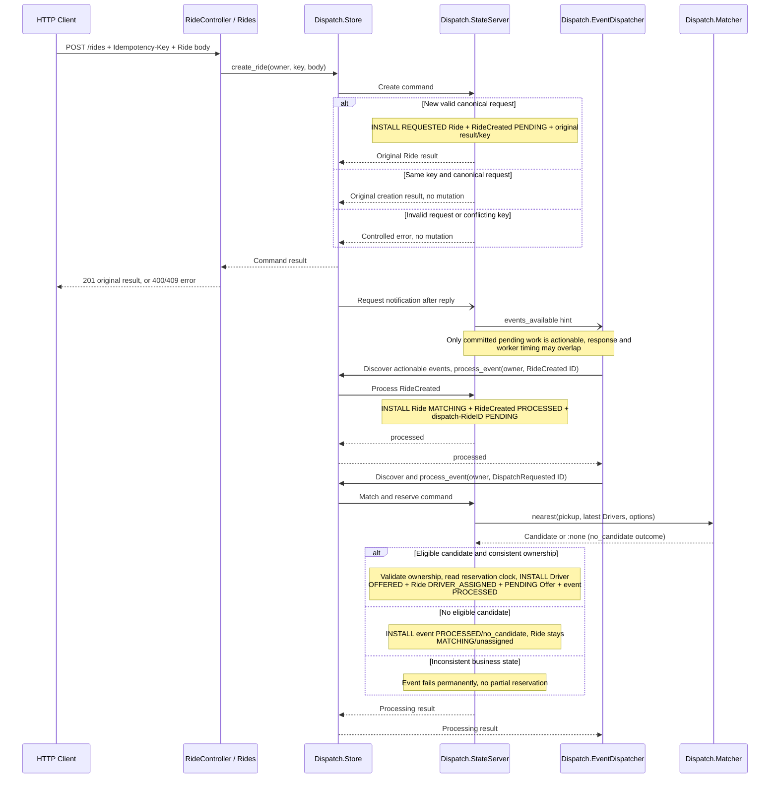
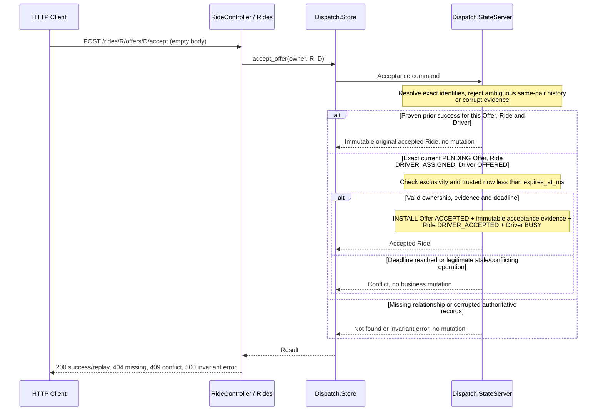
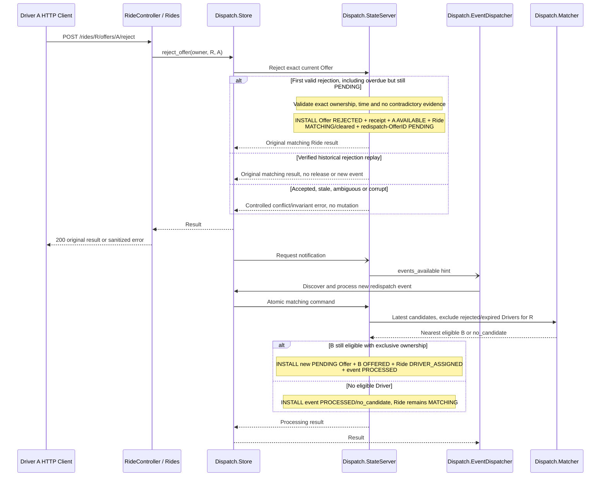
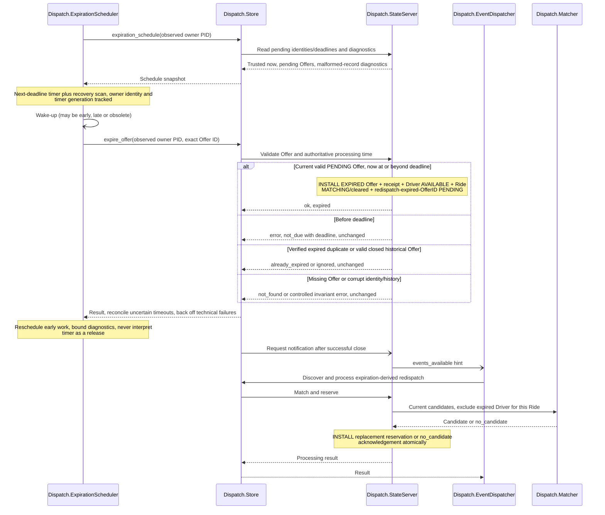
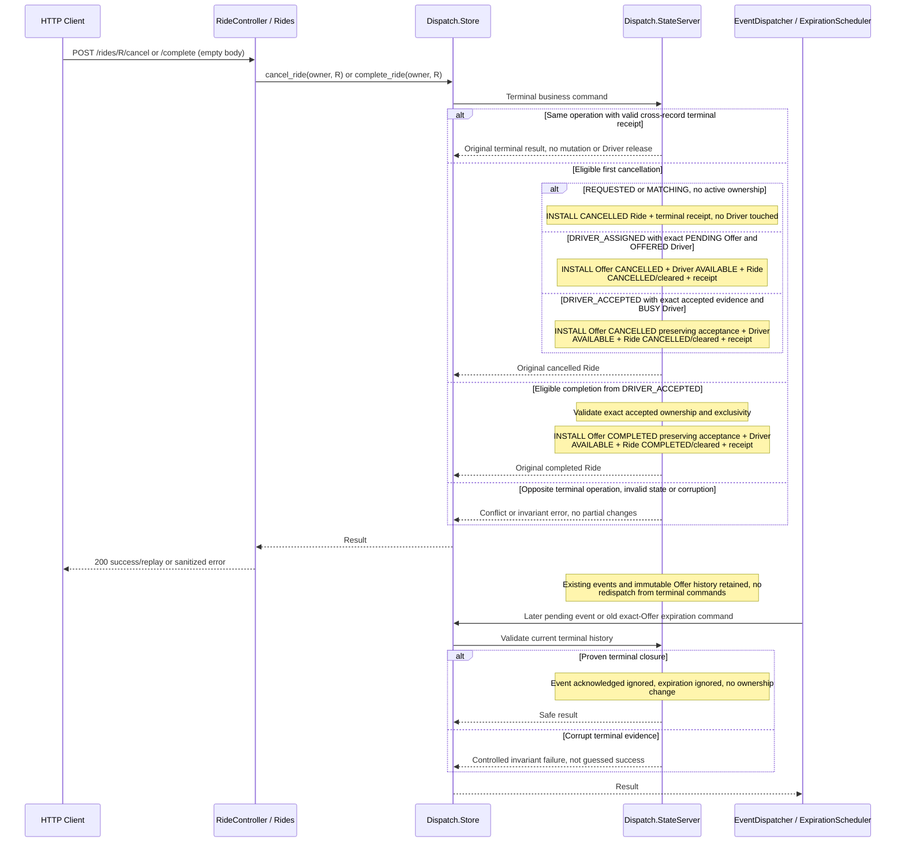
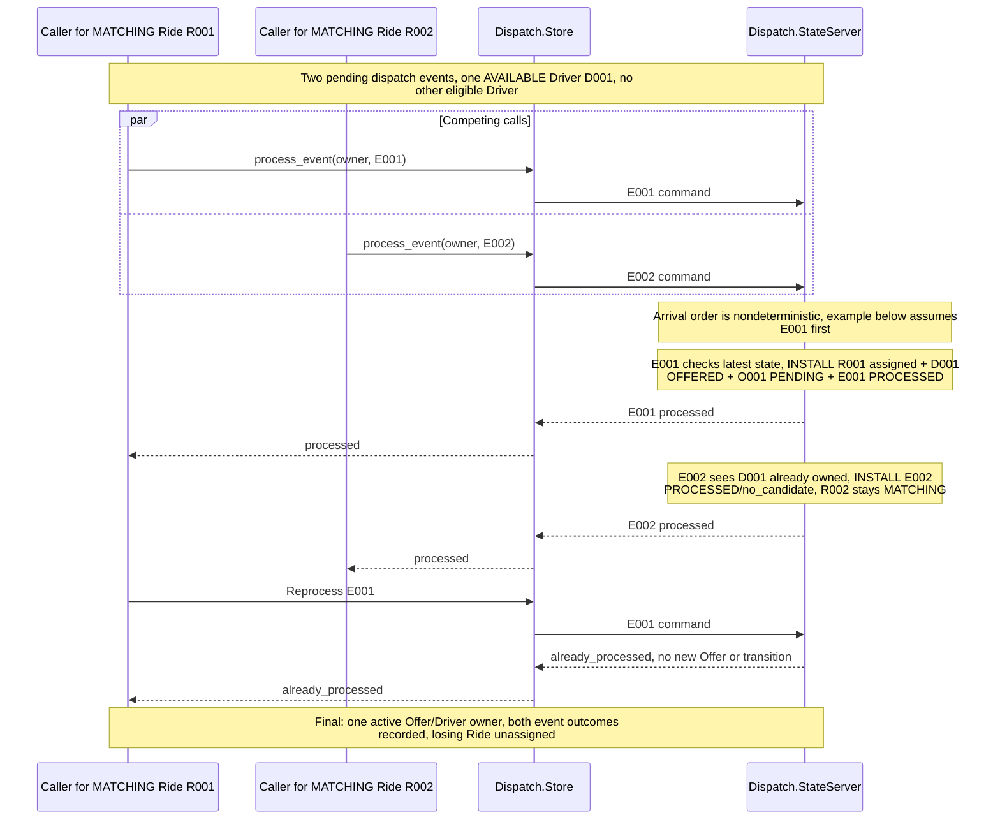

# Lifecycle sequences

These six views describe the **implemented single-VM application**, not a proposed
distributed deployment. Participants abbreviated below resolve to
`RideDispatchWeb.RideController`, `RideDispatch.Rides` and
`RideDispatch.Dispatch.{Store, StateServer, EventDispatcher, ExpirationScheduler, Matcher}`.
Controller → Rides delegation is folded into HTTP for readability. Store and
Matcher are modules; StateServer and the two workers are OTP processes.

`->>` denotes a request/local call, `-->>` its result, and `-)` a nonauthoritative
asynchronous hint. Only Client ↔ HTTP is network traffic. **INSTALL** marks the
complete authoritative state returned from a StateServer callback. No other
process observes partial Ride/Driver/Offer/Event mutation. Store requests hints
after replies; publication occurs in a separate StateServer notification callback.
Hints may be lost, so workers also discover work at startup and on recovery scans.
Post-installation Logger continuations are omitted: they are best-effort
observations, not a transactional audit store. See [architecture](architecture.md).

## 1. Create Ride, dispatch and atomic reservation

Matcher options supply radius and Ride-scoped exclusions.
Creation returns REQUESTED even if a later GET already sees an assignment. With no
candidate, processing creates neither an Offer nor an immediate redispatch loop. A repeated
processed event returns `:already_processed` without business effects. Evidence:
[creation](../test/ride_dispatch/dispatch/ride_store_test.exs),
[reservation](../test/ride_dispatch/dispatch/reservation_test.exs) and
[real dispatcher](../test/ride_dispatch/dispatch/reservation_dispatcher_test.exs).
Technical failure/retry is separate from the successful no-candidate branch.

## 2. Offer acceptance and original-result replay

Request-shape errors return 400 before business processing. Acceptance replay is
checked before a new-attempt deadline check; late retries can replay a genuine
success. Terminal progression and Driver reuse do not authorize restoring an old
snapshot. Evidence: [Store acceptance](../test/ride_dispatch/dispatch/acceptance_test.exs),
[HTTP acceptance](../test/ride_dispatch_web/controllers/offer_acceptance_test.exs)
and [live terminal reuse](../test/ride_dispatch/dispatch/terminal_lifecycle_test.exs).
Malformed-history fixtures are synthetic corruption tests, not user workflows.

## 3. Rejection and asynchronous rematching

A is available to **other** Rides. B can move or become unavailable before
processing; only the current authoritative candidates count. Replay never rejects
B's replacement Offer. The replacement event may already be PROCESSED when the
client reads it. Evidence: [rejection/receipt/races](../test/ride_dispatch/dispatch/rejection_test.exs),
[real rematching](../test/ride_dispatch/dispatch/rematching_test.exs) and the
[external demo](../README.md#local-opt-in-demo-and-lifecycle-logs-r2).

## 4. Expiration and rematching

The last redispatch path exists only after a successful expiration. An expired
clock deadline alone leaves the old Driver OFFERED; first acceptance at equality
fails, explicit rejection can still win. Old-owner timer work is invalidated on
owner replacement, and no lost state is recreated. Evidence:
[scheduler restart/owner replacement](../test/ride_dispatch/dispatch/expiration_scheduler_test.exs),
[delayed scheduler and rematching](../test/ride_dispatch/dispatch/expiration_rematching_test.exs),
[failures](../test/ride_dispatch/dispatch/expiration_failure_test.exs) and
[corrupt-record isolation](../test/ride_dispatch/dispatch/expiration_diagnostics_test.exs).

## 5. Cancellation and completion

Historical Driver status may now be OFFERED/BUSY for another Ride. Replay validates
closure evidence and current relationships rather than requiring that Driver to
remain AVAILABLE. Pending events are retained and safely consumed, not deleted.
Evidence: [terminal Store/reuse](../test/ride_dispatch/dispatch/terminal_lifecycle_test.exs),
[real worker terminal safety](../test/ride_dispatch/dispatch/terminal_dispatch_test.exs)
and [HTTP lifecycle](../test/ride_dispatch_web/controllers/ride_lifecycle_test.exs).

## 6. Competing Rides and duplicate delivery

Reversing arrival order reverses the winner, not the invariant. GenServer
serialization is the mechanism, while **final-state assertions** establish the
business guarantee. [Reservation tests](../test/ride_dispatch/dispatch/reservation_test.exs)
use barrier-released callers; [acceptance](../test/ride_dispatch/dispatch/acceptance_test.exs),
[expiration races](../test/ride_dispatch/dispatch/expiration_concurrency_test.exs)
and [terminal races](../test/ride_dispatch/dispatch/terminal_concurrency_test.exs)
extend evidence through acceptance, release and reuse. The real dispatcher
serializes its own calls; it is not described as issuing simultaneous callbacks.
These guarantees stop at this single authoritative owner, not a distributed cluster.
