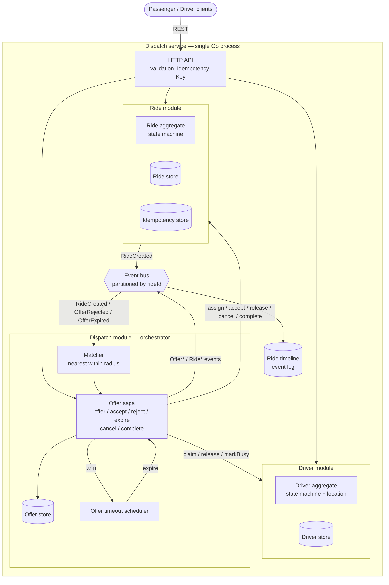
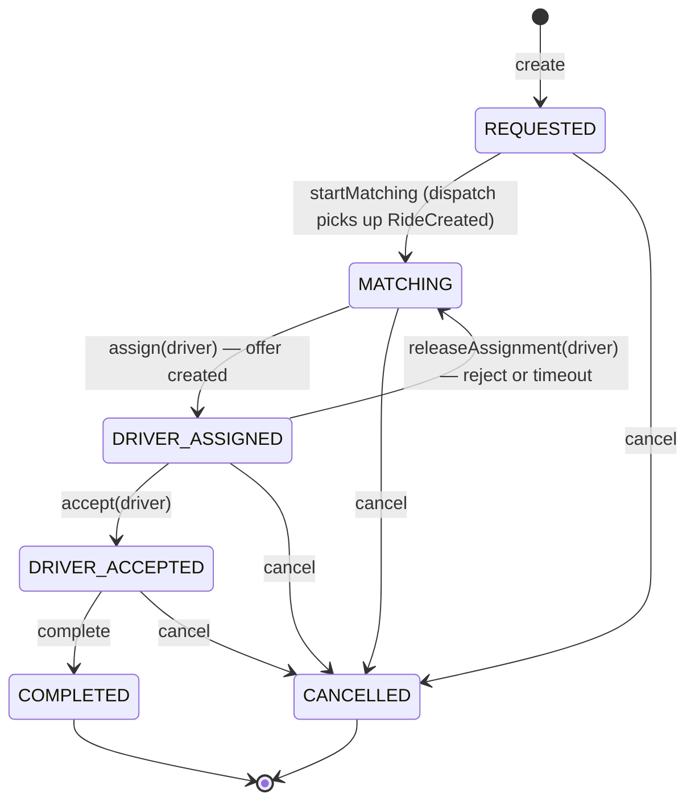
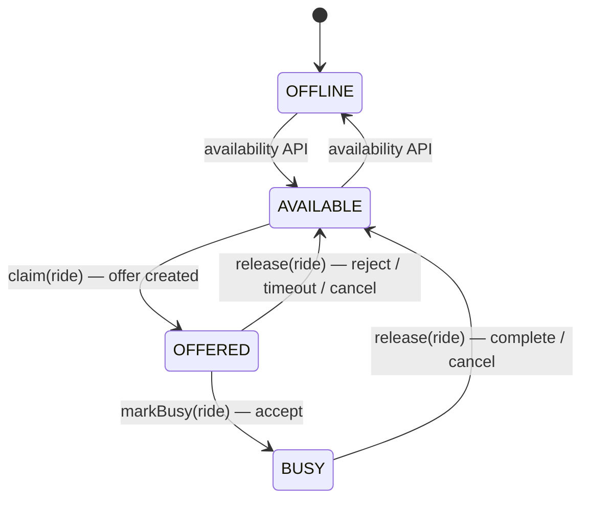

# Architecture — Ride-Hailing Dispatch Service

> **Start here.** This is the entry point for the design. It links to the
> [sequence diagrams](sequence-diagram.md), [ADR-001 Matching](adr/ADR-001-matching.md)
> and [ADR-002 Concurrency](adr/ADR-002-concurrency.md).
>
> Items marked **(future)** describe how the design evolves; they are deliberately
> not implemented. Everything else is implemented and covered by tests.

## Contents

1. [Design thesis](#1-design-thesis)
2. [System context and module boundaries](#2-system-context-and-module-boundaries)
3. [Domain model and state machines](#3-domain-model-and-state-machines)
4. [Command flows (saga-lite)](#4-command-flows-saga-lite)
5. [Event-driven dispatch](#5-event-driven-dispatch)
6. [Idempotency strategy](#6-idempotency-strategy)
7. [HTTP API](#7-http-api)
8. [Observability](#8-observability)
9. [Scalability and performance design](#9-scalability-and-performance-design)
10. [Spec interpretations](#10-spec-interpretations)
11. [Code layout and testing strategy](#11-code-layout-and-testing-strategy)
12. [Known limitations](#12-known-limitations)

---

## 1. Design thesis

**A modular monolith whose modules talk to each other as if they were already
separate services.**

- One Go process, in-memory storage, in-memory message bus. No external
  infrastructure is needed to run or test it.
- Each module owns its data. No module writes another module's state; it calls
  that module's API.
- Every cross-module operation is designed to survive the modules being split
  across a network: each step is atomic on its own, idempotent, and recoverable.
- Every infrastructure dependency (storage, bus, clock and timers) sits behind a
  port, so moving to Postgres or Kafka means swapping an adapter, not rewriting the
  domain.

The challenge measures *design that is correct today and can evolve*, so the
priority order is: correctness of the state machines → concurrency safety →
idempotency → evolvability. Infrastructure is kept minimal on purpose.

---

## 2. System context and module boundaries



### Ownership

| Module | Owns | Does **not** do |
|---|---|---|
| **Ride** | `Ride` state and lifecycle, `Idempotency-Key` records, `RideCreated` | Know which drivers exist or how matching works |
| **Driver** | `Driver.status`, `Driver.currentRideId`, location, availability API | Know about rides beyond the id it is holding |
| **Dispatch** | `RideOffer`, the matching strategy, the exclusion rule, offer timeouts, the saga that coordinates Ride and Driver | Mutate ride or driver fields directly; it only calls their module APIs |

Dispatch depends on Ride and Driver through small interfaces it defines itself
(Go's consumer-side interfaces). Ride and Driver depend on nothing in Dispatch.
This dependency direction is what lets Dispatch become its own service later.

### Why orchestration, not choreography

The offer lifecycle crosses two aggregates (ride and driver). Dispatch
**orchestrates** it: one place holds the sequence of steps and its compensations.
The alternative, choreography (Ride and Driver react to each other's events), spreads
one business rule across three modules and makes "what happens on reject?" hard to
read. Async events are still used where they are useful: kicking off matching, and
rematching after a rejection or timeout. See [ADR-002](adr/ADR-002-concurrency.md).

---

## 3. Domain model and state machines

```
Passenger   id, name                                    (seeded, read-only)
Location    latitude [-90, 90], longitude [-180, 180]   (value object, validated on construction)
Driver      id, status, location, locationUpdatedAt, currentRideId, version
Ride        id, passengerId, pickup, destination, status, assignedDriverId,
            createdAt, updatedAt, version
RideOffer   id, rideId, driverId, status, createdAt, expiresAt, respondedAt
```

**Single path of mutation.** Status fields change only through the aggregate's
transition methods (`ride.Accept(driverID)`, `driver.Claim(rideID)`, …). Every
method validates against the transition table below. Repositories persist whatever the
aggregate decided. Status fields are unexported, so the Go compiler rejects any
direct assignment from another package.

**Idempotent transitions.** Every transition method returns `(changed bool, err error)`.
Re-applying a transition that has already happened (same target, same driver)
returns `changed=false, err=nil`. That is what makes duplicate requests and events
safe at the domain level (see [§6](#6-idempotency-strategy)).

### Ride



| Method | Allowed from | Effect | Duplicate (no-op) when | Otherwise |
|---|---|---|---|---|
| `startMatching()` | `REQUESTED` | → `MATCHING` | already past `REQUESTED` | — |
| `assign(d)` | `MATCHING` | → `DRIVER_ASSIGNED`, `assignedDriverId=d` | `DRIVER_ASSIGNED` with `d` | `ErrConflict` |
| `releaseAssignment(d)` | `DRIVER_ASSIGNED` with `d` | → `MATCHING`, `assignedDriverId=nil` | already `MATCHING` | `ErrConflict` |
| `accept(d)` | `DRIVER_ASSIGNED` with `d` | → `DRIVER_ACCEPTED` | `DRIVER_ACCEPTED` with `d` | `ErrConflict` / `ErrInvalidTransition` |
| `cancel()` | `REQUESTED`, `MATCHING`, `DRIVER_ASSIGNED`, `DRIVER_ACCEPTED` | → `CANCELLED` | `CANCELLED` | `ErrInvalidTransition` |
| `complete()` | `DRIVER_ACCEPTED` | → `COMPLETED` | `COMPLETED` | `ErrInvalidTransition` |

`CANCELLED` and `COMPLETED` are terminal. `assignedDriverId` is kept after cancel or complete
for audit.

### Driver



| Method | Allowed from | Guard | Effect |
|---|---|---|---|
| `setAvailability(AVAILABLE)` | `OFFLINE` | — | → `AVAILABLE` (no-op if already `AVAILABLE`) |
| `setAvailability(OFFLINE)` | `AVAILABLE` | — | → `OFFLINE` (no-op if already `OFFLINE`) |
| `claim(r)` | `AVAILABLE` | — | → `OFFERED`, `currentRideId=r` (no-op if `OFFERED` for `r`) |
| `markBusy(r)` | `OFFERED` | `currentRideId == r` | → `BUSY` (no-op if `BUSY` for `r`) |
| `release(r)` | `OFFERED`, `BUSY` | `currentRideId == r` | → `AVAILABLE`, `currentRideId=nil` |

`release(r)` is **conditional on the ride id**. A compensation or timeout that arrives late can
never free a driver who is now serving a different ride. If the guard does not
match, `release` is a no-op. `OFFERED` and `BUSY` drivers cannot go `OFFLINE`
through the API (`409`).

### RideOffer

`PENDING → ACCEPTED | REJECTED | EXPIRED | CANCELLED`, all terminal.

Because a driver who rejects or times out is excluded from that ride forever,
**`(rideId, driverId)` identifies at most one offer**. That is why the API addresses
offers as `/rides/{rideId}/offers/{driverId}` without exposing an offer id. The
**exclusion set** for a ride is derived from its offer history: every driver with a
`REJECTED` or `EXPIRED` offer. No separate list has to be kept in sync.

---

## 4. Command flows (saga-lite)

Each step below is one atomic operation on one aggregate (see
[ADR-002](adr/ADR-002-concurrency.md) for how atomicity is achieved). Because every
step is idempotent, **replaying a whole command is always safe**. That is the
recovery strategy for a command interrupted half-way.

**The ride is the arbiter.** After an offer exists, every competing action (accept,
reject, timeout, cancel) starts with a conditional transition on the ride. Only
the action that wins on the ride goes on to touch the driver and the offer.

| Command | Step 1 | Step 2 | Step 3 | On step failure |
|---|---|---|---|---|
| **Offer** (from matcher) | `driver.claim(r)` | `ride.assign(d)` | create `PENDING` offer, re-read the ride, arm timeout | step 2 fails → `driver.release(r)` (compensation). Ride already terminal after step 3 → close the offer and release the driver |
| **Accept** | `ride.accept(d)` | `driver.markBusy(r)` | offer → `ACCEPTED` | step 1 fails → `409`, nothing changed |
| **Reject** | `ride.releaseAssignment(d)` | offer → `REJECTED` | `driver.release(r)`, publish `OfferRejected` | step 1 fails → `409` |
| **Expire** (timer) | `ride.releaseAssignment(d)` | offer → `EXPIRED` | `driver.release(r)`, publish `OfferExpired` | ride already `DRIVER_ACCEPTED` by `d` → roll forward (finish accept) |
| **Cancel** | `ride.cancel()` | pending offer → `CANCELLED` | `driver.release(r)` if a driver was assigned | step 1 fails → `409` |
| **Complete** | `ride.complete()` | `driver.release(r)` | — | step 1 fails → `409` |

Accept and reject first look up the offer for `(rideId, driverId)`. If there is none,
the result is `404`. If the offer is already in the requested final state (`ACCEPTED`
for accept, `REJECTED` for reject), the result is `200` with the current ride, which
makes the command idempotent. Any other non-`PENDING` state gives `409`. A replay of
a command interrupted half-way still finds the offer `PENDING`, and finishes the
remaining steps because each step is idempotent.

Two consequences worth stating:

- **Claim the driver first.** The driver is the contended resource, so we win it
  before touching the ride. If we lose the ride afterwards (it was cancelled), the
  compensation (`release`) is invisible to the passenger. Assigning the ride first
  would make a failure visible as a `DRIVER_ASSIGNED → MATCHING` flicker.
- **Rejected/expired offers are recorded before the driver is released.** By the time
  the driver is `AVAILABLE` again, the exclusion rule already sees them, so a racing
  rematch cannot offer the same ride back to them.
- **A cancel can land between steps 2 and 3 of the offer saga.** It then finds no offer
  to close. The saga covers this by re-reading the ride *after* creating the offer:
  the cancel moves the ride before it looks for the offer, so either the cancel sees
  the offer, or the re-read sees the cancelled ride and closes the offer itself.

---

## 5. Event-driven dispatch

### Why asynchronous

`POST /rides` returns as soon as the ride is stored (`201`, `REQUESTED`).
Matching happens on a dispatch worker:

- **Latency isolation.** Ride creation does not wait for a geo search, and it does not fail
  because no driver is nearby.
- **Independent scaling.** Matching is the CPU-heavy part, and dispatch workers scale
  separately from the API.
- **Natural retry point.** A failed matching attempt is redelivered without the passenger
  re-submitting.
- **Service boundary.** The `RideCreated` event is the contract that would let Dispatch become
  its own service.

The trade-off is eventual consistency: right after creation the ride is
`REQUESTED` and a client must poll `GET /rides/{id}` (push notifications are out of scope).

### Events

| Event | Published by | Consumed by |
|---|---|---|
| `RideCreated` | Ride | Dispatch → start matching |
| `OfferCreated` | Dispatch | timeline (driver notification is out of scope) |
| `OfferAccepted` | Dispatch | timeline |
| `OfferRejected` | Dispatch | Dispatch → rematch |
| `OfferExpired` | Dispatch | Dispatch → rematch |
| `MatchingExhausted` | Dispatch | timeline (ride stays `MATCHING`) |
| `RideCancelled`, `RideCompleted` | Dispatch | timeline |

Every event carries an envelope: `eventId` (unique), `type`, `rideId`,
`driverId` (when relevant), `causationId` (the event or request that caused it),
`occurredAt`.

### Bus semantics (in-memory implementation)

- **Partitioned by `rideId`.** `N` worker goroutines, and an event goes to worker
  `hash(rideId) % N`. Events of the same ride are processed in order, one at a time.
  Different rides are processed in parallel, which is exactly where AC-09's race lives.
  This mirrors a Kafka partition key, so the semantics survive the migration. A retried
  delivery goes to the back of its partition's queue, so while it waits for its retry,
  later events of the same ride can overtake it. Handlers do not rely on order: each
  one re-reads the ride and acts on its current state.
- **At-least-once.** Publishing happens after the state change is committed. A
  handler error triggers redelivery with exponential backoff (up to 5 attempts),
  then the event goes to a dead-letter list with an `ERROR` log line.
- **Publish-after-commit instead of an outbox.** Store and bus live in the same
  process and share fate (a crash loses both), so publishing after commit is
  enough here. **(future)** With a durable database, the event is written to an
  outbox table in the same transaction as the state change, and a relay publishes
  it.

### What happens if a message is delivered twice?

1. The consumer's inbox records processed `eventId`s and skips known ones.
2. The inbox is **only an optimisation**. Correctness comes from the state machine:
   a second `RideCreated` finds the ride no longer `REQUESTED`/unassigned and does
   nothing. A duplicate that races the original past the inbox loses on the ride's
   conditional `assign` and compensates its driver claim.

### What happens if processing fails?

- The handler returns an error → the bus redelivers with backoff. Every step is
  idempotent, so a retry after a partial success is safe.
- After the attempts are exhausted → dead-letter list + `ERROR` log with
  `rideId`/`eventId`. The ride stays in `REQUESTED` or `MATCHING`, which is a safe,
  visible state (the failure is in the logs, not in the timeline). **(future)** A sweeper re-drives
  rides stuck in `MATCHING`/`REQUESTED` and offers past `expiresAt`.
- A panicking handler is recovered by the worker and treated as an error.

---

## 6. Idempotency strategy

Idempotency is applied at three layers. Each one covers a different kind of duplicate.

| Layer | Protects against | Mechanism |
|---|---|---|
| **HTTP** — `POST /rides` | Client retries (timeouts, double taps) | `Idempotency-Key` store: key → `{requestHash, state, response}`. Same key + same hash → replay the stored response (`201`, header `Idempotent-Replayed: true`). Same key + different hash → `422`. Same key while the first request is still `IN_PROGRESS` → `409`, retry later. Missing key → `400`. |
| **Command** — accept, reject, cancel, complete | Duplicate driver/passenger actions | Idempotent transitions ([§3](#3-domain-model-and-state-machines)). A repeated `accept` by the same driver returns `200` with the current ride. Every saga step is idempotent, so the whole command can be replayed. |
| **Event** — `RideCreated`, `OfferRejected`, `OfferExpired` | Broker redelivery | Inbox per consumer (optimisation) + state-machine guards (guarantee), see [§5](#what-happens-if-a-message-is-delivered-twice). |

`requestHash` is a SHA-256 of the canonicalised JSON body. The key store reserves the key
(`IN_PROGRESS`) atomically *before* creating the ride. Two concurrent requests with the
same key therefore cannot both create a ride. **(future)** Keys expire after 24 h.

---

## 7. HTTP API

| Method & path | Purpose | Success | Notable errors |
|---|---|---|---|
| `POST /rides` | Create ride (requires `Idempotency-Key`) | `201` ride | `400` validation / missing key, `404` unknown passenger, `409` key in progress, `422` key reused with a different body |
| `GET /rides/{rideId}` | Read ride | `200` ride | `404` |
| `GET /rides/{rideId}/timeline` | Ordered events for the ride | `200` events | `404` |
| `POST /rides/{rideId}/offers/{driverId}/accept` | Driver accepts | `200` ride | `404` no such offer, `409` offer not pending |
| `POST /rides/{rideId}/offers/{driverId}/reject` | Driver rejects | `200` ride | `404`, `409` |
| `POST /rides/{rideId}/cancel` | Cancel ride | `200` ride | `409` terminal state |
| `POST /rides/{rideId}/complete` | Complete ride | `200` ride | `409` not accepted |
| `GET /drivers/{driverId}` | Read driver | `200` driver | `404` |
| `PUT /drivers/{driverId}/availability` | `{"status":"AVAILABLE"\|"OFFLINE"}` | `200` driver | `400`, `404`, `409` driver is `OFFERED`/`BUSY` |
| `PUT /drivers/{driverId}/location` | `{"latitude":…, "longitude":…}` | `200` driver | `400`, `404` |

Errors use one shape: `{"error": {"code": "INVALID_TRANSITION", "message": "…"}}`.

`POST /rides` also returns a `Location: /rides/{rideId}` header. Every response
carries `X-Request-ID` (echoed from the request, or generated).

Configuration (environment variables): `PORT` (8080), `DISPATCH_RADIUS_KM` (2),
`OFFER_TIMEOUT` (30s), `DISPATCH_WORKERS` (4, the number of bus partitions),
`LOG_LEVEL` (info). Passengers and drivers are seeded at startup.

---

## 8. Observability

**Structured logs** (`log/slog`, JSON). Every line about a ride carries `ride_id`,
and where relevant `driver_id`, `offer_id`, `event_id`, `causation_id`. Log messages
are stable event names, so they can be filtered:

```
ride.created  ride.create_replayed  ride.cancelled  ride.completed
dispatch.matching_started  dispatch.matching_skipped  dispatch.matching_exhausted
dispatch.claim_lost  dispatch.claim_compensated  dispatch.offer_created
dispatch.offer_superseded  dispatch.ride_not_found
offer.accepted  offer.rejected  offer.expired  offer.rolled_forward  offer.closed
driver.availability_changed  driver.location_updated (debug)
bus.redelivery  bus.dead_lettered  bus.duplicate_skipped  http.request
```

"What happened to ride R001?" is answered in two ways:

```bash
# from logs
grep '"ride_id":"R001"' app.log
# from the API — the same story as an ordered list of events
curl localhost:8080/rides/R001/timeline
```

`causation_id` links each event to what triggered it (e.g. `OfferExpired` →
`OfferCreated` → `RideCreated` → the HTTP request id), so the chain can be followed
even when two workers interleave.

**(future)** Metrics: time-to-offer, time-to-accept, offer acceptance rate,
claim-lost count (contention), dead-letter count. Plus tracing that propagates
`causation_id` as the trace context.

---

## 9. Scalability and performance design

The implementation targets ~1,000 drivers. This section explains how the same
boundaries carry it to 1,000,000.

### Load model

Drivers report location roughly every 4 s; ride requests are orders of magnitude
rarer. **The hot path is location writes, not rides.**

| Drivers | Location writes/s | Matching scan cost (linear) |
|---|---|---|
| 1,000 | ~250 | trivial |
| 100,000 | ~25,000 | ~100K distance computations per match — too slow at peak |
| 1,000,000 | ~250,000 | infeasible |

### Evolution

| Concern | 1K (this implementation) | 100K | 1M |
|---|---|---|---|
| **Driver location storage** | In-memory map in the Driver module | Redis GEO (or in-memory geo index per instance). Locations are **not** written to the main DB on every ping, only snapshotted | Location service sharded by geo cell (e.g. H3 resolution 7, roughly city-district size) |
| **Matching** | Linear scan + Haversine behind `DriverLocator` | Geo index query (`GEOSEARCH` / cell lookup) returns a short candidate list. Haversine only on that list | Matching runs in the shard owning the pickup cell, and queries neighbour cells for the radius ring |
| **Database** | In-memory repositories | Postgres. Rides and offers in OLTP tables, finished rides archived. Driver claim = conditional `UPDATE` | Rides partitioned by region. Each region's DB owns its drivers' claim state |
| **Message broker** | In-memory bus, partitioned by `rideId` | Kafka/SQS FIFO with `rideId` partition key, consumer group of dispatch workers | Topics per region. Partition count sized to peak dispatch rate |
| **Dispatch workers** | `N` goroutines | `N` stateless instances in one consumer group | Workers pinned to region partitions. Driver claims stay **local** to a region, so no distributed lock |
| **Caching** | — | Driver read model (status + location) cached for candidate search. Claims always go to the source of truth | Same, per region |
| **Partitioning** | By `rideId` on the bus | By `rideId` (bus), by driver id (claim store) | By **geography** first, then `rideId`. Geography makes matching and claiming local |

### Bottlenecks

1. **Location write throughput.** 25K–250K writes/s will overwhelm a relational DB if
   every ping is persisted. → Keep hot location in a geo store, persist snapshots.
2. **Geo query cost.** A linear scan is O(drivers) per match. → Spatial index, so only
   nearby cells are scanned.
3. **Driver contention at hotspots** (airport, stadium). Many rides compete for the
   same few drivers, which means many lost claims and retries. → Claim the next candidate
   immediately instead of retrying the same one. **(future)** Batch matching per cell
   every ~1 s to assign globally instead of greedily.
4. **Single-writer claim store.** Every offer is a write on the driver row/key. → Shard
   claim state by region. Claims never span shards because matching is regional.
5. **Broker partition hot spots.** One busy region saturates its partitions. → Size
   partitions per region, split hot regions into finer cells.

### Architectural trade-offs

1. **Stale reads for search, strong consistency for claims.** Candidate search may
   use a slightly old location or status. Correctness is guaranteed by the
   conditional claim. Cost: occasional lost claims. Benefit: search can be cached
   and replicated freely.
2. **One offer at a time (sequential) vs broadcast to several drivers.** Sequential is
   fair, simple, and avoids double acceptance, but a slow driver delays the passenger
   by up to the timeout. See [ADR-001](adr/ADR-001-matching.md).
3. **Orchestration vs choreography.** One saga owner is easier to reason about and
   test. Cost: Dispatch is coupled to Ride's and Driver's command APIs. See
   [ADR-002](adr/ADR-002-concurrency.md).
4. **Greedy nearest-driver vs global batch optimisation.** Greedy is simple and fast.
   It is not globally optimal under load (it can take the only driver near ride B to
   serve ride A).
5. **Geo-sharding vs cell-edge effects.** Regional ownership removes distributed locks,
   but a pickup near a cell edge needs neighbour-cell candidates. Those are read across
   shards, while claims stay owned by the driver's shard.

---

## 10. Spec interpretations

Where the brief is ambiguous, this is the position taken and why.

| # | Question | Decision | Reasoning |
|---|---|---|---|
| 1 | Can a `DRIVER_ACCEPTED` ride be cancelled? | **Yes.** Driver `BUSY → AVAILABLE` | AC-06 lists the transition. AC-05 describes "cancelling an accepted ride". The passenger sentence in AC-05 is read as an example, not an exhaustive list. |
| 2 | What moves `REQUESTED → MATCHING`? | The dispatch handler, when it picks up `RideCreated` | Gives `REQUESTED` a meaning: "accepted, not yet processed by dispatch". The async gap becomes visible in the timeline. |
| 3 | Is a driver whose offer **expired** excluded from that ride? | **Yes** | The brief says a timeout "is treated as rejected". Trade-off: in a sparse area a driver who missed the ping is never asked again ([ADR-001](adr/ADR-001-matching.md)). |
| 4 | Retry a ride stuck in `MATCHING` when a driver becomes available? | **No** | AC-07: "the ride stays in `MATCHING`". Listed under limitations. |
| 5 | Duplicate commands (cancel twice, complete twice, `AVAILABLE → AVAILABLE`) | `200`, no change | "Duplicate transitions are safely handled". |
| 6 | Two concurrent requests with the same `Idempotency-Key` | Second gets `409` while the first is in progress | Prevents two rides being created by a race the brief does not mention. |
| 7 | Missing `Idempotency-Key` | `400` | The brief says clients *must* send it. |
| 8 | Accept/reject by a driver who does not hold a pending offer | `404` if no offer exists for that driver, `409` if it is no longer pending | "Only the driver holding the current offer can accept or reject it." |
| 9 | Location update while `OFFLINE`/`OFFERED`/`BUSY` | Allowed | Location is independent of availability. Matching ignores non-`AVAILABLE` drivers anyway. |
| 10 | Is `assignedDriverId` cleared on cancel/complete? | **No**, kept for audit | The brief only requires clearing it on rejection/timeout. |

---

## 11. Code layout and testing strategy

```
coding-challenge-3/jameslu/
├── cmd/server/            main: config, logger, HTTP server, graceful shutdown
├── internal/
│   ├── app/               wiring of all modules + seed data (shared by main and the API tests)
│   ├── apperr/            error categories mapped to HTTP status codes
│   ├── geo/               Location value object, Haversine
│   ├── passenger/         seeded passenger directory
│   ├── ride/              Ride aggregate, repository port + in-memory adapter, idempotency store
│   ├── driver/            Driver aggregate, repository port + in-memory adapter
│   ├── dispatch/          Matcher, offer store, offer saga, timeouts, event handler
│   ├── timeline/          per-ride event log behind GET /rides/{id}/timeline
│   ├── httpapi/           handlers, request validation, error mapping
│   └── platform/          bus, clock (real + fake), events, ids, trace (causation id)
└── docs/
```

**Testing (TDD, red → green → refactor, visible in commit history).**

| Level | What | Tooling |
|---|---|---|
| Domain | Every row of the transition tables, valid / invalid / duplicate | table-driven unit tests |
| Matching | nearest selected, outside radius, offline, busy, none available, tie-break, exclusion, latest location | unit tests on `Matcher`, with the real Driver module as `DriverLocator` |
| Saga | offer / accept / reject / expire / cancel / complete, incl. compensation and roll-forward | in-memory adapters, fake clock, real bus + `WaitIdle` |
| Concurrency | two rides vs one driver; accept vs timeout / cancel; reject vs timeout; duplicate matching; same `Idempotency-Key` | goroutines released by a barrier, repeated 1,000× (200× for the idempotency key), `go test -race` |
| API | status codes, validation, `Idempotency-Key` replay / mismatch, timeline | `net/http/httptest` against the fully wired app |

Time is injected through `clock.Clock` (`Now` and `AfterFunc`), so the 30 s offer timeout is
tested by advancing a fake clock, never by sleeping.

---

## 12. Known limitations

- In-memory only: state is lost on restart, and timers do not survive a restart.
- A ride left in `MATCHING` with no eligible driver is not retried automatically.
- One offer at a time: time-to-accept is bounded by `OFFER_TIMEOUT` × attempts.
- No push channel to drivers. Drivers learn about offers by polling `GET /drivers/{id}`.
- No authentication: the `driverId` in the path is trusted.
- Idempotency keys are never expired.
