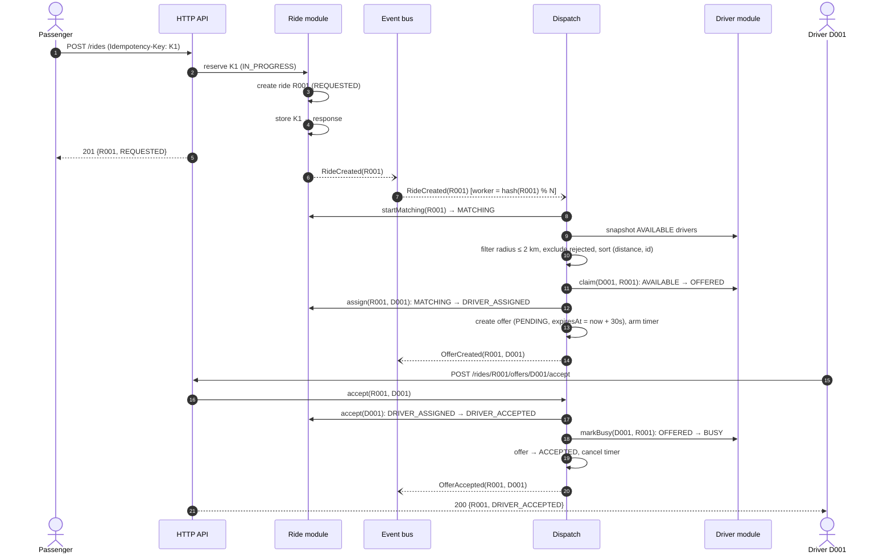
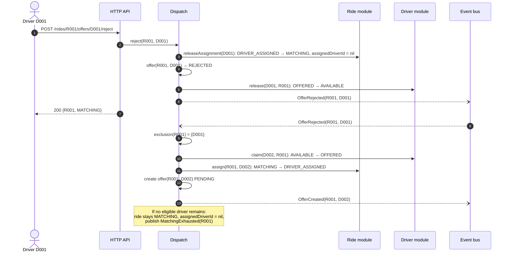
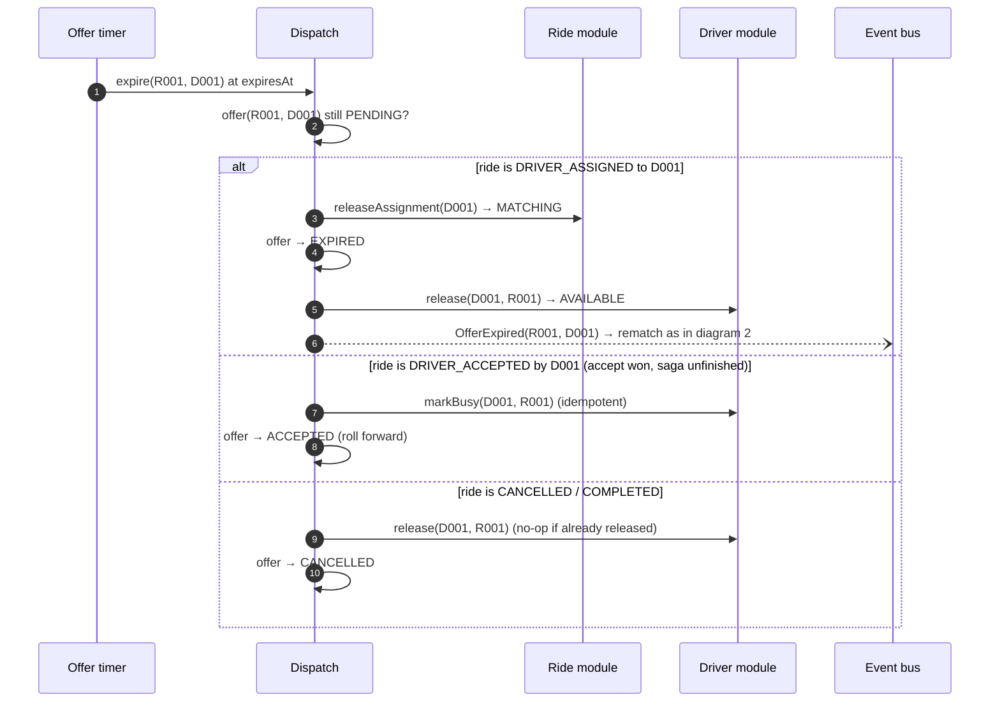
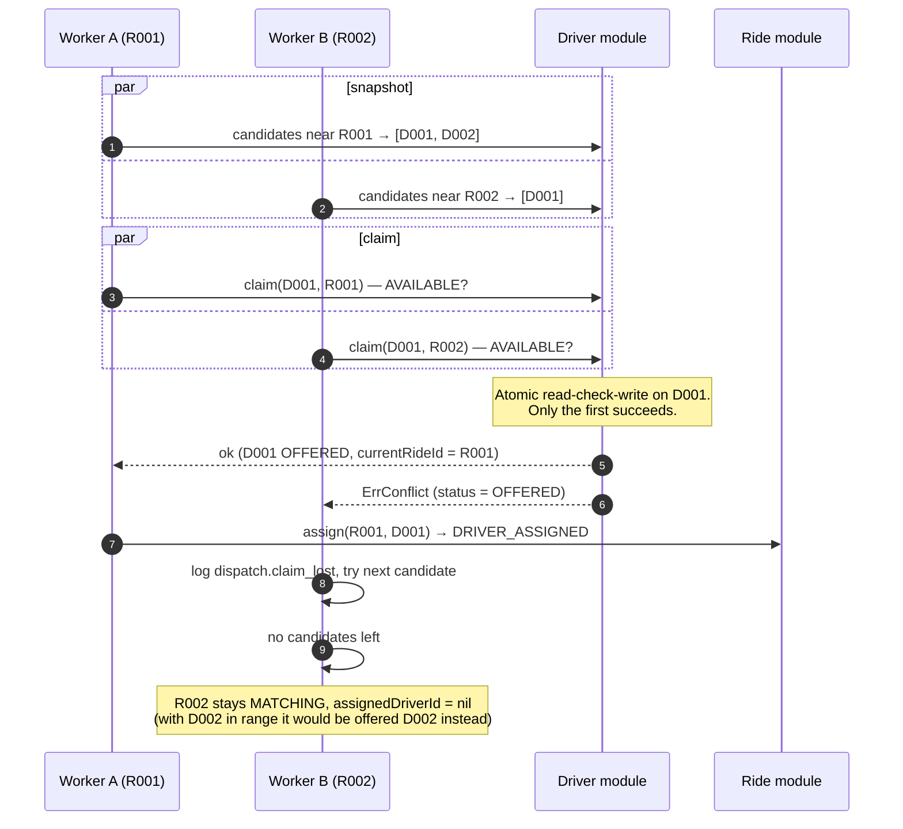
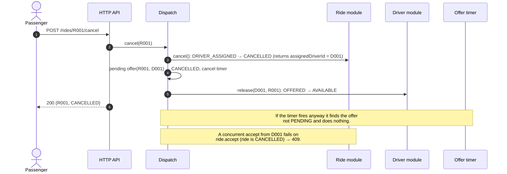
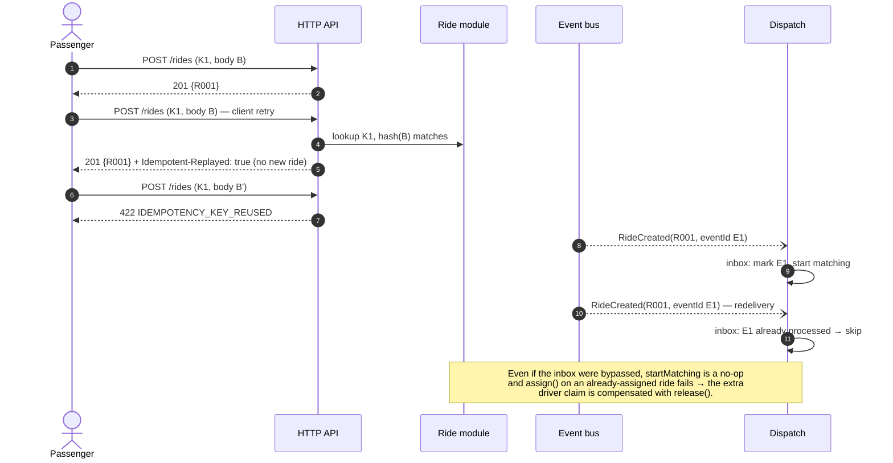

# Sequence Diagrams

Back to [architecture](architecture.md). Step names match the command table in
[architecture §4](architecture.md#4-command-flows-saga-lite).

1. [Create ride → match → offer → accept](#1-create-ride--match--offer--accept)
2. [Reject → rematch](#2-reject--rematch)
3. [Offer timeout](#3-offer-timeout)
4. [Two rides race for the same driver (AC-09)](#4-two-rides-race-for-the-same-driver-ac-09)
5. [Cancel during a pending offer](#5-cancel-during-a-pending-offer)
6. [Duplicate delivery and idempotent replay](#6-duplicate-delivery-and-idempotent-replay)

---

## 1. Create ride → match → offer → accept

## 2. Reject → rematch

The rejected offer is recorded **before** D001 becomes `AVAILABLE` again. A rematch that
runs immediately afterwards already sees D001 in the exclusion set.

## 3. Offer timeout

The timer goes through the same conditional ride transition as a manual reject. If
the driver accepted in the same instant, only one of the two wins on the ride.

## 4. Two rides race for the same driver (AC-09)

Workers for R001 and R002 run in parallel because the rides hash to different
partitions. Both see D001 as the nearest available driver in their snapshots. The
claim is a conditional update, so exactly one of them wins.

## 5. Cancel during a pending offer

## 6. Duplicate delivery and idempotent replay

