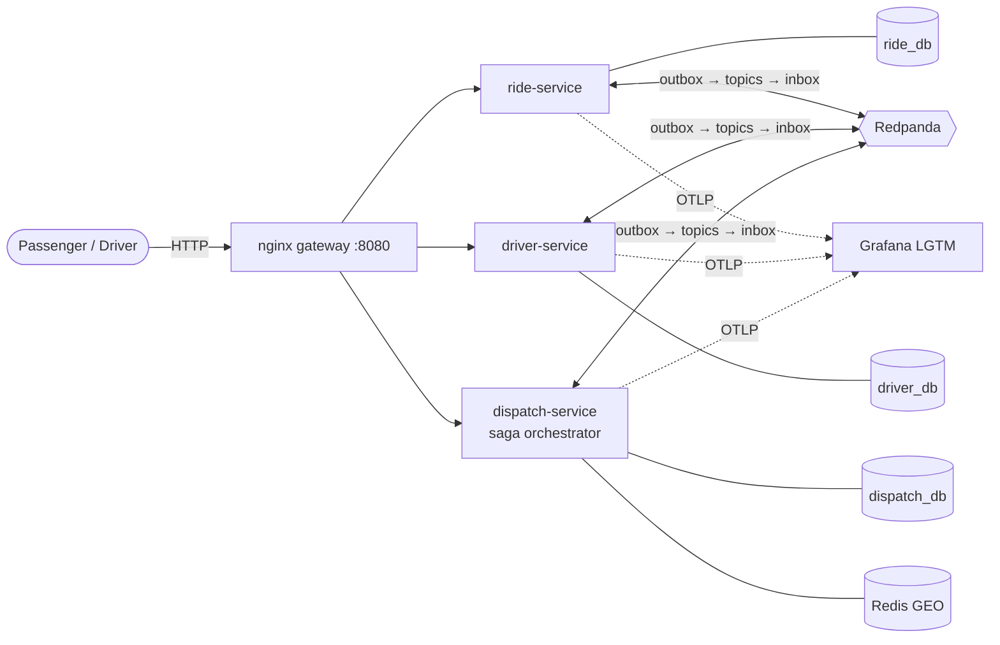

# KVP (Khoa-Vinh-Phuong) - Coding Challenge #3: Ride-Hailing Dispatch Service

A ride-hailing **dispatch service**: passengers request rides, the system offers each ride to the **nearest available driver**, drivers accept or reject, and rejected or expired offers are **rematched**. A driver can never be given two rides at once, duplicates are harmless, and every ride can be traced end to end.

Built for [Coding Challenge #3](../coding-challenge-3.md) as **three Go microservices** coordinated by an **orchestrated saga** over **Redpanda**, with **PostgreSQL** as the source of truth, **Redis GEO** for nearby drivers, and **OpenTelemetry → Grafana** for logs, traces and metrics. Everything runs in Docker (Colima) with one command.

| | |
|---|---|
| **Requirements** | All 10 acceptance criteria and every §5 evaluation item are met and traced to code and tests → [requirements traceability](docs/requirements-traceability.md) |
| **Quality** | golangci-lint + OpenAPI lint clean; GitHub Actions CI runs lint → tests → full-stack e2e on every push → [CI](#3-how-to-test) |
| **Tests** | 32 unit + architecture, 23 integration (real Postgres/Redis), 12 end-to-end (REST + gRPC + OpenAPI contract), 56 Postman requests / 115 checks, all green → [testing](docs/testing.md) |
| **Design** | C4 architecture, 8 sequence flows, 14 design patterns explained, 12 ADRs that explain each choice → [documentation](#6-documentation) |
| **Run it** | `make up && make demo` → details in [local-development](docs/local-development.md) |

## Contents

* [1. Team Members](#1-team-members)
* [2. How to Run](#2-how-to-run)
* [3. How to Test](#3-how-to-test)
* [4. Approach](#4-approach)
  * [4.1 Architecture](#41-architecture)
  * [4.2 How a ride is dispatched](#42-how-a-ride-is-dispatched)
  * [4.3 Code structure](#43-code-structure)
  * [4.4 Requirements coverage](#44-requirements-coverage)
  * [4.5 Matching strategy](#45-matching-strategy)
  * [4.6 Concurrency strategy](#46-concurrency-strategy)
  * [4.7 Idempotency strategy](#47-idempotency-strategy)
  * [4.8 Event-driven dispatch](#48-event-driven-dispatch)
  * [4.9 Observability](#49-observability)
  * [4.10 Scalability](#410-scalability)
* [5. Design Decisions](#5-design-decisions)
  * [5.1 Why this tech stack?](#51-why-this-tech-stack)
  * [5.2 What trade-offs did we make?](#52-what-trade-offs-did-we-make)
  * [5.3 What patterns did we use?](#53-what-patterns-did-we-use)
* [6. Documentation](#6-documentation)
  * [6.1 Reading paths](#61-reading-paths)
  * [6.2 All documents](#62-all-documents)
* [7. 🏆 Bonus: What We Added and Used](#7--bonus-what-we-added-and-used)

---

## 1. Team Members

KVP (Khoa Vinh Phuong): Three Minds, Thousands of Debates, One Mission 🏆

1. **Khoa Phan**  (_Developer_): khoa.phan@thoughtworks.com
2. **Victor Nguyen** (_Developer_): victor.nguyen@thoughtworks.com
3. **Duy Phuong Nguyen** (_Developer_): phuong.nguyen@thoughtworks.com

---

## 2. How to Run

### 2.1 Prerequisites (macOS, with Docker)

```bash
brew install colima docker docker-compose docker-buildx lazydocker go jq
colima start --cpu 4 --memory 8 --vm-type vz --vz-rosetta
```

Add `"cliPluginsExtraDirs": ["/opt/homebrew/lib/docker/cli-plugins"]` to `~/.docker/config.json` so `docker compose` works. Step-by-step guide, Intel Macs and troubleshooting: [docs/local-development.md](docs/local-development.md).

### 2.2 Start

```bash
cd coding-challenge-3/kvp
make up          # build + start all 10 containers, waits until healthy (~30 s after the first build)
```

| Open | What |
|---|---|
| http://localhost:8080 | **REST API v1** (gateway) |
| localhost:9090 | **gRPC API v2** (gateway): driver location stream and offer push, see [below](#24-grpc-api-v2) |
| http://localhost:8080/docs/ | **Swagger UI**: the REST contract [api/openapi.yaml](api/openapi.yaml), with "Try it out" |
| http://localhost:3000 | Grafana → Dashboards → *Dispatch overview* (logs, traces, metrics) |
| http://localhost:8088 | Redpanda Console (topics, messages, consumer groups) |
| `lazydocker` | Containers, logs, restarts in the terminal |

Seeded data: passengers `P001–P010`; drivers `D001–D010` `AVAILABLE` ~220 m apart north of Ben Thanh (HCMC); `D011–D020` `OFFLINE`.

### 2.3 Try it

```bash
make demo        # walkthrough: request → reject → rematch → accept → complete, duplicates, a race
                 # every request and response is printed
```

Or by hand:

```bash
curl -s -X POST localhost:8080/rides -H 'Idempotency-Key: k1' \
  -d '{"passengerId":"P001","pickup":{"latitude":10.7769,"longitude":106.7009},"destination":{"latitude":10.8231,"longitude":106.6297}}'
curl -s localhost:8080/rides/<rideId>                         # → DRIVER_ASSIGNED to D001 (nearest)
curl -s -X POST localhost:8080/rides/<rideId>/offers/D001/accept
curl -s -X POST localhost:8080/rides/<rideId>/complete
make trace-ride RIDE=<rideId>                                  # what happened, from the logs
```

**Postman:** import [postman/ridehail.postman_collection.json](postman/ridehail.postman_collection.json): a happy-path scenario plus one folder per acceptance criterion ([how to use](docs/local-development.md#postman)).

Full API: [api/openapi.yaml](api/openapi.yaml) (OpenAPI 3.0, also at http://localhost:8080/docs/) and [architecture §6](docs/architecture.md#6-public-api).

### 2.4 gRPC API v2

The two highest-frequency driver-app calls also exist as **gRPC streams** on `localhost:9090`. They call the same use cases as REST:

| v2 RPC | Replaces | Why a stream |
|---|---|---|
| `ridehail.driver.v2.DriverLocationService/StreamLocations` | `PUT /drivers/{id}/location` | One connection for an update every few seconds; each update is acknowledged |
| `ridehail.dispatch.v2.OfferService/WatchOffers` | polling `GET /drivers/{id}/offer` | Offers are pushed (`OFFERED`, then `CLOSED`) instead of polled |

```bash
brew install grpcurl
make grpc-offers DRIVER=D001      # waits for offers; request a ride in another terminal
make grpc-location DRIVER=D010    # streams two location updates
```

Contracts: [api/proto](api/proto/). Why only these two: [ADR-010 Part 6](docs/adr/ADR-010-api-and-identifiers.md#part-6-grpc-api-v2-for-two-driver-app-apis).

### 2.5 Stop

```bash
make down        # stop, keep data      ·  make clean   stop and delete all data
colima stop      # free the VM's CPU and RAM
```

---

## 3. How to Test

| Command | What runs | Needs | Time |
|---|---|---|---|
| `make lint` | **golangci-lint** ([.golangci.yml](.golangci.yml): errcheck, staticcheck, govet, unused, bodyclose, noctx, gofmt/goimports, …) + **OpenAPI lint** | golangci-lint, Node | ~10 s |
| `make test` | Unit tests (state machines, matching, validation, ride use cases with fakes) + **architecture rules** | Go | < 2 s |
| `make test-int` | + **integration** on real Postgres 18 / Redis 8 via testcontainers (concurrency race, idempotency, saga flows) | Colima | ~15 s |
| `make test-e2e` | **End-to-end** through the gateway, incl. the real 30 s offer timeout | `make up` | ~40 s |
| `make postman` | Postman collection via newman (9 folders, one per AC) | `make up`, Node | ~40 s |

Highlights:

* **Concurrency (AC-09):** 50 rounds of two goroutines reserving the same driver against real Postgres; exactly one wins every time.
* **Idempotency (AC-08):** the same `Idempotency-Key` sent 10× in parallel creates one ride; 5 parallel accepts change state once.
* **Saga:** rematch, permanent exclusion, timeout, cancel/complete compensation, accept racing timeout.

**CI (GitHub Actions):** [.github/workflows/cc3-kvp.yml](../../.github/workflows/cc3-kvp.yml) runs on every push and pull request that touches this folder. `lint` and `test` (vet, unit, architecture, integration) run in parallel; when both pass, `e2e` starts the whole stack in Docker and runs the e2e tests and the Postman collection (with a 5 s offer timeout). Container logs are uploaded when it fails.

Every test and the invariants they protect: [docs/testing.md](docs/testing.md). Which test proves which requirement: [docs/requirements-traceability.md](docs/requirements-traceability.md).

---

## 4. Approach

The system is split along its three aggregates (**ride**, **driver**, **dispatch/offer**) into three services that never share a database. They cooperate through an **orchestrated saga**: dispatch-service sends commands and reacts to replies and events on Redpanda. Every write is a local Postgres transaction that also stores its outgoing messages (**transactional outbox**), and every consumer skips duplicates (**inbox**). Every race is decided by **one atomic SQL statement** in the service that owns the data. Redis only *suggests* candidates; Postgres *decides*.

### 4.1 Architecture



| Service | Owns | Requirements |
|---|---|---|
| **ride-service** | Rides, passengers, `Idempotency-Key`s, ride state machine, status history | AC-01, AC-06, AC-08 |
| **driver-service** | Driver status and location, driver state machine, the **atomic reservation** | AC-02, AC-03, AC-09 |
| **dispatch-service** | Saga, offers, exclusions, 30 s timeouts, matching, Redis GEO projection | AC-04, AC-05, AC-07, AC-10 |

Why microservices when a modular monolith is allowed: it was a team learning goal, and the split follows how the parts scale (location writes dominate at scale). The honest comparison is in [ADR-006](docs/adr/ADR-006-service-architecture.md). Full C4 views, message catalogue and data model: [docs/architecture.md](docs/architecture.md).

### 4.2 How a ride is dispatched

```
1. POST /rides ──► ride REQUESTED ──(RideRequested)──► dispatch starts a saga
2. saga ──StartMatching──► ride MATCHING
3. saga picks the nearest eligible driver (Redis GEO + Haversine) ──ReserveDriver──► driver AVAILABLE→OFFERED (atomic)
4. saga creates a 30 s offer ──AssignDriver──► ride DRIVER_ASSIGNED
5a. driver accepts  ─► PIVOT ─MarkDriverBusy + MarkAccepted─► driver BUSY, ride DRIVER_ACCEPTED ─► complete ─► driver AVAILABLE
5b. driver rejects / 30 s timeout ─► driver excluded for this ride, released, ride back to MATCHING ─► step 3
5c. nobody eligible ─► ride stays MATCHING; retried every 10 s and as soon as a driver becomes available
 *  passenger cancels at any time ─► the saga compensates (cancels the offer, releases the driver)
```

Every flow and race as a sequence diagram: [docs/sequence-diagram.md](docs/sequence-diagram.md).

### 4.3 Code structure

Each service follows **Clean Architecture**: dependencies point inward only, and `make test` fails if they don't ([ADR-012](docs/adr/ADR-012-clean-architecture.md)).

```
services/<ride|driver|dispatch>/
├── cmd/main.go           composition root: builds adapters, injects them into use cases
└── internal/
    ├── domain/           entities + business rules: state machines, matching (pure Go)
    ├── usecase/          application logic + ports.go (interfaces for DB, outbox, …)
    └── adapter/          http · grpc (API v2) · messaging (Kafka) · postgres · redis · driverclient
api/                      openapi.yaml (REST v1) · proto/ (gRPC v2) · gen/ (generated Go)
pkg/                      shared: messaging contract, broker (outbox/inbox/consumer), pgutil, obs, geo, …
test/arch · test/e2e      architecture rules · black-box tests
```

Full layout: [architecture §14](docs/architecture.md#14-repository-layout).

### 4.4 Requirements coverage

| AC | Requirement | How it is met | Key proof | Details |
|---|---|---|---|---|
| 01 | Create ride | `POST /rides` → `REQUESTED`, UUIDv7, coordinate/passenger validation, `Idempotency-Key` stored with the response | `TestConcurrentDuplicateCreationCreatesOneRide` | [→](docs/requirements-traceability.md#ac-01-create-ride) |
| 02 | Driver availability | `OFFLINE ⇄ AVAILABLE`; `OFFERED`/`BUSY` cannot go offline; every status change is a conditional update | `TestDriverStatusLifecycle` | [→](docs/requirements-traceability.md#ac-02-driver-availability) |
| 03 | Driver location | Stored with a version; versioned events keep the GEO index on the latest location | `TestIndexKeepsOnlyLatestAvailableDrivers` | [→](docs/requirements-traceability.md#ac-03-driver-location) |
| 04 | Matching | Nearest `AVAILABLE` within 2 km (configurable), Haversine, ties → smallest `driverId` | `TestEquidistantPicksSmallestDriverID` | [→](docs/requirements-traceability.md#ac-04-driver-matching) |
| 05 | Ride offer | Offer `PENDING` 30 s; only the offered driver can answer; timeout = rejection | `TestOnlyTheOfferedDriverCanRespond`, `TestOfferTimeoutRematches` | [→](docs/requirements-traceability.md#ac-05-ride-offer) |
| 06 | State machine | Pure, table-driven; invalid → `409`; duplicates are no-ops; history persisted | `TestInvalidTransitions` | [→](docs/requirements-traceability.md#ac-06-ride-state-machine) |
| 07 | Rematching | Permanent per-ride exclusions; next nearest; stays `MATCHING` if nobody left | `TestRejectionRematchesAndExcludesTheDriverForever` | [→](docs/requirements-traceability.md#ac-07-rematching) |
| 08 | Idempotency | Idempotency-Key, inbox, saga PK, idempotent state machines | `TestDuplicateRideRequestedStartsOneSaga`, `TestDuplicateAcceptKeepsValidState` | [→](docs/requirements-traceability.md#ac-08-idempotency) |
| 09 | Concurrent assignment | Atomic `UPDATE … WHERE status='AVAILABLE'` + partial unique indexes | `TestConcurrentReservationOnlyOneWins` (50 rounds) | [→](docs/requirements-traceability.md#ac-09-concurrent-driver-assignment) |
| 10 | Event-driven dispatch | Outbox → Redpanda → saga; retries, DLQ, resume | `TestHappyPath`, crash drill | [→](docs/requirements-traceability.md#ac-10-event-driven-dispatch) |

### 4.5 Matching strategy

*Nearest `AVAILABLE` driver within `MATCH_RADIUS_M` (default 2000 m); equidistant drivers → smallest `driverId`.*

1. driver-service publishes every status and location change with a version. dispatch-service keeps a **Redis GEO set of AVAILABLE drivers**, updated by a Lua script that ignores older versions, so matching uses the **latest location**.
2. `GEOSEARCH … BYRADIUS … ASC` returns candidates. The pure function `SelectNearest` drops excluded and non-available drivers, computes **Haversine** distance, cuts at the radius and sorts by `(distance, driverId)`.
3. Redis only suggests. The pick is confirmed by driver-service's atomic reservation, so a stale index costs a retry, never a wrong assignment.

Why Redis GEO rather than PostGIS, and greedy rather than batch matching: [ADR-001](docs/adr/ADR-001-matching.md).

### 4.6 Concurrency strategy

**The race:** two sagas read Redis at the same moment and both pick D001. "Read status, then write" would let both succeed.

**The guard:** the owner of the data decides in one statement; the number of updated rows is the answer.

```sql
UPDATE drivers SET status='OFFERED', current_ride_id=$ride, version=version+1
WHERE id=$driver AND status='AVAILABLE'      -- 1 row = reserved · 0 rows = another ride won
```

Postgres row locking serialises the racers. The loser gets `DriverReservationFailed` and tries the next driver, or waits. The same pattern decides every other race:

* accept vs reject vs timeout vs cancel: `UPDATE offers … WHERE status='PENDING'`
* a release only applies while the driver still holds that ride
* ride transitions: `SELECT … FOR UPDATE`, then the state machine
* lock order is always saga → offer, so there are no deadlocks

Defence in depth: partial unique indexes (at most one `PENDING` offer per driver and per ride) and a `CHECK` on drivers. Why not a distributed lock: [ADR-002](docs/adr/ADR-002-concurrency.md).

### 4.7 Idempotency strategy

| What | How |
|---|---|
| `POST /rides` | The `Idempotency-Key` row is inserted **first, in the ride's transaction**, with a request hash and the response. Same key + same body → original `201` with `Idempotent-Replayed: true`. Same key + different body → `422 IDEMPOTENCY_KEY_REUSED`. A concurrent duplicate waits on the key, then replays |
| Driver acceptance | Conditional update on the offer; a repeat finds it already `ACCEPTED` by that driver → `200`, no new commands |
| Ride state transitions | A repeat (already in the target state with the same data) is a no-op success; an invalid one is `409` |
| Every consumed message | Inbox row `(consumer, event_id)` in the handler's transaction; duplicates are skipped and logged |
| `RideCreated ×3` | The saga's primary key is the ride id, so there is one saga whatever the number of deliveries |
| Driver commands | Carry `rideId`; a late `ReleaseDriver(R1)` never frees a driver now serving R2 |

### 4.8 Event-driven dispatch

* **Why asynchronous:** `POST /rides` answers immediately; matching may take several offer rounds and minutes and must not hold a request open. Spikes queue in Redpanda, services can restart without losing work, and dispatch scales by partition.
* **How:** ride created → `RideRequested` (via the outbox) → Redpanda → dispatch consumer → saga → matching. Topics are keyed by `rideId`/`driverId`, so messages about one ride stay in order.
* **If a message is delivered twice:** delivery is at-least-once. The inbox skips the copy, and if it comes back under a new id, the domain guards (saga PK, state machines, `rideId` checks) make it a no-op.
* **If processing fails:** the transaction rolls back (no partial state, no outgoing messages) and the offset is not committed. The message is retried 5× with exponential backoff and jitter, then goes to `<topic>.dlq` with an `ERROR` log; replay with `make replay-dlq`. If a reply is lost, the saga resumer re-sends the last command after 30 s (safe: commands are idempotent). A crashed service catches up from Redpanda after restart (verified with a kill/restart drill).

Details: [ADR-004](docs/adr/ADR-004-messaging-outbox-inbox.md), [ADR-009](docs/adr/ADR-009-message-broker.md), [architecture §12](docs/architecture.md#12-failure-modes-and-recovery).

### 4.9 Observability

* **Logs:** plain `key=value` lines. Every line of a ride's journey carries `ride_id`, `driver_id`, `event_id`, `causation_id` and the ride's `trace_id`. HTTP calls are logged with request and response bodies; every produced and consumed message is logged with its value.
* **Traces:** **one trace per ride**, from `POST /rides` through offers, rejections, timeouts and acceptance to completion, across all services and Redpanda.
* **Metrics:** offers by outcome, time to first offer, reservation conflicts, outbox backlog, consumer outcomes, HTTP latency, on a provisioned Grafana dashboard.

**"What happened to ride R001?"**

```bash
make trace-ride RIDE=<rideId>     # the ride's state changes from all services, in order + a Tempo link
make trace-logs TRACE=<traceId>   # every log line of the journey, incl. bodies and message values
```

Runbook (Loki and Tempo queries, dashboard, alerts): [docs/observability.md](docs/observability.md).

### 4.10 Scalability

Location updates grow to **250,000 writes/s at 1M drivers**, while dispatch stays below ~1,000/s. Scaling is about the location stream and the geo index, not rides.

| Bottleneck | Strategy | Trade-off |
|---|---|---|
| **B1** location writes on one `driver_db` primary (~50–100k drivers) | **S1** location via a compacted topic + batched snapshots | **T1** microservices vs modular monolith |
| **B2** one Redis GEO key | **S2** GEO sharded by H3 cell + area-owned dispatchers | **T2** Redis projection (fast, slightly stale) vs fresh DB reads |
| **B3** hot zones: many rides chase the same drivers | **S5** batch matching per hot cell | **T3** greedy nearest vs global assignment |

How each of the seven topics the challenge lists (location storage, matching, database, broker, dispatch workers, caching, partitioning) evolves from 1k → 100k → 1M drivers: [scalability §3](docs/scalability.md#3-topic-by-topic). All 6 bottlenecks, 6 strategies and 5 trade-offs: [docs/scalability.md](docs/scalability.md).

---

## 5. Design Decisions

### 5.1 Why this tech stack?

| Area | Chosen | Why (short) | Details |
|---|---|---|---|
| Language | Go 1.27, standard library first | ~20 MB images, millisecond start-up, goroutines for consumer loops and workers, explicit code | [ADR-007](docs/adr/ADR-007-language-and-libraries.md) |
| Architecture | 3 microservices, DB per service | Team goal; split by how parts scale | [ADR-006](docs/adr/ADR-006-service-architecture.md) |
| Code structure | Clean Architecture, enforced by a test | Flows testable with fakes; atomic SQL in one adapter | [ADR-012](docs/adr/ADR-012-clean-architecture.md) |
| Consistency | Orchestrated saga, hand-rolled | Loop + timer + compensations need one owner; no workflow server | [ADR-003](docs/adr/ADR-003-saga-orchestration.md) |
| Messaging | Outbox + inbox, at-least-once | No lost or phantom events, no extra infrastructure | [ADR-004](docs/adr/ADR-004-messaging-outbox-inbox.md) |
| Broker | Redpanda | Kafka API in one light container | [ADR-009](docs/adr/ADR-009-message-broker.md) |
| Data | PostgreSQL 18 + Redis 8 | Conditional updates, `SKIP LOCKED`, partial unique indexes; in-memory geo search | [ADR-008](docs/adr/ADR-008-data-stores.md), [ADR-001](docs/adr/ADR-001-matching.md) |
| API | REST + RFC 9457 (v1); gRPC streams for 2 driver APIs (v2); UUIDv7 | Matches the spec; standard errors; streams where they pay off; time-sortable ids | [ADR-010](docs/adr/ADR-010-api-and-identifiers.md) |
| Observability | OpenTelemetry → Grafana LGTM | Vendor-neutral; one container locally | [ADR-005](docs/adr/ADR-005-observability.md) |
| Runtime | Colima + Compose + lazydocker, nginx gateway | No Docker Desktop; one-command start | [local-development.md](docs/local-development.md), [deploy/nginx.conf](deploy/nginx.conf) |
| Testing | Unit + fakes + testcontainers + e2e + Postman | AC-09 proven on a real database | [ADR-011](docs/adr/ADR-011-testing-strategy.md) |

### 5.2 What trade-offs did we make?

| We chose | Over | Gained | Paid |
|---|---|---|---|
| Microservices + saga | Modular monolith | Independent scaling of the location path; practice with distributed patterns | Eventual consistency (ms); more infrastructure; well over the 4–6 h timebox |
| Redis GEO projection | Querying the driver database | Fast matching, no load on the reservation rows | Index may be stale; costs a retry, never a wrong assignment |
| Hand-rolled saga | Temporal | No workflow server; every mechanism visible | We own timers, retries and resume code |
| Clean Architecture | One package per service | Testable use cases, swappable adapters, enforced boundaries | ~15 ports, more files; transaction passed implicitly in `context` |
| Accept returns at the pivot | Waiting for ride + driver updates | Fast, honest response | The ride shows `DRIVER_ACCEPTED` a few ms later |

### 5.3 What patterns did we use?

Fourteen patterns, grouped by the problem they solve. Each one is explained in **[docs/patterns.md](docs/patterns.md)**: the problem, how it works here, the code, what breaks without it, its cost, and the tests that prove it.

| Group | Pattern | What it does here | Where |
|---|---|---|---|
| **Distributed workflow** | [P1 Saga orchestration with compensations and a pivot](docs/patterns.md#p1-saga-orchestration-with-compensations-and-a-pivot) | dispatch-service drives each ride through local transactions in three services. Before the driver accepts (the **pivot**), every step can be undone (release driver, unassign ride); after it, steps are only retried. Workers expire offers, retry waiting rides and resume stuck sagas | `dispatch/internal/usecase` |
| | [P2 Semantic locks](docs/patterns.md#p2-semantic-locks) | Driver `OFFERED`/`BUSY` and ride `DRIVER_ASSIGNED` mark records as "in a saga", with an owner (`current_ride_id`, `current_offer_id`), so other sagas skip them and stale releases do nothing | driver and ride state |
| **Reliable messaging** | [P3 Transactional outbox](docs/patterns.md#p3-transactional-outbox) | Messages are inserted in the same transaction as the state change; a relay publishes them. No lost or phantom events | `pkg/broker/outbox.go` |
| | [P4 Idempotent consumer (inbox)](docs/patterns.md#p4-idempotent-consumer-inbox) | Each consumer records `(consumer, event_id)` in the same transaction as its work; copies are skipped | `pkg/broker` `Claim` |
| | [P5 Retry + backoff + jitter, dead-letter queue](docs/patterns.md#p5-retry-with-exponential-backoff--jitter-and-a-dead-letter-queue) | 5 attempts, 100 ms → 5 s with random jitter, then `<topic>.dlq`; `make replay-dlq` re-publishes | `pkg/broker/consumer.go` |
| **Concurrency and duplicates** | [P6 Compare-and-set in SQL](docs/patterns.md#p6-compare-and-set-in-sql) | `UPDATE … WHERE status='AVAILABLE'` / `'PENDING'`: the affected row count decides who won. Fixed lock order (saga → offer) | driver and dispatch postgres adapters |
| | [P7 Explicit state machines](docs/patterns.md#p7-explicit-state-machines) | Pure functions return *changed*, *duplicate (no-op)* or *invalid (409)*; every change is stored in a history table | `*/internal/domain` |
| | [P8 Idempotency key with stored response](docs/patterns.md#p8-idempotency-key-with-stored-response) | `POST /rides` stores key + request hash + response in the ride's transaction; a retry gets the same ride, a reused key with another body gets `422` | `ride/internal/usecase/rides.go` |
| **Data ownership and reads** | [P9 Database per service](docs/patterns.md#p9-database-per-service) | `ride_db`, `driver_db`, `dispatch_db`, each with its own user, outbox and inbox | `deploy/postgres/init.sql` |
| | [P10 CQRS-style read model](docs/patterns.md#p10-cqrs-style-read-model-geo-projection) | Driver events build a Redis GEO set of `AVAILABLE` drivers (versioned, so old events are ignored). Redis suggests, Postgres decides | `dispatch/internal/usecase/projection.go` |
| | [P11 API gateway](docs/patterns.md#p11-api-gateway) | nginx routes REST by path and gRPC by service name to the owning service, hides `/internal/*`, serves the API docs | `deploy/nginx.conf` |
| **Code structure** | [P12 Clean Architecture](docs/patterns.md#p12-clean-architecture-ports-adapters-and-a-composition-root) | domain → use cases (with ports) → adapters; `cmd/main.go` wires them; a test enforces the dependency rule | `services/*`, `test/arch` |
| | [P13 Unit of work via a transaction port](docs/patterns.md#p13-unit-of-work-via-a-transaction-port) | `TxManager.WithinTx(ctx, fn)`: lock, state, history, outbox and inbox commit together, with no pgx in use cases | `pkg/pgutil` |
| **Observability** | [P14 Correlation/causation ids, one trace per journey](docs/patterns.md#p14-correlationcausation-ids-and-one-trace-per-long-running-journey) | Every message carries `correlationId` (ride) and `causationId` (the message that caused it); the ride's `traceparent` is stored so every later step joins one trace | `pkg/obs`, `pkg/messaging` |

How they combine on a single accept call, and the patterns we decided **not** to use (2PC, choreography, event sourcing, distributed locks, …): [patterns §9–10](docs/patterns.md#9-how-the-patterns-work-together-one-driver-accepts).

---

## 6. Documentation

All detailed documents are in [docs/](docs/). The challenge requires [architecture.md](docs/architecture.md), [sequence-diagram.md](docs/sequence-diagram.md), [ADR-001](docs/adr/ADR-001-matching.md) and [ADR-002](docs/adr/ADR-002-concurrency.md) by name; the rest add detail.

### 6.1 Reading paths

| You are… | Read in this order | Time |
|---|---|---|
| **A reviewer checking the requirements** | [requirements-traceability.md](docs/requirements-traceability.md): every AC bullet → mechanism → code → tests → how to verify, plus the latest test run | 15 min |
| **Someone who wants to understand the design** | [architecture.md](docs/architecture.md) → [sequence-diagram.md](docs/sequence-diagram.md) → [patterns.md](docs/patterns.md) → [ADR-002](docs/adr/ADR-002-concurrency.md), [ADR-003](docs/adr/ADR-003-saga-orchestration.md), [ADR-004](docs/adr/ADR-004-messaging-outbox-inbox.md) | 40 min |
| **A developer running or changing the code** | [local-development.md](docs/local-development.md) → [architecture §4 and §14](docs/architecture.md#4-inside-a-service-clean-architecture-c4-level-3) → [ADR-012](docs/adr/ADR-012-clean-architecture.md) → [testing.md](docs/testing.md) | 20 min |
| **An engineer investigating a ride** | [observability.md](docs/observability.md) (`make trace-ride`, `make trace-logs`, Tempo, Grafana) | 10 min |
| **Thinking about growth and limits** | [scalability.md](docs/scalability.md) → [known limitations](docs/architecture.md#15-known-limitations) | 15 min |

### 6.2 All documents

| Document | What it answers |
|---|---|
| [requirements-traceability.md](docs/requirements-traceability.md) | Is every requirement met, where, and how is it proven? (AC-01…AC-10, §5 evaluation items, team constraints, assumptions, test evidence) |
| [architecture.md](docs/architecture.md) | How is it built? (C4 context/containers/components, glossary, API, state machines, saga, message catalogue, data model, consistency, failure modes, decisions, repository layout, **known limitations**) |
| [sequence-diagram.md](docs/sequence-diagram.md) | What happens step by step? (happy path, rematch, timeout, two-ride race, duplicates, cancel races, location → GEO index, crash recovery) |
| [patterns.md](docs/patterns.md) | Which design patterns are used, why, where in the code, at what cost, and how they work together? |
| [testing.md](docs/testing.md) | How is it tested? (levels, every test, invariants, how the integration tests work, gaps) |
| [scalability.md](docs/scalability.md) | How does it grow from 1k to 1M drivers? (load model, evolution, the 7 topics, 6 bottlenecks, 6 strategies, 5 trade-offs) |
| [observability.md](docs/observability.md) | What happened to ride R001? (log format, trace-by-id, one trace per ride, dashboard, alerts) |
| [local-development.md](docs/local-development.md) | How do I install, run, demo and test it on a Mac with Colima? (incl. Postman, config, troubleshooting) |
| [adr/](docs/adr/README.md) | Why each decision was made (12 ADRs) |
| [api/openapi.yaml](api/openapi.yaml), [api/proto](api/proto/) | What exactly does each endpoint accept and return? (REST contract, browsable at http://localhost:8080/docs/; gRPC v2 contracts) |

---

## 7. 🏆 Bonus: What We Added and Used

A summary of the work that goes beyond the acceptance criteria, for the Creative Bonus.

| # | What we did | Short description | Details |
|---|---|---|---|
| 1 | **Go, with gRPC included** | A modern, lightweight language: ~20 MB images, millisecond start-up, goroutines for every consumer loop and worker. Next to REST, two driver-app APIs are also **gRPC streams** (location updates and pushed offers) | [ADR-007](docs/adr/ADR-007-language-and-libraries.md), [ADR-010 Part 6](docs/adr/ADR-010-api-and-identifiers.md#part-6-grpc-api-v2-for-two-driver-app-apis) |
| 2 | **Redpanda instead of Kafka** | The same Kafka API and client code, in one light binary with no JVM or ZooKeeper; starts in seconds on a laptop, with `rpk` and Redpanda Console for inspecting topics | [ADR-009](docs/adr/ADR-009-message-broker.md) |
| 3 | **Redis GEOSEARCH for matching** | Nearest available drivers found in memory in under a millisecond. A versioned Lua script keeps only the latest location, and the index can be rebuilt at any time | [ADR-001](docs/adr/ADR-001-matching.md), [patterns P10](docs/patterns.md#p10-cqrs-style-read-model-geo-projection) |
| 4 | **Microservices** | Three services split by domain (ride, driver, dispatch), each with its own database, behind one gateway for REST and gRPC | [ADR-006](docs/adr/ADR-006-service-architecture.md), [architecture](docs/architecture.md) |
| 5 | **Saga pattern** | An orchestrated saga drives each ride across the three services: compensations before the driver accepts, retries after. Timeouts, retries and crash recovery are built in | [ADR-003](docs/adr/ADR-003-saga-orchestration.md), [patterns P1](docs/patterns.md#p1-saga-orchestration-with-compensations-and-a-pivot) |
| 6 | **Concurrency control with database locks** | One atomic `UPDATE … WHERE status='AVAILABLE'` decides every race, backed by row locks and partial unique indexes. Proven by a 50-round race test on real Postgres | [ADR-002](docs/adr/ADR-002-concurrency.md), [patterns P6](docs/patterns.md#p6-compare-and-set-in-sql) |
| 7 | **Partitioning to keep messages in order** | Topics are keyed by `rideId` / `driverId`, so all messages about one ride or driver land on the same partition, in order, while services scale out by partition. The transactional outbox keeps publish order and the inbox removes duplicates | [ADR-004](docs/adr/ADR-004-messaging-outbox-inbox.md), [architecture §9](docs/architecture.md#9-messaging-topics-message-catalogue-envelope) |
| 8 | **Automated tests at every level** | Unit, architecture rules, integration on real Postgres/Redis (testcontainers), end-to-end through the gateway (REST, gRPC and an OpenAPI contract test), and a Postman collection | [testing](docs/testing.md), [requirements traceability](docs/requirements-traceability.md) |
| 9 | **CI pipeline** | GitHub Actions on every push: lint (golangci-lint + OpenAPI) and tests in parallel, then the whole stack in Docker for e2e and Postman | [testing › CI](docs/testing.md#continuous-integration), [cc3-kvp.yml](../../.github/workflows/cc3-kvp.yml) |
| 10 | **Detailed documentation** | C4 architecture, 8 sequence diagrams, 14 design patterns, 12 ADRs, every requirement traced to code and tests, an OpenAPI spec with Swagger UI, and a local setup guide | [6. Documentation](#6-documentation) |
