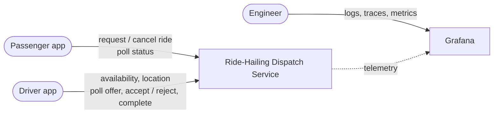
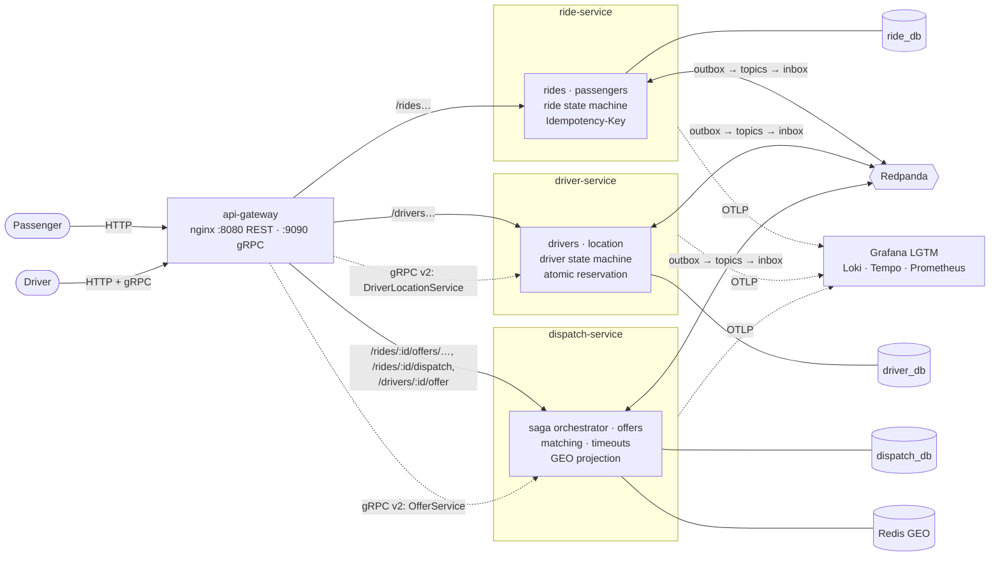
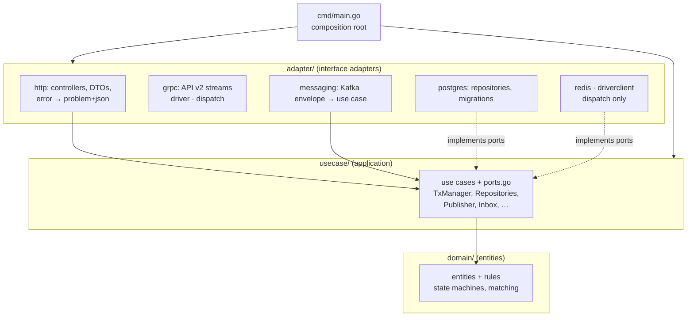
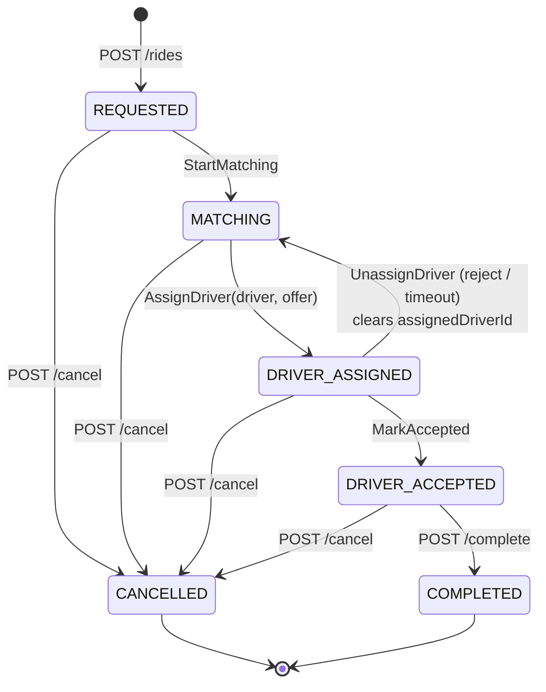
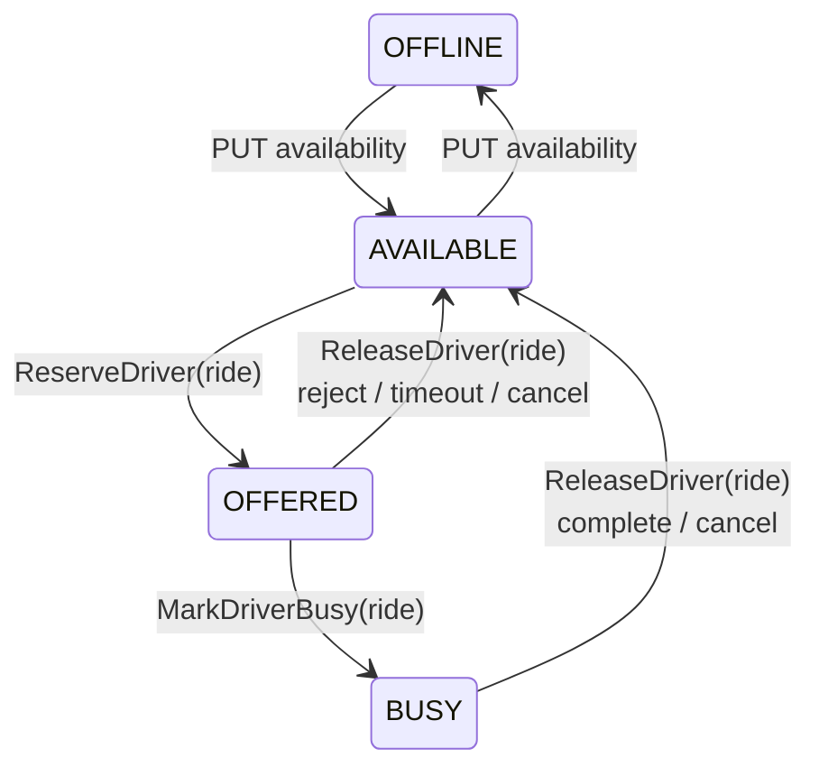
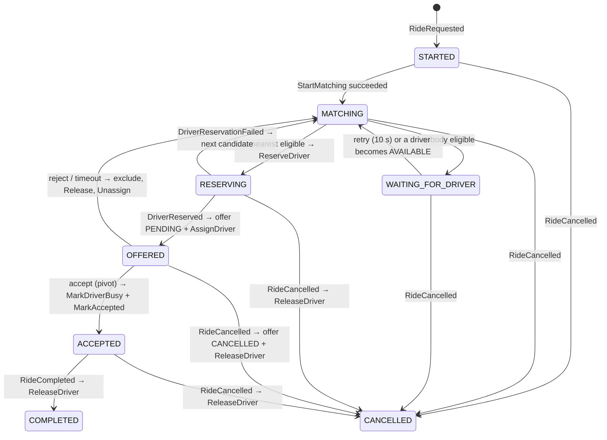
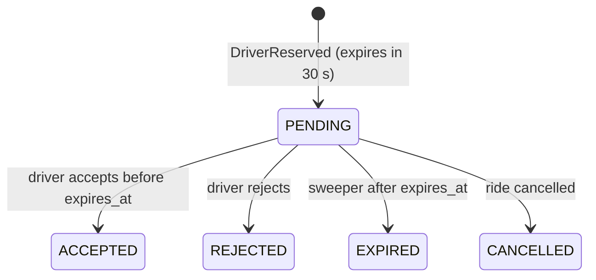
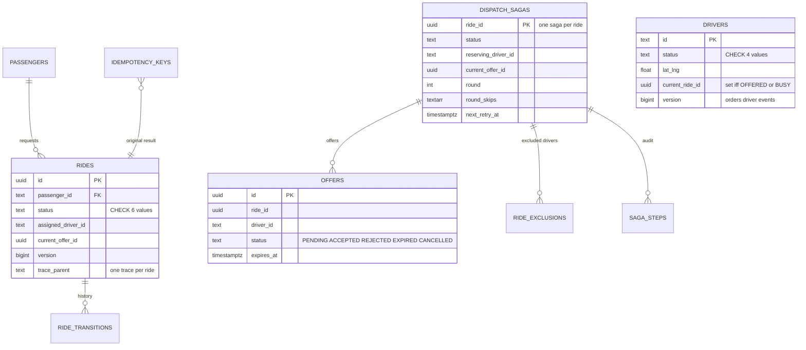

# Architecture

How the Ride-Hailing Dispatch Service is built: from the system context down to the code. Every choice links to an ADR that explains why it was chosen. Every requirement is traced to code and tests in [requirements-traceability.md](requirements-traceability.md).

**Contents:**
1. [Goals and constraints](#1-goals-and-constraints)
2. [System context (C4 level 1)](#2-system-context-c4-level-1)
3. [Containers (C4 level 2)](#3-containers-c4-level-2)
4. [Inside a service: Clean Architecture (C4 level 3)](#4-inside-a-service-clean-architecture-c4-level-3)
5. [Glossary](#5-glossary)
6. [Public API](#6-public-api)
7. [State machines](#7-state-machines)
8. [The dispatch saga](#8-the-dispatch-saga)
9. [Messaging: topics, message catalogue, envelope](#9-messaging-topics-message-catalogue-envelope)
10. [Data model](#10-data-model)
11. [Consistency, concurrency and idempotency](#11-consistency-concurrency-and-idempotency)
12. [Failure modes and recovery](#12-failure-modes-and-recovery)
13. [Decisions at a glance](#13-decisions-at-a-glance)
14. [Repository layout](#14-repository-layout)
15. [Known limitations](#15-known-limitations)

The design patterns used (saga, outbox, inbox, compare-and-set, …) are explained one by one in [patterns.md](patterns.md).

---

## 1. Goals and constraints

| Goal | How the architecture meets it |
|---|---|
| Never assign one driver to two rides (AC-09) | The owner of a driver row decides with one atomic SQL statement ([§11](#11-consistency-concurrency-and-idempotency)) |
| Survive duplicates and crashes (AC-08, AC-10) | Transactional outbox + inbox; idempotent state machines ([ADR-004](adr/ADR-004-messaging-outbox-inbox.md)) |
| Explicit, valid ride lifecycle (AC-06) | Pure state machines in each service's domain layer ([§7](#7-state-machines)) |
| Rematch, exclusions, timeouts (AC-05, AC-07) | One orchestrated saga per ride ([§8](#8-the-dispatch-saga)) |
| "What happened to ride R001?" | One trace and correlated logs per ride ([observability.md](observability.md)) |
| Evolve to 1M drivers | Location path isolated in its own service; GEO index as a disposable projection ([scalability.md](scalability.md)) |

Team constraints: microservices + saga (T1), Go (T2), observability (T3), everything in Docker on Colima (T4), Redis GEO + Redpanda + PostgreSQL (T5), docs in `docs/` (T6). See [requirements-traceability.md §3](requirements-traceability.md#3-team-constraints).

## 2. System context (C4 level 1)



* **Passengers** request a ride, poll its status, and may cancel.
* **Drivers** go online or offline, send their location, poll for an offer, accept or reject it, and complete the ride.
* **Engineers** investigate any ride by `rideId`, `driverId`, `eventId` or `traceId`.

Out of scope (challenge §7): payments, pricing, authentication, registration, mobile push notifications, ETA, multi-region, Kubernetes. (Offers can be pushed to a connected driver app through the gRPC v2 stream.)

## 3. Containers (C4 level 2)



| Container | Technology | Responsibility | Requirements |
|---|---|---|---|
| api-gateway | nginx 1.29 | REST on `:8080` (routes by path, hides `/internal/*`, serves `/docs/` and `/openapi.yaml`); gRPC on `:9090` (routes by gRPC service) | Spec endpoints span two services |
| swagger-ui | Swagger UI 5 | Renders `api/openapi.yaml` at `/docs/` behind the gateway | API documentation |
| ride-service | Go | Ride lifecycle, passengers, Idempotency-Key, status history | AC-01, AC-06, AC-08 |
| driver-service | Go | Driver status and location; **atomic reservation** | AC-02, AC-03, AC-09 |
| dispatch-service | Go | Saga orchestrator, offers, exclusions, timeouts, matching, GEO projection | AC-04, AC-05, AC-07, AC-10 |
| PostgreSQL 18 | 1 server, 3 databases, 3 users | Source of truth; row locks, conditional updates, outbox/inbox | AC-06, AC-08, AC-09 |
| Redis 8 | GEO sorted set + hashes | Nearest-driver index (read model, rebuildable) | AC-03, AC-04 |
| Redpanda 26 | Kafka API | Commands, replies, events; per-key ordering, replay | AC-10 |
| Grafana LGTM | OTel Collector, Loki, Tempo, Prometheus | Logs, traces, metrics | Observability |

**Why three services and not a monolith?** This is a team learning goal (T1). The split follows aggregates that change and scale differently: rides (low write rate), drivers (location: up to 250k writes/s at 1M drivers) and dispatch (coordination). A modular monolith would be enough at 1,000 drivers. More in [ADR-006](adr/ADR-006-service-architecture.md).

**Data ownership:** each service writes only its own database, and services never read each other's tables. The only synchronous internal call is dispatch-service → `GET /internal/drivers`, used to rebuild the GEO index.

## 4. Inside a service: Clean Architecture (C4 level 3)

Every service has the same rings ([ADR-012](adr/ADR-012-clean-architecture.md)). Dependencies point inward only, and [test/arch](../test/arch/arch_test.go) enforces this on every `make test`.



| Ring | ride-service | driver-service | dispatch-service |
|---|---|---|---|
| **domain** | `Ride`, `Apply(ride, action)` state machine, `NewRide` validation | `Driver`, `SetAvailability`/`Reserve`/`MarkBusy`/`Release` rules | `Saga`, `Offer`, `Step`; `SelectNearest` matching |
| **usecase** | `CreateRide` (idempotent), `Cancel`, `Complete`, `HandleCommand` | `SetAvailability`, `UpdateLocation`, `HandleCommand` (reserve / busy / release) | `Orchestrator` (saga), `Accept`/`Reject`, `SweepExpired`, `RetryAndResume`, `Projection` |
| **ports** | `RideRepository`, `PassengerRepository`, `IdempotencyStore`, `TxManager`, `Publisher`, `Inbox` | `DriverRepository` (`ReserveIfAvailable`, `MarkBusyIfOffered`, `ReleaseIfHeld`, `SetStatusIf`), `TxManager`, `Publisher`, `Inbox` | `SagaRepository`, `OfferRepository`, `ExclusionRepository`, `CandidateSource`, `GeoIndex`, `DriverDirectory`, `TxManager`, `Publisher`, `Inbox` |
| **adapters** | http, messaging, postgres | http, grpc, messaging, postgres | http, grpc, messaging, postgres, redis, driverclient |

**One transaction across rings.** A use case calls `Tx.WithinTx(ctx, fn)`. Repositories and the outbox join the transaction carried in `ctx`, so "lock row → domain decides → write state + history + outbox" commits atomically while the use case never imports pgx.

## 5. Glossary

| Term | Meaning |
|---|---|
| **Ride** | A passenger's trip request and its lifecycle (`REQUESTED` … `COMPLETED`/`CANCELLED`) |
| **Offer** (RideOffer) | One ride proposed to one driver; `PENDING` for 30 s, then `ACCEPTED`, `REJECTED`, `EXPIRED` or `CANCELLED` |
| **Saga** | dispatch-service's state for one ride: which step it is in, which driver is being reserved or offered, the current round |
| **Reservation** | driver-service atomically moving a driver `AVAILABLE → OFFERED` for one ride (`ReserveDriver`) |
| **Exclusion** | A driver who rejected or timed out on a ride; never offered that ride again |
| **Round skip** | A driver lost to another ride during this matching round (not an exclusion; may be retried later) |
| **Pivot** | Offer accepted: the point after which the saga never compensates, only moves forward |
| **Compensation** | Undoing a completed step: release a driver, unassign a ride |
| **Outbox / Inbox** | Tables that make publishing atomic with a state change / make consuming idempotent |
| **Projection** | The Redis GEO index of available drivers, built from driver events (read model) |
| **Command / Reply / Event** | Orchestrator → participant request / participant → orchestrator answer / fact published by the owner of the data |

## 6. Public API

All traffic goes through the gateway: **REST (v1) on `:8080`** and **gRPC (v2) on `:9090`**. REST errors use RFC 9457 `application/problem+json` with a stable `code` ([ADR-010](adr/ADR-010-api-and-identifiers.md)).

**Contracts:** REST is specified in [api/openapi.yaml](../api/openapi.yaml) (OpenAPI 3.0; browse it at **http://localhost:8080/docs/**, checked against the running API by `TestRESTResponsesMatchOpenAPI`); gRPC in [api/proto](../api/proto/). The tables below summarise them.

### REST (v1)

| Method & path | Owner | Success | Errors | AC |
|---|---|---|---|---|
| `POST /rides` + `Idempotency-Key` | ride | `201` ride in `REQUESTED` (with `traceId`). Same key + same body → `201` original ride, `Idempotent-Replayed: true` | `400 IDEMPOTENCY_KEY_REQUIRED`, `400 INVALID_JSON`, `422 PASSENGER_REQUIRED`, `422 UNKNOWN_PASSENGER`, `422 INVALID_COORDINATES`, `422 IDEMPOTENCY_KEY_REUSED` | 01, 08 |
| `GET /rides/{rideId}` | ride | `200` ride | `404 RIDE_NOT_FOUND` | 01 |
| `GET /rides/{rideId}/history` | ride | `200` every status change | `404` | 06 |
| `POST /rides/{rideId}/cancel` | ride | `200` `CANCELLED` (repeat → `200`) | `409 INVALID_TRANSITION` | 05, 06 |
| `POST /rides/{rideId}/complete` | ride | `200` `COMPLETED` (repeat → `200`) | `409 INVALID_TRANSITION` | 05, 06 |
| `PUT /drivers/{driverId}/availability` `{"status":"AVAILABLE"\|"OFFLINE"}` | driver | `200` driver | `409 INVALID_TRANSITION` (OFFERED/BUSY), `422 INVALID_STATUS`, `404` | 02 |
| `PUT /drivers/{driverId}/location` `{"latitude","longitude"}` | driver | `200` driver | `422 INVALID_COORDINATES`, `404` | 03 |
| `GET /drivers/{driverId}` | driver | `200` driver | `404` | 02, 03 |
| `GET /drivers/{driverId}/offer` | dispatch | `200` pending offer, or `204` | — | 05 |
| `POST /rides/{rideId}/offers/{driverId}/accept` | dispatch | `200 {offerId, status:"ACCEPTED"}` (repeat → `200` + `Idempotent-Replayed`) | `404 OFFER_NOT_FOUND`, `409 OFFER_NOT_CURRENT`, `409 OFFER_EXPIRED` | 05, 08 |
| `POST /rides/{rideId}/offers/{driverId}/reject` | dispatch | `200 {status:"REJECTED"}` (repeat → `200`) | same as accept | 05, 07 |
| `GET /rides/{rideId}/dispatch` | dispatch | `200` saga, offers, exclusions, steps | `404 SAGA_NOT_FOUND` | observability |

**Accept is synchronous on the offer and eventual on the ride.** `200 ACCEPTED` means the offer row changed (the pivot). The ride shows `DRIVER_ACCEPTED` and the driver `BUSY` a few milliseconds later, once the saga's commands are processed.

### gRPC (v2): two driver-app APIs as streams

Version 2 exists only where a stream is better than request/response. Both call the **same use cases** as their REST version, so validation, state machines, events and errors are identical. Contracts: [api/proto](../api/proto/). Decision and comparison: [ADR-010 Part 6](adr/ADR-010-api-and-identifiers.md#part-6-grpc-api-v2-for-two-driver-app-apis).

| RPC (gateway `:9090`) | Replaces (v1) | Shape | Behaviour | AC |
|---|---|---|---|---|
| `ridehail.driver.v2.DriverLocationService/StreamLocations` | `PUT /drivers/{driverId}/location` | Bidirectional stream: `LocationUpdate` in, `LocationAck` out | Each update is applied like the REST call and acknowledged with the new `version`; an invalid one gets `accepted=false` + `INVALID_COORDINATES` / `DRIVER_NOT_FOUND` and the stream stays open | 03 |
| `ridehail.dispatch.v2.OfferService/WatchOffers` | polling `GET /drivers/{driverId}/offer` | Server stream: `WatchOffersRequest` in, `OfferEvent` out | `OFFERED` when an offer is waiting, `CLOSED` (with final status) when it is accepted, rejected, expired or cancelled, `HEARTBEAT` every 15 s. Drivers still answer with REST accept/reject | 05 |

Try them: `make grpc-offers DRIVER=D001` and `make grpc-location DRIVER=D010` (grpcurl).

### Internal endpoints

Not exposed by the gateway: `GET /internal/drivers`, `PUT /internal/drivers/{id}` (test/demo fixtures), `POST /internal/geo/rebuild`.

## 7. State machines

All three are pure functions in the domain ring and unit-tested in every direction: valid, invalid, duplicate, terminal.

### Ride: [services/ride/internal/domain/ride.go](../services/ride/internal/domain/ride.go)



`Apply(ride, action) → (next, changed, err)`:

* **valid:** new state, `changed=true`; persisted with the history row and events in one transaction;
* **duplicate:** already in the target state with the same driver/offer (or a stale command for an older offer): `changed=false`, no error, no event;
* **invalid:** for example `COMPLETED → DRIVER_ASSIGNED`: `ErrInvalidTransition` → HTTP `409` or a `CommandRejected` reply.

### Driver: [services/driver/internal/domain/driver.go](../services/driver/internal/domain/driver.go)



`OFFERED` and `BUSY` cannot go `OFFLINE`. Every saga command carries `rideId` and applies only while the driver holds that ride, so a late `ReleaseDriver(R1)` never frees a driver now serving R2.

### Dispatch saga and offer: [services/dispatch/internal/usecase/orchestrator.go](../services/dispatch/internal/usecase/orchestrator.go)





Each offer transition is one conditional `UPDATE … WHERE status='PENDING'`: accept, reject, timeout and cancel race on the same row, and exactly one wins.

## 8. The dispatch saga

**Orchestration** ([ADR-003](adr/ADR-003-saga-orchestration.md)): the flow has a loop (rematch), a timer (30 s) and compensations, so one coordinator owns it.

| # | Step | Participant | Kind | Compensation |
|---|---|---|---|---|
| 1 | `StartMatching` → ride `MATCHING` | ride | compensatable | cancel |
| 2 | Nearest eligible candidate from Redis GEO + `SelectNearest` | dispatch | read-only | — |
| 3 | `ReserveDriver` → driver `AVAILABLE → OFFERED` (atomic) | driver | compensatable | `ReleaseDriver` |
| 4 | Offer `PENDING` (30 s) + `AssignDriver` → ride `DRIVER_ASSIGNED` | dispatch + ride | compensatable | offer `REJECTED/EXPIRED/CANCELLED` + `UnassignDriver` |
| 5 | **Driver accepts → offer `ACCEPTED`** | dispatch | **pivot** | — |
| 6 | `MarkDriverBusy` + `MarkAccepted` | driver + ride | retriable | — |
| 7 | Completed / cancelled → `ReleaseDriver` | driver | retriable | — |

Background workers in dispatch-service (each pass runs every 1 s; they use `FOR UPDATE SKIP LOCKED`, so they are safe with replicas):

* **Timeout sweeper:** expires offers past `expires_at`, using the same path as a rejection.
* **Retrier:** moves `WAITING_FOR_DRIVER` sagas back to matching when they are due.
* **Resumer:** re-sends the last command of a saga with no reply for 30 s; participants are idempotent.

Every flow and race is drawn in [sequence-diagram.md](sequence-diagram.md).

## 9. Messaging: topics, message catalogue, envelope

| Topic | Key (ordering) | Producer → consumer |
|---|---|---|
| `ride.events.v1` | `rideId` | ride → dispatch |
| `driver.events.v1` | `driverId` | driver → dispatch (GEO projection) |
| `ride.commands.v1` | `rideId` | dispatch → ride |
| `driver.commands.v1` | `driverId` | dispatch → driver |
| `dispatch.replies.v1` | `rideId` | ride, driver → dispatch |
| `<topic>.dlq` | same | any consumer, after 5 failed attempts |

| Message | Kind | Topic | Payload | Consumer's effect |
|---|---|---|---|---|
| `RideRequested` | event | ride.events | passengerId, pickup, destination | create saga (PK = rideId) → `StartMatching` |
| `RideStatusChanged` | event | ride.events | from, to, action, driverId | informational (logs, future consumers) |
| `RideCancelled` | event | ride.events | from, to, driverId | saga compensates: cancel offer, release driver |
| `RideCompleted` | event | ride.events | from, to, driverId | `ReleaseDriver` |
| `DriverStatusChanged` | event | driver.events | status, lat, lng, **version**, currentRideId | GEO index update; `AVAILABLE` wakes waiting sagas |
| `DriverLocationUpdated` | event | driver.events | status, lat, lng, **version** | GEO index update (latest location) |
| `StartMatching` | command | ride.commands | — | `REQUESTED → MATCHING` |
| `AssignDriver` | command | ride.commands | driverId, offerId | `MATCHING → DRIVER_ASSIGNED` |
| `UnassignDriver` | command | ride.commands | offerId | `DRIVER_ASSIGNED → MATCHING`, clear driver |
| `MarkAccepted` | command | ride.commands | offerId | `DRIVER_ASSIGNED → DRIVER_ACCEPTED` |
| `ReserveDriver` | command | driver.commands | rideId, offerId | atomic `AVAILABLE → OFFERED` |
| `MarkDriverBusy` | command | driver.commands | rideId | `OFFERED → BUSY` |
| `ReleaseDriver` | command | driver.commands | rideId | `OFFERED/BUSY → AVAILABLE` if still holding the ride |
| `CommandSucceeded` / `CommandRejected` | reply | dispatch.replies | command, commandEventId, reason | saga advances / compensates |
| `DriverReserved` / `DriverReservationFailed` | reply | dispatch.replies | command, commandEventId | create offer / try next candidate |

Envelope ([pkg/messaging/envelope.go](../pkg/messaging/envelope.go)):

```json
{
  "eventId": "01a19673-…",            // UUIDv7, the dedup key (inbox)
  "type": "ReserveDriver", "schemaVersion": 1, "occurredAt": "2026-11-01T09:31:29.10Z",
  "correlationId": "<rideId>",        // always the ride
  "causationId": "<eventId that caused this message>",
  "rideId": "…", "driverId": "D003", "offerId": "…",
  "payload": { }
}
```

Kafka headers carry `type` and the W3C `traceparent`, so one trace follows the ride across every hop.

## 10. Data model



| Database | Table | Key constraints / indexes | Why |
|---|---|---|---|
| ride_db | `rides` | PK `id`; `CHECK status IN (…)`; lat/lng range checks | lifecycle, validation in depth |
| ride_db | `ride_transitions` | `(ride_id, id)` | durable status history (`GET /rides/{id}/history`) |
| ride_db | `idempotency_keys` | PK `key`; stores request hash + original response | AC-01/AC-08 replay |
| driver_db | `drivers` | `CHECK ((status IN ('OFFERED','BUSY')) = (current_ride_id IS NOT NULL))` | a driver holds a ride iff engaged |
| dispatch_db | `dispatch_sagas` | PK `ride_id`; partial index on active statuses | one saga per ride; workers |
| dispatch_db | `offers` | **`UNIQUE (driver_id) WHERE status='PENDING'`**, **`UNIQUE (ride_id) WHERE status='PENDING'`**, index on `expires_at` where pending | AC-09 defence in depth; sweeper |
| dispatch_db | `ride_exclusions` | PK `(ride_id, driver_id)` | AC-07 permanent exclusion |
| dispatch_db | `saga_steps` | `(ride_id, id)` | audit ("what happened") |
| every db | `outbox`, `inbox` | outbox `event_id UNIQUE`; inbox PK `(consumer, event_id)` | ADR-004 |

Redis (owned by dispatch-service, rebuildable, no persistence): `geo:drivers:available` (GEO set, AVAILABLE drivers only) and `driver:{id}` (hash: status, lat, lng, version). A Lua script applies an event only when its version is newer.

Migrations are embedded in each service ([ride](../services/ride/internal/adapter/postgres/migrations), [driver](../services/driver/internal/adapter/postgres/migrations), [dispatch](../services/dispatch/internal/adapter/postgres/migrations), [outbox/inbox](../pkg/broker/schema)) and applied at start-up under an advisory lock. Seeds: passengers P001–P010; drivers D001–D010 AVAILABLE ~220 m apart going north of Ben Thanh; D011–D020 OFFLINE.

## 11. Consistency, concurrency and idempotency

| Concern | Mechanism | Detail |
|---|---|---|
| Consistency model | Strong inside a service (one Postgres transaction); eventual across services (milliseconds) | [ADR-003](adr/ADR-003-saga-orchestration.md) |
| **Two rides, one driver** | `UPDATE drivers SET status='OFFERED' … WHERE id=$d AND status='AVAILABLE'`: the row lock serialises racers, the loser updates 0 rows → `DriverReservationFailed` → next candidate | [ADR-002](adr/ADR-002-concurrency.md) |
| Accept vs reject vs timeout vs cancel | `UPDATE offers … WHERE status='PENDING'` (+ `expires_at > now()` for accept) | exactly one wins |
| Ride transitions | `SELECT … FOR UPDATE`, then the domain state machine | concurrent cancel/assign serialise |
| Lock ordering | Always saga → offer | no deadlocks between accept, reject, sweeper |
| Defence in depth | Partial unique indexes on pending offers; `CHECK` on drivers; per-driver Kafka key | |
| **Ride creation idempotency** | `Idempotency-Key` row inserted first, in the ride's transaction; stores hash + response | concurrent duplicates block on the PK, then replay |
| Message idempotency | Inbox row in the handler's transaction; saga PK = `rideId`; state machines treat repeats as no-ops; `rideId`/`offerId` guards on commands; versioned GEO updates | [ADR-004](adr/ADR-004-messaging-outbox-inbox.md) |
| Acceptance idempotency | Repeat accept finds the offer already `ACCEPTED` by the same driver → `200`, no new commands | |

## 12. Failure modes and recovery

| Failure | What happens | Passenger/driver sees | Recovery | Verified by |
|---|---|---|---|---|
| Crash after DB commit, before publish | Message is safe in the outbox | Small delay | Relay publishes after restart | design (outbox) |
| Crash after publish, before marking published | Same `eventId` published twice | Nothing | Consumer inbox skips the duplicate | `TestDuplicate*` tests |
| Message delivered twice | Inbox conflict → skipped | Nothing | — | `TestDuplicateCommandIsProcessedOnce`, `TestDuplicateRideRequestedStartsOneSaga` |
| Handler error (DB down, bug) | Transaction rolls back; offset not committed; 5 retries with backoff + jitter, then `<topic>.dlq` + `ERROR` log | Ride waits in its state | Fix, `make replay-dlq TOPIC=…` | design (consumer) |
| dispatch-service down | Commands and events wait in Redpanda | Ride stays `REQUESTED` | Consumers resume; sweeper expires stale offers | manual drill ([local-development.md](local-development.md#5-watch-with-lazydocker)) |
| Lost reply (participant crashed mid-flight) | Saga stuck in `STARTED`/`RESERVING` | Delay | Resumer re-sends after 30 s (idempotent) | design (`RetryAndResume`) |
| Redpanda down | Writes still accepted (outbox grows) | Dispatch pauses | Relay drains when back | design |
| Redis empty / down | No candidates → `WAITING_FOR_DRIVER` | Ride stays `MATCHING` | Rebuild on start or `make rebuild-geo` | design |
| Stale Redis candidate | Reservation fails (conditional update) → next candidate | +1 round-trip | — | `TestTwoRidesCannotOfferTheSameDriver` |
| Driver never answers | Sweeper expires the offer at 30 s | Rematch | — | `TestTimeoutIsTreatedAsRejection`, e2e `TestOfferTimeoutRematches` |
| Accept racing timeout or cancel | One conditional update wins; the saga releases the driver if the ride was cancelled | Consistent end state | — | `TestAcceptRacingTimeoutHasOneWinner`, `TestCancelReleasesTheOfferedDriver` |
| Restarted consumer | Leaves its group cleanly (`AllowRebalance` before `Close`); 10 s session timeout for crashes | Seconds of delay | — | manual drill |

## 13. Decisions at a glance

| # | Decision | Chosen | Main alternative | ADR |
|---|---|---|---|---|
| 1 | Matching | Greedy nearest, Haversine in Go, Redis GEO projection | PostGIS | [001](adr/ADR-001-matching.md) |
| 2 | Concurrency | Atomic conditional updates + row locks + partial unique indexes | Distributed lock (Redlock) | [002](adr/ADR-002-concurrency.md) |
| 3 | Cross-service consistency | Orchestrated saga, hand-rolled | Choreography; Temporal | [003](adr/ADR-003-saga-orchestration.md) |
| 4 | Reliable messaging | Outbox (polling) + inbox, at-least-once | CDC (Debezium) | [004](adr/ADR-004-messaging-outbox-inbox.md) |
| 5 | Observability | OpenTelemetry → Grafana LGTM, slog text logs, one trace per ride | ELK | [005](adr/ADR-005-observability.md) |
| 6 | Architecture style | 3 microservices by aggregate, DB per service | Modular monolith | [006](adr/ADR-006-service-architecture.md) |
| 7 | Language and libraries | Go 1.27, `net/http`, pgx, franz-go, go-redis | Java + Spring Boot | [007](adr/ADR-007-language-and-libraries.md) |
| 8 | Data stores | PostgreSQL 18, Redis 8 | MySQL | [008](adr/ADR-008-data-stores.md) |
| 9 | Broker | Redpanda | Apache Kafka | [009](adr/ADR-009-message-broker.md) |
| 10 | API and ids | REST + problem+json (v1), gRPC streams for location and offers (v2), Idempotency-Key in Postgres, UUIDv7 | WebSocket; UUIDv4 | [010](adr/ADR-010-api-and-identifiers.md) |
| 11 | Testing | Unit + fakes + testcontainers + e2e + Postman + architecture test | Mocks | [011](adr/ADR-011-testing-strategy.md) |
| 12 | Code structure | Clean Architecture per service | 3-layer | [012](adr/ADR-012-clean-architecture.md) |

## 14. Repository layout

```
.github/workflows/cc3-kvp.yml   CI at the repository root: lint ∥ test → e2e (see testing.md)
coding-challenge-3/kvp/
├── README.md · Makefile · docker-compose.yml · Dockerfile · go.mod · .golangci.yml (lint rules)
├── api/                  openapi.yaml REST contract (v1) · proto/ gRPC contracts (v2) · gen/ generated Go code
├── deploy/                 nginx gateway · Postgres init (3 DBs) · Grafana dashboard
├── pkg/                    shared outer-ring code, no business rules
│   ├── geo/                Point, validation, Haversine (pure)
│   ├── messaging/          message contract: envelope, topics, types (pure)
│   ├── broker/             outbox + relay, inbox, Kafka consumer (retry, DLQ), topic admin
│   ├── pgutil/             connect, migrations, TxManager (transaction in ctx)
│   ├── obs/ · obs/otelsetup/   correlation + one trace per ride (OTel API) · SDK/exporters
│   ├── httpx/ · grpcx/     HTTP helpers (problem+json, access log) · gRPC server (tracing, logging, health)
│   ├── svc/                service bootstrap (HTTP + optional gRPC server)
│   └── testpg/             Postgres testcontainer for integration tests
├── services/{ride,driver,dispatch}/
│   ├── cmd/main.go         composition root
│   └── internal/{domain, usecase, adapter/…}
├── test/arch/              architecture (dependency rule) tests
├── test/e2e/               black-box tests against the running stack
├── postman/                Postman collection (happy path + one folder per AC)
├── scripts/                demo · trace-ride · trace-logs · replay-dlq · gen-postman
└── docs/                   this documentation
```

## 15. Known limitations

| Area | Limitation | Impact | Next step |
|---|---|---|---|
| Consistency | Accept is synchronous on the offer, eventual on the ride: `200 ACCEPTED` is the saga's pivot, and the ride and driver statuses follow within milliseconds | A client reading the ride right after accepting may still see `DRIVER_ASSIGNED` | Return the expected final state, or let clients wait for `DRIVER_ACCEPTED` |
| Driver experience | REST clients poll `GET /drivers/{id}/offer`; the gRPC `WatchOffers` stream pushes, but inside dispatch-service each stream still checks the database every 500 ms; no mobile push when the app is closed | Up to 0.5 s offer latency on v2; one indexed read per open stream per tick | Postgres `LISTEN/NOTIFY` or an offers topic to wake streams; mobile push (FCM/APNs) in production ([ADR-010](adr/ADR-010-api-and-identifiers.md)) |
| Waiting rides | A ride with no eligible driver waits in `MATCHING` until cancelled; no max-wait auto-cancel | Rides can wait forever | Auto-cancel after a configurable time |
| Messaging | One outbox relay per service instance: per-key ordering assumes a single instance | Replicas could publish out of order | Relay leader election or CDC ([ADR-004](adr/ADR-004-messaging-outbox-inbox.md)) |
| Messaging | Transient outages longer than the retry budget (~10 s) send messages to the DLQ | Manual `make replay-dlq` needed | Retry topics with longer delays; alert on DLQ depth |
| Housekeeping | No cleanup jobs for inbox rows, published outbox rows or old idempotency keys | Tables grow without limit | Scheduled deletes or partition dropping by time |
| Geo index | Automatic rebuild only on dispatch start (otherwise `make rebuild-geo`); the Lua script is single-node, not Redis Cluster safe as written | A Redis loss at runtime leaves rides waiting until a rebuild | Rebuild on detected loss; hash tags for cluster mode ([scalability.md](scalability.md)) |
| Storage | Stage-1 storage: every location update is a Postgres write; one Postgres server hosts all three databases | Limits the location write rate (B1) | Location fast path, separate servers ([scalability.md](scalability.md)) |
| Security | No authentication; fixture endpoints (`/internal/*`) are reachable only on service ports, not via the gateway | Anyone with gateway access can act as any driver or passenger | Auth at the gateway (JWT), per-driver authorization |
| Operations | Not load-tested; alerts are documented but not wired | Capacity numbers are estimates | k6 load tests; Grafana alert rules ([observability.md](observability.md)) |
