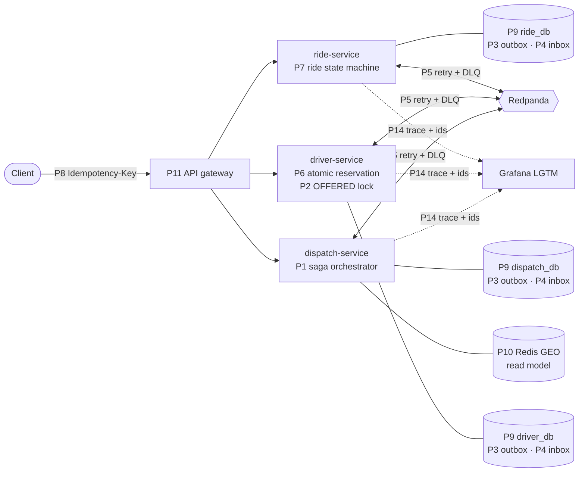

# Design patterns

This document explains every design pattern the system uses: the problem it solves here, how it works, where the code is, what goes wrong without it, what it costs, and which tests prove it.

* **Related:** [architecture.md](architecture.md) (how the parts fit), [sequence-diagram.md](sequence-diagram.md) (the flows step by step), [ADRs](adr/README.md) (why each option was chosen over the alternatives)

## Contents

1. [Overview](#1-overview)
2. [Where the patterns sit](#2-where-the-patterns-sit)
3. **Distributed workflow**
   * [P1 Saga orchestration with compensations and a pivot](#p1-saga-orchestration-with-compensations-and-a-pivot)
   * [P2 Semantic locks](#p2-semantic-locks)
4. **Reliable messaging**
   * [P3 Transactional outbox](#p3-transactional-outbox)
   * [P4 Idempotent consumer (inbox)](#p4-idempotent-consumer-inbox)
   * [P5 Retry with exponential backoff + jitter, and a dead-letter queue](#p5-retry-with-exponential-backoff--jitter-and-a-dead-letter-queue)
5. **Correctness under concurrency and duplicates**
   * [P6 Compare-and-set in SQL](#p6-compare-and-set-in-sql)
   * [P7 Explicit state machines](#p7-explicit-state-machines)
   * [P8 Idempotency key with stored response](#p8-idempotency-key-with-stored-response)
6. **Data ownership and reads**
   * [P9 Database per service](#p9-database-per-service)
   * [P10 CQRS-style read model (GEO projection)](#p10-cqrs-style-read-model-geo-projection)
   * [P11 API gateway](#p11-api-gateway)
7. **Code structure**
   * [P12 Clean Architecture: ports, adapters and a composition root](#p12-clean-architecture-ports-adapters-and-a-composition-root)
   * [P13 Unit of work via a transaction port](#p13-unit-of-work-via-a-transaction-port)
8. **Observability**
   * [P14 Correlation/causation ids and one trace per long-running journey](#p14-correlationcausation-ids-and-one-trace-per-long-running-journey)
9. [How the patterns work together: one driver accepts](#9-how-the-patterns-work-together-one-driver-accepts)
10. [Patterns we considered and did not use](#10-patterns-we-considered-and-did-not-use)

---

## 1. Overview

| # | Pattern | Problem it solves here | Main code | Requirement | Decision | Proof |
|---|---|---|---|---|---|---|
| P1 | Saga orchestration + compensations + pivot | A ride spans three services and databases; no shared transaction | [orchestrator.go](../services/dispatch/internal/usecase/orchestrator.go), [offers.go](../services/dispatch/internal/usecase/offers.go) | AC-05, AC-07, AC-10 | [ADR-003](adr/ADR-003-saga-orchestration.md) | `TestRejectionRematchesAndExcludesTheDriverForever`, `TestCancelReleasesTheOfferedDriver` |
| P2 | Semantic locks | Other sagas must see "this driver/ride is taken" before the saga finishes | driver `OFFERED`, ride `DRIVER_ASSIGNED` | AC-02, AC-09 | [ADR-002](adr/ADR-002-concurrency.md) | `TestTwoRidesCannotOfferTheSameDriver` |
| P3 | Transactional outbox | Writing to Postgres and Redpanda separately can lose or invent events | [pkg/broker/outbox.go](../pkg/broker/outbox.go) | AC-10 | [ADR-004](adr/ADR-004-messaging-outbox-inbox.md) | `TestEveryChangeEmitsVersionedEvent`, crash drill |
| P4 | Idempotent consumer (inbox) | Redpanda delivers at least once, so copies arrive | [pkg/broker/outbox.go](../pkg/broker/outbox.go) `Claim` | AC-08 | [ADR-004](adr/ADR-004-messaging-outbox-inbox.md) | `TestDuplicateCommandIsProcessedOnce` |
| P5 | Retry + backoff + jitter + DLQ | Transient failures vs poison messages | [pkg/broker/consumer.go](../pkg/broker/consumer.go) | AC-10 | [ADR-004](adr/ADR-004-messaging-outbox-inbox.md) | Manual crash drill; DLQ metrics |
| P6 | Compare-and-set in SQL | Two rides race for one driver; accept races timeout | driver and dispatch postgres adapters | AC-05, AC-09 | [ADR-002](adr/ADR-002-concurrency.md) | `TestConcurrentReservationOnlyOneWins` (50 rounds), `TestAcceptRacingTimeoutHasOneWinner` |
| P7 | Explicit state machines | Invalid or repeated transitions | [ride.go](../services/ride/internal/domain/ride.go), [driver.go](../services/driver/internal/domain/driver.go), [saga.go](../services/dispatch/internal/domain/saga.go) | AC-02, AC-06, AC-08 | [ADR-002](adr/ADR-002-concurrency.md) | `TestInvalidTransitions`, `TestDuplicateTransitionsAreNoOps` |
| P8 | Idempotency key + stored response | A client retries `POST /rides` after a timeout | [rides.go](../services/ride/internal/usecase/rides.go) `CreateRide` | AC-01, AC-08 | [ADR-010](adr/ADR-010-api-and-identifiers.md) | `TestConcurrentDuplicateCreationCreatesOneRide` |
| P9 | Database per service | Services must change and scale independently | `ride_db`, `driver_db`, `dispatch_db` | Team constraint T1 | [ADR-006](adr/ADR-006-service-architecture.md), [ADR-008](adr/ADR-008-data-stores.md) | `test/arch` (no cross-service imports) |
| P10 | CQRS-style read model | Nearest-driver search must be fast and not load the reservation rows | [projection.go](../services/dispatch/internal/usecase/projection.go), [redis.go](../services/dispatch/internal/adapter/redis/redis.go) | AC-03, AC-04 | [ADR-001](adr/ADR-001-matching.md) | `TestIndexKeepsOnlyLatestAvailableDrivers` |
| P11 | API gateway | One public address; internal endpoints hidden | [deploy/nginx.conf](../deploy/nginx.conf) | API surface | [ADR-006](adr/ADR-006-service-architecture.md) | e2e + Postman run through the gateway |
| P12 | Clean Architecture | Business logic testable without infrastructure | `services/*/internal/{domain,usecase,adapter}`, `cmd/main.go` | Maintainability | [ADR-012](adr/ADR-012-clean-architecture.md) | [test/arch](../test/arch/arch_test.go) |
| P13 | Unit of work via a transaction port | Lock + state + history + outbox must commit together, without pgx in use cases | [pkg/pgutil/pgutil.go](../pkg/pgutil/pgutil.go) `TxManager` | AC-08, AC-10 | [ADR-012](adr/ADR-012-clean-architecture.md) | `TestCreateRidePublishesRideRequested` |
| P14 | Correlation/causation ids + one trace per journey | "What happened to ride R001?" across services and minutes | [pkg/obs](../pkg/obs/), [envelope.go](../pkg/messaging/envelope.go) | Observability | [ADR-005](adr/ADR-005-observability.md) | `make trace-ride`, Tempo |

## 2. Where the patterns sit



Inside every service: **P12** decides where code lives and **P13** decides how a transaction crosses the layers.

---

## 3. Distributed workflow

### P1 Saga orchestration with compensations and a pivot

**Problem.** Dispatching a ride changes three databases: the ride (`ride_db`), the driver (`driver_db`) and the offer (`dispatch_db`). A distributed transaction (2PC) would lock rows in all three across network calls, and Redpanda cannot join one. The flow is also long: it loops over drivers, waits up to 30 s per offer, and can be cancelled at any point.

**Pattern.** A *saga* is a sequence of local transactions. Each one commits on its own and publishes a message that triggers the next. If a later step cannot go forward, earlier steps are undone by *compensating* transactions. In the *orchestrated* form, one component (the orchestrator) holds the state and tells the participants what to do.

**How it works here.**

* **Orchestrator:** dispatch-service. One `dispatch_sagas` row per ride (primary key `ride_id`) holds the status (`STARTED → MATCHING → RESERVING → OFFERED → ACCEPTED → COMPLETED`, or `WAITING_FOR_DRIVER`, `CANCELLED`), the current offer, the round and the ride's trace.
* **Participants:** ride-service and driver-service. They receive **commands** on `ride.commands.v1` and `driver.commands.v1` and answer with **replies** on `dispatch.replies.v1`.
* **Steps:**

| Step | Command → participant | Local transaction | Compensation if the saga cannot continue |
|---|---|---|---|
| 1 | `StartMatching` → ride | ride `REQUESTED → MATCHING` | ride → `CANCELLED` (passenger cancel) |
| 2 | `ReserveDriver` → driver | driver `AVAILABLE → OFFERED` (atomic, P6) | `ReleaseDriver` (driver → `AVAILABLE`) |
| 3 | (local) create offer | offer `PENDING`, 30 s deadline | offer → `CANCELLED` / `EXPIRED` / `REJECTED` |
| 4 | `AssignDriver` → ride | ride `MATCHING → DRIVER_ASSIGNED` | `UnassignDriver` (ride → `MATCHING`) |
| **5 (pivot)** | driver accepts | offer `PENDING → ACCEPTED` | **none: from here the saga only moves forward** |
| 6 | `MarkDriverBusy` → driver, `MarkAccepted` → ride | driver `BUSY`, ride `DRIVER_ACCEPTED` | retried until done (retriable steps) |
| 7 | ride completed → `ReleaseDriver` | driver `BUSY → AVAILABLE` | retried until done |

* **The pivot** is the accept. Before it, every step can be undone: a rejection or timeout runs `endOffer` (exclude the driver, `ReleaseDriver`, `UnassignDriver`, back to `MATCHING`) and the saga loops to the next driver. After it, the remaining steps are *retriable*: they cannot fail for business reasons, so they are re-sent until they succeed. Choosing the pivot made every failure case easy to answer: "before accept → compensate; after accept → retry".
* **Compensation on cancel** (`cancel()` in [orchestrator.go](../services/dispatch/internal/usecase/orchestrator.go)): looks at what the saga currently holds and undoes exactly that: in `RESERVING` it releases the driver being reserved; in `OFFERED` it cancels the pending offer and releases the driver. It is idempotent: cancelling a cancelled saga is a no-op, and a completed saga ignores it.
* **Unwanted results are compensated too:** if a `DriverReserved` reply arrives for a reservation the saga no longer wants (it was cancelled meanwhile), `onReserved` immediately sends `ReleaseDriver`.
* **Recovery workers** keep the saga moving when messages are lost or a service crashes ([offers.go](../services/dispatch/internal/usecase/offers.go)):
  * `SweepExpired`: expires `PENDING` offers past their deadline, then follows the rejection path.
  * `RetryAndResume`: retries `WAITING_FOR_DRIVER` sagas every 10 s, re-runs `MATCHING` sagas left by a crash, and re-sends the last command for sagas stuck in `STARTED` / `RESERVING` (safe, because commands are idempotent: P4, P7).
  * `WakeWaiting`: a driver becoming `AVAILABLE` wakes waiting sagas at once.
  * All of them lock with `FOR UPDATE SKIP LOCKED`, so several dispatch replicas can run them without blocking each other.
* **Audit trail:** every step writes a `saga_steps` row and one log line, so the saga explains itself.

**Without it.** Either 2PC (blocking, not supported by the broker) or each service reacting to others' events with no single owner of the loop, the timer and the compensation (choreography). With choreography, "who releases the driver when the passenger cancels during an offer?" has no single answer.

**Trade-offs.** We own the timers, retries and resume code (a workflow engine such as Temporal would provide them). The ride and driver are eventually consistent for a few milliseconds after each step. Compared options: [ADR-003](adr/ADR-003-saga-orchestration.md).

**Proof.** `TestNearestDriverGetsOfferAndAcceptMovesForward`, `TestRejectionRematchesAndExcludesTheDriverForever`, `TestTimeoutIsTreatedAsRejection`, `TestCancelReleasesTheOfferedDriver`, `TestCompletionReleasesTheDriver` ([orchestrator integration tests](../services/dispatch/internal/usecase/orchestrator_integration_test.go)); e2e `TestHappyPath`, `TestRejectRematchesToNextDriver`, `TestOfferTimeoutRematches`, `TestCancelReleasesOfferedDriver`.

### P2 Semantic locks

**Problem.** A saga is not one transaction, so its intermediate state is visible to everyone. Between "driver reserved" and "driver accepted", another saga could try to offer the same driver, and the passenger could cancel.

**Pattern.** A *semantic lock* is an application-level flag in the data that says "this record is in the middle of a saga; others must not use it". It is the saga version of a row lock, and it survives across transactions and crashes.

**How it works here.**

| Lock | Set by | Meaning for others | Released by |
|---|---|---|---|
| Driver `OFFERED` + `current_ride_id` | `ReserveDriver` (P6) | Not `AVAILABLE`: removed from the GEO read model, any other reservation gets 0 rows, cannot go `OFFLINE` | `ReleaseDriver(rideId)` or `MarkDriverBusy` |
| Driver `BUSY` + `current_ride_id` | `MarkDriverBusy` | Serving a ride; same effect | `ReleaseDriver(rideId)` on completion or cancel |
| Ride `DRIVER_ASSIGNED` + `current_offer_id` | `AssignDriver` | Only commands for *this* offer apply; a late `UnassignDriver` for an older offer is a no-op | `UnassignDriver(offerId)` or `MarkAccepted(offerId)` |
| Offer `PENDING` | offer creation | Only the offered driver can answer; at most one per driver and per ride (partial unique indexes) | accept / reject / timeout / cancel (P6) |

The locks carry an **owner** (`current_ride_id`, `current_offer_id`). A release only applies while the owner still matches, so a delayed `ReleaseDriver(R1)` can never free a driver who has since been reserved for R2. A database `CHECK` (`ride_held_iff_engaged`) guarantees a driver has a ride id exactly when `OFFERED` or `BUSY`.

**Without it.** Lost updates between sagas: two rides holding the same driver, or a stale release freeing a driver in the middle of another ride.

**Trade-offs.** A lock left behind by a crash must be released by recovery (the resumer and sweeper do this). Readers see intermediate states such as `DRIVER_ASSIGNED`, which is acceptable here and documented in the API.

**Proof.** `TestTwoRidesCannotOfferTheSameDriver`, `TestReleaseForAnotherRideIsIgnored`, `TestOfferedOrBusyCannotGoOffline`; e2e `TestConcurrentRidesCannotShareADriver`.

---

## 4. Reliable messaging

### P3 Transactional outbox

**Problem.** After creating a ride, ride-service must publish `RideRequested`. Writing to Postgres and then to Redpanda is a *dual write*: a crash between the two loses the event (the ride is never dispatched); publishing first and then failing the commit invents an event for a ride that does not exist.

**Pattern.** Write the outgoing message into an `outbox` table **in the same database transaction** as the state change. A separate *relay* reads committed outbox rows and publishes them.

**How it works here.**

1. A use case calls `Publisher.Publish(ctx, topic, key, envelope)`. The broker adapter `broker.Enqueue` inserts an `outbox` row in the transaction carried by `ctx` (P13), filling `eventId` (UUIDv7), `occurredAt`, `correlationId`, `causationId` and the W3C trace headers (P14).
2. The transaction commits: state, history and messages appear together, or none of them do.
3. The `Relay` (one goroutine per service) polls: `SELECT … FROM outbox WHERE published_at IS NULL ORDER BY id LIMIT 200 FOR UPDATE SKIP LOCKED`, produces the batch to Redpanda synchronously, then sets `published_at`.
4. Messages are keyed by `rideId` (ride topics) or `driverId` (driver topics), so everything about one ride or driver lands on one partition, in order.

```go
// usecase: one transaction, no Kafka call
err := u.Tx.WithinTx(ctx, func(ctx context.Context) error {
    r, err = u.Rides.Insert(ctx, r)                                  // state
    err = u.Rides.AddTransition(ctx, ...)                            // history
    _, err = u.Publisher.Publish(ctx, TopicRideEvents, r.ID, env)    // INSERT INTO outbox
    return err
})
```

**Without it.** Lost or phantom events, which here means rides that are never dispatched, or drivers who stay `OFFERED` forever.

**Trade-offs.** Delivery is **at-least-once**: if the relay crashes after producing and before marking the rows, they are published again. P4 makes that harmless. Polling adds up to one poll interval of latency and some database load; CDC (Debezium) would remove both. Per-key ordering assumes one relay per service (see [known limitations](architecture.md#15-known-limitations)).

**Proof.** `TestEveryChangeEmitsVersionedEvent`, `TestCreateRidePublishesRideRequested` (with fakes), and the manual kill/restart drill ([requirements traceability, AC-10](requirements-traceability.md#ac-10-event-driven-dispatch)).

### P4 Idempotent consumer (inbox)

**Problem.** The outbox and Redpanda both deliver at least once. A consumer can also crash after committing its work and before committing the Kafka offset. Without protection, a duplicate `RideRequested` starts a second saga, or a duplicate `ReserveDriver` sends a second reply.

**Pattern.** The consumer records each processed message id in an `inbox` table **in the same transaction** as its work. A message whose id is already there is skipped.

**How it works here.**

```go
// dispatch use case (orchestrator.go)
func (o *Orchestrator) inTx(ctx, eventID, fn) error {
    return o.Tx.WithinTx(ctx, func(ctx context.Context) error {
        fresh, err := o.Inbox.Claim(ctx, eventID) // INSERT INTO inbox(consumer, event_id) ON CONFLICT DO NOTHING
        if !fresh { log "duplicate message skipped"; return nil }
        return fn(ctx)                            // the real work, same transaction
    })
}
```

* The key is `(consumer, event_id)`, so the same message can be processed once by each consumer group.
* If `fn` fails, the inbox row rolls back with it and the message is retried (P5).
* **Second line of defence:** a copy re-published under a *new* event id (for example a re-sent command from the resumer) passes the inbox, but the domain still treats it as a duplicate: the saga's primary key is the ride id (`ON CONFLICT (ride_id) DO NOTHING`), state machines return "no change" for repeated transitions (P7), and driver commands check the owning `rideId` (P2).

**Without it.** Duplicate side effects: a second saga, a second offer, a status history with repeated rows.

**Trade-offs.** One extra insert per message, and the inbox grows (no cleanup job yet). The inbox only works when the handler's effects live in the same database as the inbox, which is true for all our consumers.

**Proof.** `TestDuplicateCommandIsProcessedOnce`, `TestDuplicateCommandIsAppliedAndRepliedOnce`, `TestDuplicateRideRequestedStartsOneSaga`.

### P5 Retry with exponential backoff + jitter, and a dead-letter queue

**Problem.** Some failures are transient (Postgres restarting, a lock timeout); some messages can never be processed (malformed JSON, a bug). Retrying forever blocks the partition behind a poison message; giving up immediately loses work during a short outage.

**Pattern.** Retry a bounded number of times with growing, randomised delays; then move the message to a *dead-letter queue* (DLQ) and continue with the next one.

**How it works here** ([consumer.go](../pkg/broker/consumer.go)):

* Up to **5 attempts**. The delay starts at 100 ms and doubles up to 5 s, plus a random **jitter** of up to half the delay, so many consumers recovering at once do not retry in lockstep.
* Each attempt is a fresh transaction (P13); a failed attempt leaves no partial state and no outgoing messages.
* After the last attempt (or immediately for a malformed envelope) the record is produced to `<topic>.dlq` with headers `dlq.error`, `dlq.consumer`, `dlq.attempts`, the span is marked as an error, and an `ERROR` log line carries the ride's ids.
* The Kafka offset is committed only after the message is handled or dead-lettered, so a crash re-delivers it.
* `make replay-dlq` re-publishes DLQ messages to their original topic after the cause is fixed; P4 and P7 make a replay safe.

**Without it.** Either a poison message stops a whole partition (every ride on it), or transient errors drop messages.

**Trade-offs.** An outage longer than the retry budget (~10 s) sends messages to the DLQ, and someone must replay them. Retrying inline keeps ordering but delays the partition while retrying; retry topics would avoid that at the cost of ordering. Lost *replies* are handled differently: the saga resumer re-sends the command after 30 s (P1).

**Proof.** Manual crash drill (kill a service mid-flow, restart, the ride finishes); consumer outcomes (`ok`, `dlq`) on the Grafana dashboard. Automated broker failure injection is a known test gap ([testing.md](testing.md)).

---

## 5. Correctness under concurrency and duplicates

### P6 Compare-and-set in SQL

**Problem.** Two sagas read the GEO index at the same moment and both pick D001. "Read the status, check it, then write" lets both succeed. The same race exists between accept, reject, timeout and cancel on one offer.

**Pattern.** *Compare-and-set* (CAS): make the check and the write **one atomic operation**, and use the result to decide who won. In SQL, that is an `UPDATE … WHERE <expected state>`; the number of affected rows is the answer.

**How it works here.**

| Race | Statement (owner of the data) | Winner / loser |
|---|---|---|
| Two rides reserve one driver | `UPDATE drivers SET status='OFFERED', current_ride_id=$ride … WHERE id=$d AND status='AVAILABLE'` | 1 row: reserved. 0 rows: reply `DriverReservationFailed`, the saga tries the next driver |
| Accept vs reject vs timeout vs cancel | `UPDATE offers SET status=$to … WHERE ride_id=$r AND driver_id=$d AND status='PENDING'` (and `expires_at > now()` for accept) | Exactly one moves the offer out of `PENDING`; the others read the result and answer `200` (same outcome), `409 OFFER_NOT_CURRENT` or `409 OFFER_EXPIRED` |
| Accept for the right ride | `UPDATE drivers SET status='BUSY' WHERE id=$d AND status='OFFERED' AND current_ride_id=$ride` | Only the reserving ride can make the driver busy |
| Late release | `… WHERE status IN ('OFFERED','BUSY') AND current_ride_id=$ride` | A release for an old ride changes nothing |
| Ride transitions | `SELECT … FOR UPDATE`, then the state machine (P7), then `UPDATE` | Serialised per ride |

Postgres row locking serialises the racers: the second `UPDATE` waits for the first to commit, re-checks its `WHERE` clause, and finds 0 rows. **Defence in depth:** partial unique indexes allow at most one `PENDING` offer per driver and per ride, and a `CHECK` keeps the driver's status and ride id consistent.

**Lock order.** Accept, reject, the sweeper and the resumer all lock the **saga row first, then the offer**, so they cannot deadlock. The workers use `SKIP LOCKED` to step over rows another transaction is handling.

**Without it.** Two rides assigned one driver (AC-09 fails), or an offer both accepted and expired.

**Trade-offs.** The guard lives in the database of the data's owner, so it cannot protect data spread across services; the saga (P1) handles that. Why not a distributed lock: [ADR-002](adr/ADR-002-concurrency.md).

**Proof.** `TestConcurrentReservationOnlyOneWins` (50 rounds of two goroutines on real Postgres, exactly one winner each time), `TestSecondReservationIsRejectedWithReply`, `TestAcceptRacingTimeoutHasOneWinner`, `TestOnlyTheOfferedDriverCanRespond`.

### P7 Explicit state machines

**Problem.** Rides, drivers, offers and sagas each have a lifecycle. Scattered `if status == …` checks drift apart, and duplicates (P4) and stale commands (P2) must be told apart from real errors.

**Pattern.** Model each lifecycle as an explicit state machine: a pure function `(current state, action) → (next state, changed?, error)` in the domain layer, with every allowed transition listed in one place.

**How it works here.**

* **Ride:** `domain.Apply(ride, action)` in [ride.go](../services/ride/internal/domain/ride.go). It returns one of three outcomes:
  * `changed=true`: a valid transition; the use case persists it, writes a `ride_transitions` history row (from, to, action, driver, offer, cause) and publishes `RideStatusChanged`.
  * `changed=false, err=nil`: a duplicate (already in the target state with the same data) or a stale command for an older offer; a safe no-op that still replies success.
  * `ErrInvalidTransition`: not allowed; `409 INVALID_TRANSITION` over HTTP, or a rejection reply to the saga.
* **Driver:** `SetAvailability`, `Reserve`, `MarkBusy`, `Release` in [driver.go](../services/driver/internal/domain/driver.go). The adapter's CAS (P6) applies the change atomically; when it reports 0 rows, the use case asks the pure rule whether that means "duplicate" or "not allowed".
* **Offer and saga:** statuses in [saga.go](../services/dispatch/internal/domain/saga.go); the orchestrator only moves a saga along the documented diagram ([architecture §7](architecture.md#7-state-machines)).
* Transitions are matched on **data, not only status**: `AssignDriver` for offer O2 is a duplicate only if the ride is `DRIVER_ASSIGNED` *with O2*.

**Without it.** Duplicate deliveries look like errors (and get dead-lettered) or, worse, are applied twice; invalid transitions slip through.

**Trade-offs.** Every new action needs an explicit row in the machine. That is the point.

**Proof.** Table-driven `TestValidTransitions`, `TestInvalidTransitions`, `TestDuplicateTransitionsAreNoOps`, `TestTerminalStates`, `TestInvalidDriverTransitions`; `TestCommandsAreIdempotentAndHistoryIsRecorded` on real Postgres.

### P8 Idempotency key with stored response

**Problem.** A mobile client sends `POST /rides`, the network drops the response, and the client retries. Without protection, the passenger gets two rides and two drivers drive to them.

**Pattern.** The client sends a unique `Idempotency-Key` header. The server stores the key with a fingerprint of the request and the response it produced. A retry with the same key gets the stored response instead of a new execution.

**How it works here** (`CreateRide` in [rides.go](../services/ride/internal/usecase/rides.go)):

1. In the ride's transaction, **insert the key first**: `INSERT INTO idempotency_keys(key, request_hash, ride_id, …) ON CONFLICT (key) DO NOTHING`. A concurrent duplicate blocks on the primary key until the first transaction commits.
2. If the key already existed:
   * same request hash → return the stored ride with `201` and `Idempotent-Replayed: true`;
   * different hash → `422 IDEMPOTENCY_KEY_REUSED` (a client bug, not a retry).
3. Otherwise create the ride, its history row and `RideRequested` (P3), and save the response body on the key row, all in one commit.

The fingerprint is a SHA-256 of the normalised fields (passenger, pickup, destination), so JSON formatting differences are not "different requests". Accept, reject, cancel and complete need no key: they are state transitions, and P6/P7 make repeats return the same result.

**Without it.** Duplicate rides on every client retry.

**Trade-offs.** One extra row per ride; keys never expire yet (no cleanup job).

**Proof.** `TestDuplicateRideCreationReturnsOriginal`, `TestConcurrentDuplicateCreationCreatesOneRide` (10 parallel requests → 1 ride), `TestIdempotencyKeyReusedWithDifferentRequestIsRejected`, `TestCreateRideIdempotency` (fakes); e2e `TestDuplicateRideCreation`.

---

## 6. Data ownership and reads

### P9 Database per service

**Problem.** If services share tables, a schema change in one breaks the others, and locks and load from one service slow the rest.

**Pattern.** Each service owns its data; nobody else reads or writes it directly. Other services learn about changes through events or ask through an API.

**How it works here.**

| Database | Owner | Tables |
|---|---|---|
| `ride_db` | ride-service | `passengers`, `rides`, `ride_transitions`, `idempotency_keys`, `outbox`, `inbox` |
| `driver_db` | driver-service | `drivers`, `outbox`, `inbox` |
| `dispatch_db` | dispatch-service | `dispatch_sagas`, `offers`, `ride_exclusions`, `saga_steps`, `outbox`, `inbox` |

Each service has its own database user and runs its own embedded migrations at start-up. Locally the three databases share one Postgres server to save memory; they could move to separate servers without code changes. Each service also gets its own `outbox` and `inbox` (P3, P4), so its messaging is atomic with its own data.

**Without it.** Hidden coupling through the schema; cross-service transactions creeping in.

**Trade-offs.** No joins or transactions across services: that is why the saga (P1) and the read model (P10) exist. Data is duplicated on purpose (the dispatch saga keeps the pickup point).

**Proof.** `test/arch` forbids one service importing another's packages; each service's integration tests run against only its own database.

### P10 CQRS-style read model (GEO projection)

**Problem.** Matching asks "which `AVAILABLE` drivers are nearest to this point?" many times per ride. Asking driver-service's Postgres would put read load on the same rows the reservation CAS (P6) writes, and needs a geo index there.

**Pattern.** CQRS (*Command Query Responsibility Segregation*) separates the model that handles writes from the model that answers queries. Here the *write model* is `driver_db` and the *read model* is a Redis GEO set, kept up to date from events (a *projection*).

**How it works here.**

* driver-service publishes `DriverStatusChanged` / `DriverLocationUpdated` with the driver's **version** for every change (via the outbox, P3).
* dispatch-service's `Projection.Apply` writes them to Redis with a Lua script that applies an event only if its version is newer than the stored one, so duplicates and out-of-order events are ignored. The GEO set `geo:drivers:available` holds **only `AVAILABLE` drivers**.
* Matching: `GEOSEARCH … BYRADIUS … ASC` returns candidates; the pure `SelectNearest` drops excluded drivers, computes Haversine distance, cuts at the radius and sorts by `(distance, driverId)`.
* **The read model suggests; the write model decides.** A stale entry costs one failed reservation and a retry with the next driver, never a wrong assignment (P6).
* It is disposable: `RebuildIfEmpty` on start-up and `make rebuild-geo` rebuild it from driver-service.

**Without it.** Either geo queries on the hot reservation table, or a synchronous call to driver-service in every matching attempt.

**Trade-offs.** The read model lags by milliseconds (eventual consistency). It is one more store to run and to rebuild after a loss. Why not PostGIS: [ADR-001](adr/ADR-001-matching.md).

**Proof.** `TestIndexKeepsOnlyLatestAvailableDrivers` (real Redis), `TestNearestDriverSelected`, `TestEquidistantPicksSmallestDriverID`, `TestExcludedDriverSkipped`.

### P11 API gateway

**Problem.** Clients should not know there are three services, or which one owns `POST /rides/{id}/offers/{driverId}/accept`. Internal fixture endpoints must not be public.

**Pattern.** One entry point routes each request to the owning service and applies edge concerns in one place.

**How it works here** ([deploy/nginx.conf](../deploy/nginx.conf)): nginx on `:8080` routes offer accept/reject, `/rides/{id}/dispatch` and `/drivers/{id}/offer` to dispatch-service, other `/rides` paths to ride-service and other `/drivers` paths to driver-service, and returns `404` for `/internal/*`. Upstreams are variables resolved through Docker's DNS (`resolver 127.0.0.11 valid=5s`), so a rebuilt container's new IP is picked up without restarting nginx. A second listener on `:9090` speaks HTTP/2 and routes gRPC calls (API v2) by service name: `/ridehail.driver.v2.DriverLocationService/` to driver-service and `/ridehail.dispatch.v2.OfferService/` to dispatch-service, with stream timeouts raised to 1 h.

**Without it.** Clients coupled to the service split; internal endpoints exposed.

**Trade-offs.** One more hop and component. No authentication or rate limiting yet; those would be added here.

**Proof.** Every e2e test (REST and gRPC) and the whole Postman collection go through the gateway.

---

## 7. Code structure

### P12 Clean Architecture: ports, adapters and a composition root

**Problem.** The first version mixed HTTP, Kafka and SQL with business rules in one package. The saga could only be tested with a real database, and nothing stopped infrastructure from leaking into the rules.

**Pattern.** Organise code in rings; **source code depends only inward**. The inner rings define *ports* (interfaces) for what they need; the outer ring provides *adapters* that implement them; a *composition root* wires them together at start-up.

**How it works here.**

| Ring | Folder | Contains | May import |
|---|---|---|---|
| Entities | `internal/domain` | State machines, matching, validation (pure Go) | Standard library, `pkg/geo` |
| Use cases | `internal/usecase` | Application flows (create ride, saga, offers) + `ports.go` | `domain`, `pkg/messaging` (contract), `pkg/obs` (API) |
| Interface adapters | `internal/adapter/{http,grpc,messaging,postgres,redis,driverclient}` | Driving adapters (HTTP, gRPC, Kafka handlers) call use cases; driven adapters implement ports | Use cases, infrastructure libraries |
| Frameworks and drivers | `pkg/broker`, `pkg/pgutil`, `pkg/obs/otelsetup`, … | Outbox, relay, consumer, transactions, OTel SDK | Anything |
| Composition root | `cmd/main.go` | Builds adapters, injects them into use cases, starts servers and workers | Everything |

Examples of ports: ride-service declares `RideRepository`, `IdempotencyStore`, `Publisher`, `Inbox`, `TxManager`; dispatch-service declares `CandidateSource` (implemented by Redis), `DriverDirectory` (implemented by an HTTP client), `SagaRepository`, `OfferRepository`, … ([ADR-012 ports table](adr/ADR-012-clean-architecture.md#ports-per-service)).

**Enforced in code.** [test/arch/arch_test.go](../test/arch/arch_test.go) runs with `make test` and fails if a domain package imports anything but the standard library and `pkg/geo`, if a domain or use-case package (even transitively) reaches pgx, franz-go, go-redis, the OTel SDK or `net/http`, if adapters import each other, or if the message contract depends on infrastructure. It caught real leaks during the refactor.

**Without it.** Business rules tied to SQL and HTTP; flows that can only be tested end to end.

**Trade-offs.** About 15 ports across three services, each with one production implementation; more files to navigate. Why not 3-layer: [ADR-012](adr/ADR-012-clean-architecture.md).

**Proof.** The 4 architecture tests; ride use-case tests with in-memory fakes run in milliseconds without Docker.

### P13 Unit of work via a transaction port

**Problem.** The key invariant is "lock the row → decide → write state + history + outbox (+ inbox) in **one** transaction". Use cases must not import pgx (P12), yet several repositories and the outbox must share that transaction.

**Pattern.** A *unit of work* groups several writes into one atomic commit. Here it is exposed as a port, so the use case decides the transaction boundary without knowing the database.

**How it works here.**

```go
// port (usecase/ports.go)
type TxManager interface {
    WithinTx(ctx context.Context, fn func(ctx context.Context) error) error
}

// adapter (pkg/pgutil): begins a pgx transaction and stores it in ctx.
// Repositories call pgutil.Conn(ctx, pool): the transaction in ctx, or the pool.
// Outbox and inbox call pgutil.Tx(ctx), which returns an error outside a transaction.
```

* `fn` returns an error → everything rolls back, including the outbox and inbox rows.
* `fn` returns nil → one commit.
* The fakes used in unit tests implement `WithinTx` by just calling `fn`.

**Without it.** Either `*pgx.Tx` parameters through every use-case method (the database leaks inward) or each repository committing on its own (the invariant breaks).

**Trade-offs.** The transaction travels implicitly in `context.Context`. This is a common Go pattern, and `pgutil.Tx(ctx)` guards the places that must never run outside a transaction, but it is less visible than an explicit parameter.

**Proof.** Every integration test runs the real `pgutil.TxManager`; `TestCreateRidePublishesRideRequested` and `TestCreateRideIdempotency` check with fakes that the ride, its key and its event are written together.

---

## 8. Observability

### P14 Correlation/causation ids and one trace per long-running journey

**Problem.** One ride crosses three services, several messages, retries, timers and minutes of waiting. Standard per-request tracing splits it into many unrelated traces, and logs from different services cannot be joined.

**Pattern.** Give every message a **correlation id** (which journey it belongs to) and a **causation id** (which message caused it), and keep **one trace per business journey** instead of one per request.

**How it works here.**

* **Envelope** ([envelope.go](../pkg/messaging/envelope.go)): every message carries `eventId`, `correlationId` (= `rideId`), `causationId` (= the `eventId` being handled when it was produced), `rideId`, `driverId`, `offerId`. The outbox fills them in from `ctx`, so a chain such as `RideRequested → StartMatching → RideStatusChanged` can be followed link by link.
* **One trace per ride:** the `traceparent` of the `POST /rides` request is stored with the ride and the saga. Later steps that start outside that trace (a driver's accept call, the timeout sweeper, the resumer) call `obs.ContinueTrace`, which makes the new span a child of the ride's trace and keeps a **span link** to the request that triggered it. Trace context also travels in Kafka headers through the outbox.
* **Logs:** every log line is plain `key=value` text with `trace_id`, `ride_id`, `driver_id`, `offer_id`, `event_id` and `causation_id` added from `ctx`. HTTP calls log request and response bodies, and every produced and consumed message logs its value (truncated at 4 KB).
* **Audit:** `ride_transitions` and `saga_steps` hold the durable history.

```bash
make trace-ride RIDE=<rideId>     # the ride's state changes from all services, in order, plus a Tempo link
make trace-logs TRACE=<traceId>   # every log line of the journey, including bodies and message values
```

**Without it.** "What happened to ride R001?" means grepping three services' logs by timestamp.

**Trade-offs.** A ride waiting for minutes produces a long trace, which some tools render poorly; storing the trace context is extra state. Details and queries: [observability.md](observability.md), [ADR-005](adr/ADR-005-observability.md).

**Proof.** Tempo shows one trace per ride from create to complete; Loki query `{service_name=~"ride-service|driver-service|dispatch-service"} | trace_id = "<traceId>"`.

---

## 9. How the patterns work together: one driver accepts

`POST /rides/R1/offers/D001/accept`, step by step:

| Step | What happens | Patterns |
|---|---|---|
| 1 | nginx routes the call to dispatch-service | P11 |
| 2 | The HTTP adapter decodes the request and calls `Orchestrator.Accept` | P12 |
| 3 | `WithinTx` opens one transaction | P13 |
| 4 | Lock the saga row (`FOR UPDATE`), continue the ride's trace with a link to this request | P6 lock order, P14 |
| 5 | `UPDATE offers … WHERE status='PENDING' AND expires_at > now()` decides the race with reject, timeout and cancel | P6 |
| 6 | 0 rows? Read the offer: already `ACCEPTED` → `200` replay; expired → `409 OFFER_EXPIRED`; otherwise `409 OFFER_NOT_CURRENT` | P7 |
| 7 | 1 row: this is the **pivot**. Saga → `ACCEPTED`, step logged | P1 |
| 8 | `MarkDriverBusy` and `MarkAccepted` written to the outbox; commit | P3 |
| 9 | Relay publishes; driver-service and ride-service consume them | P3, P5 |
| 10 | Each consumer claims the event id in its inbox, then applies a CAS / state-machine transition in the same transaction | P4, P6, P7 |
| 11 | Driver `OFFERED → BUSY` (only for ride R1); ride `DRIVER_ASSIGNED → DRIVER_ACCEPTED` (only for this offer) | P2 |
| 12 | Every log line and span on the way carries R1's `trace_id` and the causation chain | P14 |

If the process crashes between steps 8 and 9, the relay publishes after restart. If a consumer crashes after step 10, the message comes again and the inbox skips it. If a reply is lost, the resumer re-sends the command and the state machines treat it as a duplicate.

## 10. Patterns we considered and did not use

| Pattern | Why not (here) | When we would |
|---|---|---|
| Two-phase commit (2PC / XA) | Blocks across services; Redpanda cannot take part | Never for this flow |
| Choreographed saga | No single owner for the loop, the 30 s timer and compensation | Simple linear flows with few steps |
| Workflow engine (Temporal, Camunda) | Another server to run; the goal was to understand the mechanisms | More workflows (payments, scheduled rides) |
| Event sourcing | Rides and drivers are small state machines; history tables give the audit trail | When replaying full history becomes a requirement |
| Distributed lock (Redlock, etcd lease) | A conditional `UPDATE` in the owner's database is simpler and survives crashes | Locks over resources with no database |
| Circuit breaker | Most calls are asynchronous; the one sync call (dispatch → driver for rebuild) is rare | More synchronous calls between services |
| Change data capture (Debezium) instead of outbox polling | Extra infrastructure | High message rates, several relay replicas |
