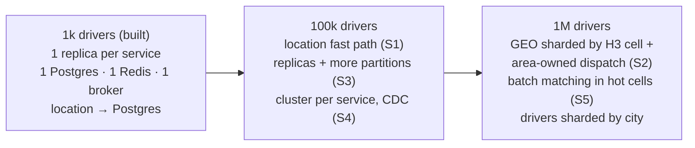

# Scalability & Performance Design

How the design evolves from **1,000 → 100,000 → 1,000,000 drivers** (challenge §5). The implementation targets 1,000 drivers. Everything at the larger scales is design, not built, and is marked as such.

**Contents:**
1. [Load model](#1-load-model)
2. [Evolution path](#2-evolution-path)
3. [Topic by topic](#3-topic-by-topic)
4. [Bottlenecks](#4-bottlenecks)
5. [Scaling strategies](#5-scaling-strategies)
6. [Architectural trade-offs](#6-architectural-trade-offs)
7. [What is not measured](#7-what-is-not-measured)

Requirement check: at least 3 bottlenecks, 3 strategies and 2 trade-offs are required; this page has **6 (B1–B6), 6 (S1–S6) and 5 (T1–T5)**.

## 1. Load model

Assumptions: an online driver sends a location update every **4 s**; at peak each driver completes **~0.6 rides/hour**; a ride needs **~1.5 offers**; one saga produces **~12 messages**.

| | 1,000 drivers | 100,000 drivers | 1,000,000 drivers |
|---|---|---|---|
| Location updates | 250 /s | 25,000 /s | **250,000 /s** |
| Ride requests (peak) | 0.2 /s | 17 /s | ~170 /s (bursts ~500 /s) |
| Offers | 0.3 /s | 25 /s | ~250 /s (bursts ~750 /s) |
| Saga messages | ~3 /s | ~200 /s | ~2,000 /s (bursts ~6,000 /s) |
| Location bandwidth (~100 B per update) | 25 KB/s | 2.5 MB/s | 25 MB/s |
| Redis GEO memory (~120 B per driver) | 120 KB | 12 MB | ~120 MB |
| Ride data (~1 KB per ride, daily average ≈ ⅓ of peak) | ~5 MB/day | ~500 MB/day | ~5 GB/day |

**Key insight:** location traffic grows to **250k writes/s**, while dispatch traffic stays below ~1k/s. Scaling this system is mainly about **ingesting locations and querying the geo index**, not about rides. This is why driver-service (the location path) is a separate service ([ADR-006](adr/ADR-006-service-architecture.md)).

## 2. Evolution path

| Stage | What changes | Why (bottleneck) |
|---|---|---|
| **1k (built)** | Nothing: one instance of everything; location written to Postgres (auditable, simple) | All loads are tiny (250 writes/s) |
| **100k** | S1 location fast path; S3 replicas + 24–48 partitions; S4 separate Postgres clusters, read replicas, CDC outbox; S6 short caches | B1 location writes on `driver_db`, B4 outbox polling, B5 partitions |
| **1M** | S2 GEO sharding by H3 cell + area-owned dispatchers; S5 batch matching in hot cells; drivers sharded by city; 3+ broker nodes with RF=3 | B2 single GEO key, B3 hot-zone contention, B6 single orchestrator database |

## 3. Topic by topic

The topics are the ones challenge §5 asks about.

| Topic | 1,000 drivers (built) | 100,000 drivers | 1,000,000 drivers |
|---|---|---|---|
| **Driver location storage** | `UPDATE drivers` + outbox event per update; Postgres is the truth | Stream-only location: publish to a compacted topic `driver.locations.v1` (key `driverId`); snapshot to Postgres in batches every 30 s; status changes stay transactional | Same, partitioned by city; history (if needed) to a time-series or column store |
| **Matching performance** | `GEOSEARCH` on one key, sub-ms; Haversine re-check in Go | Same; one Redis primary with ~25k `GEOADD`/s | One GEO key per **H3 cell (res 7, ~5 km²)**; search the pickup cell + ring-1 neighbours; batch matching in hot cells |
| **Database scaling** | One Postgres server, 3 databases | Separate cluster per service; read replicas for `GET`s; `rides` partitioned by month | `driver_db` sharded by city (Citus or app-level); a reservation stays a single-row update in one shard; Postgres-compatible distributed SQL as an option ([ADR-008](adr/ADR-008-data-stores.md)) |
| **Message broker scaling** | 1 Redpanda node, 6 partitions per topic | 3 nodes, RF=3; 24–48 partitions; location topic compacted | More nodes; 100+ partitions for location; tiered storage; per-region clusters |
| **Dispatch worker scaling** | 1 instance; sweeper and retrier poll every 1 s with `SKIP LOCKED` (replica-safe) | N replicas; sagas spread by `rideId` partition; relay leader election or CDC for ordered publishing | Partition dispatch by **area** (city/cell) instead of `rideId`: one owner per area removes most reservation conflicts |
| **Caching** | Not needed; Redis is a read model, not a cache | `GET /rides/{id}` cached ~1 s (clients poll); passengers cached in process | Edge or API cache for read endpoints; push (SSE/WebSocket) instead of polling removes most reads |
| **Partitioning** | Topics keyed by `rideId`/`driverId` (ordering per aggregate) | More partitions, same keys | Partition by **geography** (city → cell) for location, GEO and dispatch, so data and work for one area live together |

## 4. Bottlenecks

| # | Bottleneck | Where | Why it breaks | Breaks at | Signal |
|---|---|---|---|---|---|
| **B1** | Location writes on the driver database | `PUT …/location` → `UPDATE drivers` + outbox row | One Postgres primary handles roughly 10–20k such writes/s; 1M drivers need 250k/s | ~50–100k drivers | `driver_db` write p99 > 50 ms, CPU > 70 %, outbox backlog |
| **B2** | One Redis GEO key | `geo:drivers:available` | Redis runs commands on one core per shard; one key cannot be split across a cluster | a few 100k drivers | Redis CPU > 60 %, `GEOSEARCH` p99 > 5 ms, projector lag |
| **B3** | Hot zones (airport, stadium) | Reservation `UPDATE … WHERE status='AVAILABLE'` | Many rides chase the same nearest drivers: conflicts, retries and wasted round-trips. Adding servers doesn't help, because the contention is on the data | any scale, locally | `driver_reservation_conflicts_total / offers_total` > 20 % in an area |
| **B4** | Outbox polling | Relay per service | Each change is written twice; polling plus `UPDATE published_at` doubles location write load (B1) | ~100k drivers | `outbox_unpublished` growing |
| **B5** | Partition count | `driver.events.v1` (6 partitions) | Consumers in a group cannot outnumber partitions | ~100k drivers | consumer lag |
| **B6** | Single orchestrator database + polling workers | `dispatch_db`, 1 s sweeper and retrier | All sagas and offers on one primary; the workers scan by time | ~1M drivers | sweeper duration, `dispatch_db` CPU |

## 5. Scaling strategies

| # | Strategy | Fixes | What it does | Cost / risk |
|---|---|---|---|---|
| **S1** | **Location fast path** | B1, B4 | Driver apps send locations over the gRPC v2 stream (`StreamLocations`: one connection per driver instead of one HTTP request per update, already built). Location goes straight to a compacted Redpanda topic (no Postgres row per update) and is snapshotted to Postgres in batches every 30 s. Status changes stay transactional. Matching still sees the latest location via the projection | Up to 30 s of location history can be lost on a crash (acceptable; the next update fixes it) |
| **S2** | **Geo partitioning + area-owned dispatch** | B2, B3, B5 | One GEO key per city → H3 cell, spread over a Redis Cluster; ride events partitioned by area so one dispatcher owns an area | Rides near cell borders query neighbour cells; rebalancing areas needs care |
| **S3** | **Horizontal scale of stateless services** | throughput | 3–N replicas per service; more partitions; sagas spread by key; workers already use `SKIP LOCKED` | Relay ordering needs leader election or CDC (known limitation today) |
| **S4** | **Database per service as separate clusters, plus CDC** | B1, B4, B6 | Separate Postgres clusters; read replicas; `rides` partitioned by month; Debezium or Redpanda Connect reads the WAL instead of polling the outbox | More infrastructure to operate |
| **S5** | **Batch matching in hot cells** | B3 | Collect requests for ~200 ms per hot cell and solve the assignment together (greedy or Hungarian) | +~200 ms latency, only where conflicts are high |
| **S6** | **Caching and push** | read load | 1 s cache on `GET /rides/{id}`; push offers and status (SSE/WebSocket) instead of polling | Cache staleness ≤ 1 s; connection management |

## 6. Architectural trade-offs

| # | We chose | Over | Gained | Paid | Revisit when |
|---|---|---|---|---|---|
| **T1** | Microservices + saga | Modular monolith | Independent scaling of the location path; clear ownership | Eventual consistency (ms); more infrastructure; over the timebox | Scale stays < ~50k drivers and one team owns it ([ADR-006](adr/ADR-006-service-architecture.md)) |
| **T2** | Redis GEO **projection** (eventually consistent) | Querying driver-service / Postgres per match | In-memory matching; no load on reservation rows; dispatch works if driver-service is slow | A candidate may be stale; that costs one failed reservation, never a wrong assignment, because Postgres decides | Failed-reservation rate is high ([ADR-001](adr/ADR-001-matching.md)) |
| **T3** | Greedy nearest per request (spec) | Batch / global assignment | Simple, predictable, low latency | Not fleet-optimal; contention in hot zones (B3) | Conflicts > 20 % in a cell (S5) |
| **T4** | At-least-once + idempotent consumers | "Exactly-once" (Kafka transactions / 2PC) | Simple, broker-agnostic, crash-safe | Inbox/outbox tables and cleanup | Never: the DB write is outside Kafka anyway ([ADR-004](adr/ADR-004-messaging-outbox-inbox.md)) |
| **T5** | Location in Postgres per update (stage 1) | Stream-only location | Auditable, simple, one source of truth | Write amplification (B1) | ~50k drivers (S1) |

## 7. What is not measured

We did **not** run load tests. The per-node limits above (Postgres ~10–20k simple writes/s, Redis ~100k+ ops/s per core) are typical published orders of magnitude, not measurements of this system. The next step would be k6 scenarios for location ingestion and hot-zone contention ([ADR-011](adr/ADR-011-testing-strategy.md)).
