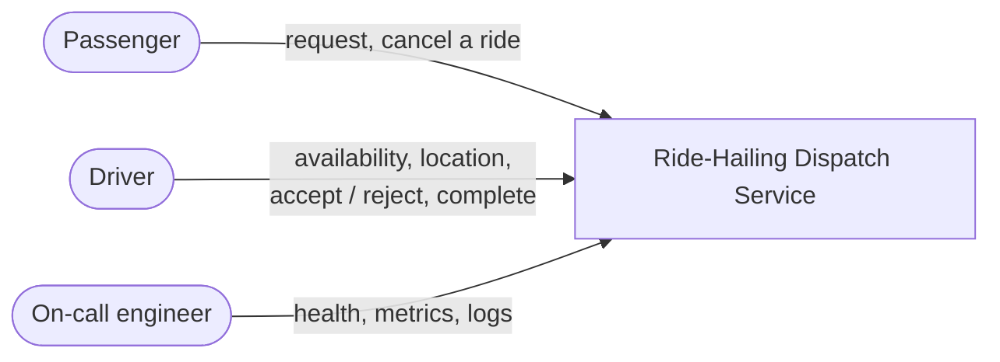
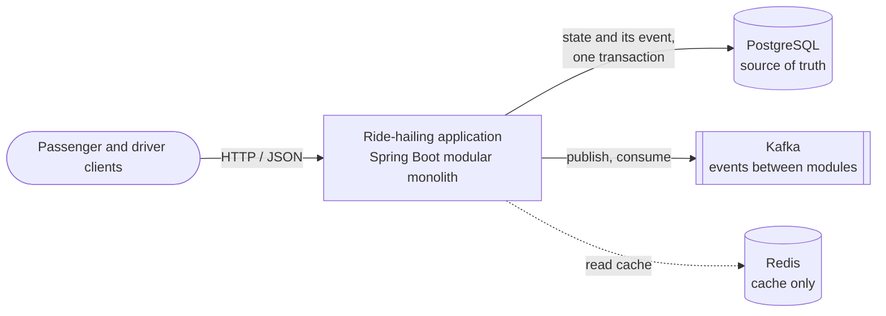
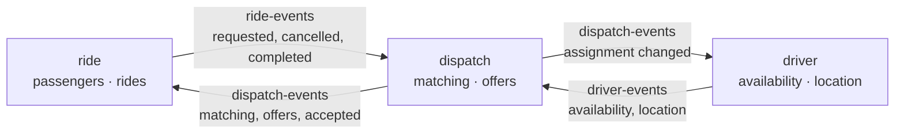
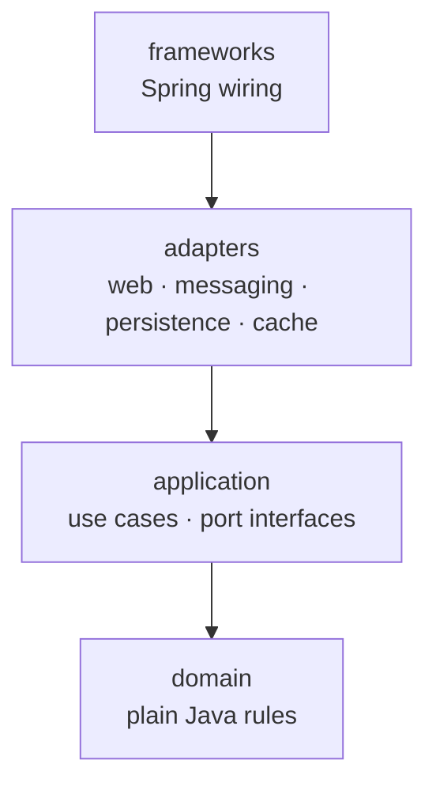
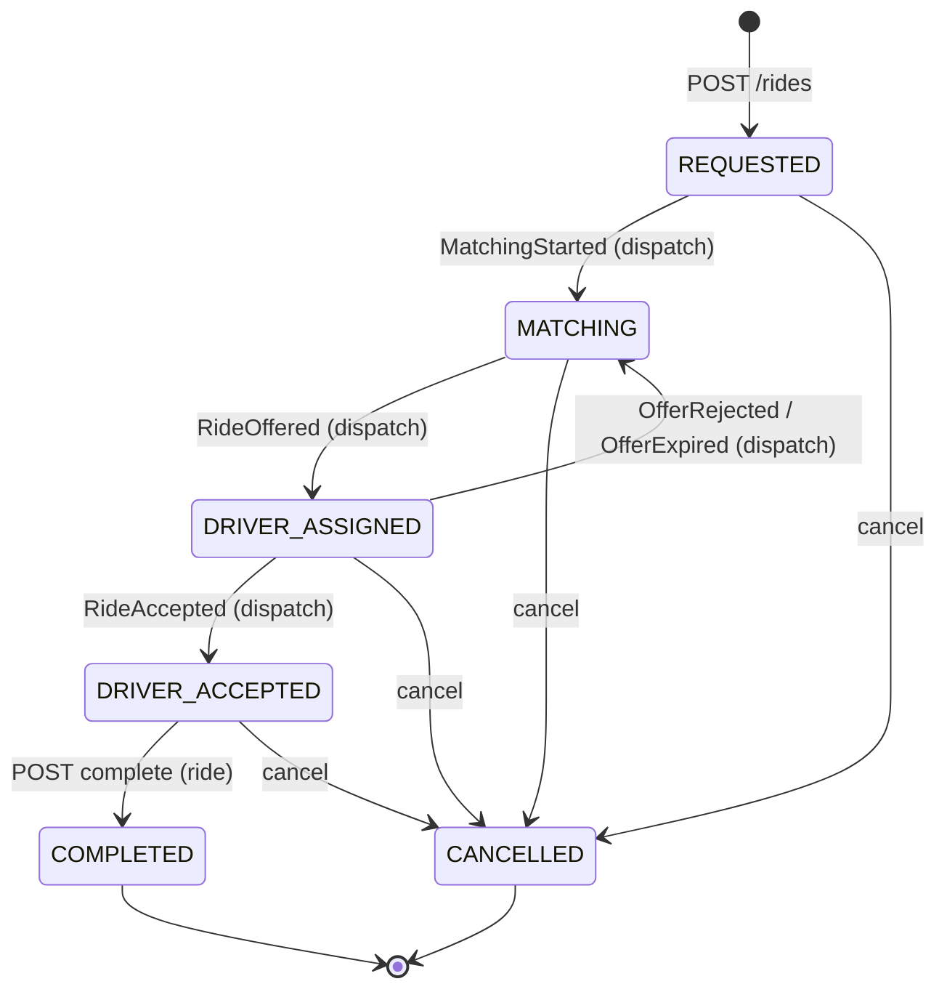
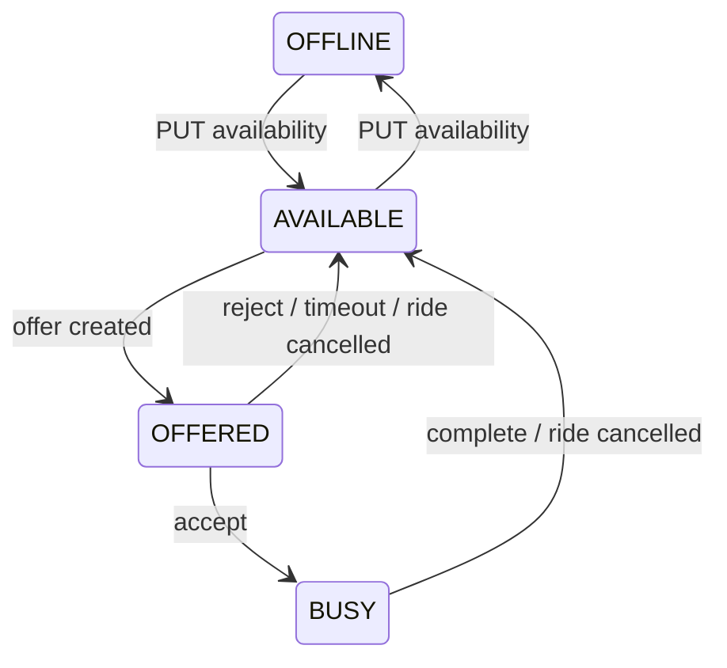
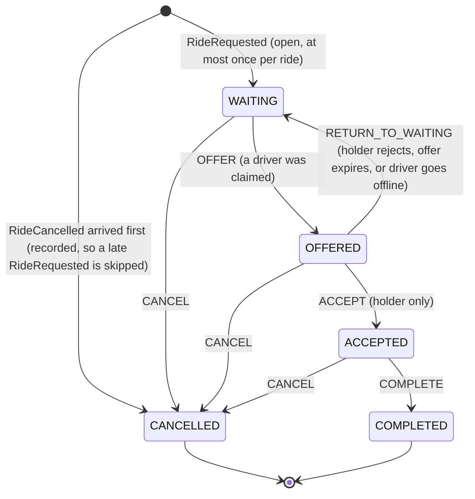
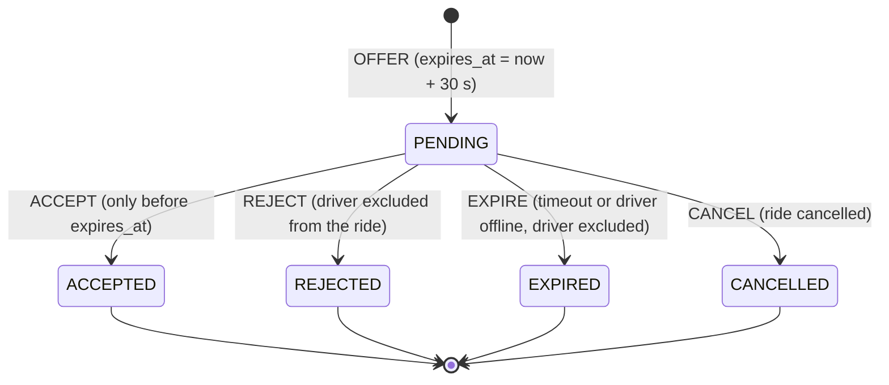
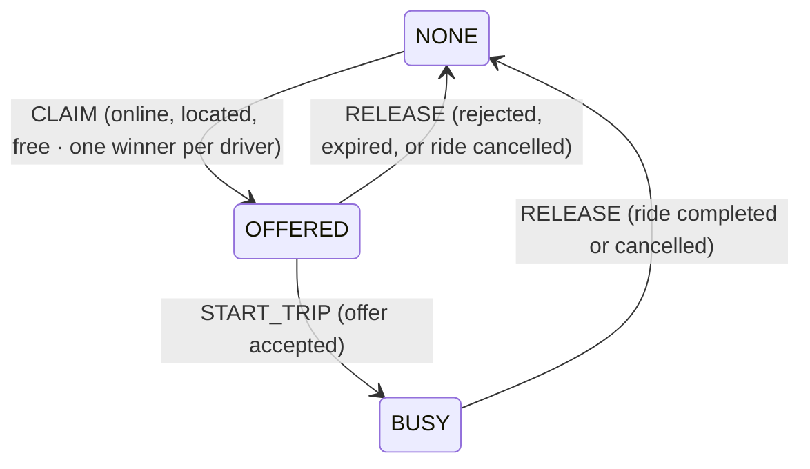
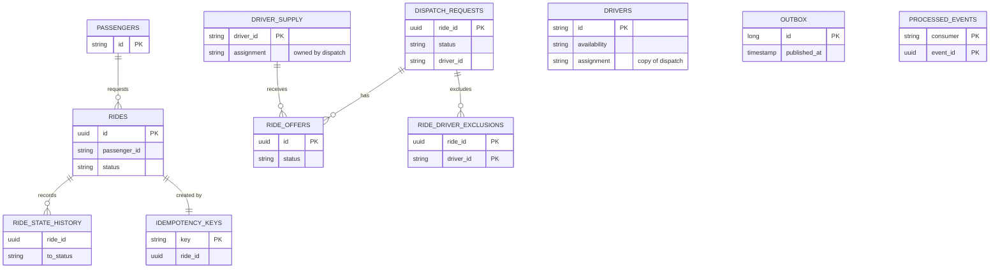

# Architecture

C4 views of the Ride-Hailing Dispatch Service, from system context down to the modules and the layers inside one, followed by the glossary, the state machines (ride, driver and dispatch's three lifecycles), the data model and the event catalogue. The diagrams show the shape only; the tables next to them and the decisions in [`adr/`](adr/) hold the detail.

## Level 1 — System context

Out of scope per the brief: authentication, registration, payments, maps and push notifications. Passengers and drivers are seeded records; clients poll `GET /rides/{id}` and `GET /drivers/{id}` instead of receiving pushes.

## Level 2 — Containers

Each module publishes only to its own topic and reacts to the others' events ([ADR-002](adr/ADR-002-decoupled-contexts.md)); in the monolith all three consumer groups run in the one application. Why these containers: [ADR-007](adr/ADR-007-idempotency.md) (idempotency is durable in Postgres), [ADR-005](adr/ADR-005-event-driven-dispatch.md) (Kafka, without dual writes) and [ADR-008](adr/ADR-008-caching.md) (Redis as a cache). Every state change and the event announcing it commit together; neither Kafka nor Redis is written inside a business transaction. Redis is drawn dashed because the system is fully correct with it stopped. Logs are plain text on stdout; `make trace RIDE=<id>` reads them, and delivery and dispatch metrics are exposed through Actuator ([README § Observability](../README.md#observability)).

## Level 3 — Modules

Three business modules, each owning its tables and publishing to its own topic. Arrows are events, through the outbox and Kafka; no module calls another's code.

Dispatch also consumes its own dispatch-events, to rematch after a rejection or an expired offer. Each event's producer, consumers and effect are in the [event catalogue](#event-catalogue). `common` (outbox, de-duplication, retention, Redis cache, geo, errors, logging) and `contracts` (topics, event wire names, versioned payload records) are libraries every module uses, and are left out of the drawing.

### Module rules (verified by `ApplicationModules.verify()`)

Each module is a separate Gradle project under `modules/` ([ADR-001](adr/ADR-001-module-structure.md)), so the "Depends on" column is also enforced by the compiler: a module only sees the modules it declares as dependencies. Each module owns its tables and migrations, and no foreign key crosses a module boundary.

| Module | Owns | Depends on | Never depends on |
|---|---|---|---|
| `contracts` | topic names, event wire names, `EventEnvelope`, versioned payload records | — | anything |
| `common` | shared kernel `common.kernel` (`Location`, `GeoDistance`, `BoundingBox`, `StateTransition`); platform: outbox, processed events, their retention (`EventRetention`), outbox backlog gauges (`OutboxBacklog`), `VersionedCache` (Redis), errors and their HTTP mapping (`common.web`), logging | `contracts` | business modules |
| `driver` | `drivers`: availability and location; a versioned copy of dispatch's assignment | `common`, `contracts` | `ride`, `dispatch` |
| `ride` | `rides`, `passengers` (seeded), `idempotency_keys`, `ride_state_history`; create, read, cancel, complete; a projection of dispatch's offer state | `common`, `contracts` | `driver`, `dispatch` |
| `dispatch` | `dispatch_requests`, `ride_offers`, `ride_driver_exclusions`, `driver_supply` (assignment owned, online/location copied); matching, accept, reject, expiry | `common`, `contracts` | `ride`, `driver` |

No business module calls another's code: ride, driver and dispatch communicate only through events on the owner's topic. Every decision is a local transaction in the module that owns the data — in particular the driver claim (AC-09) happens entirely in dispatch's tables. The copies other modules keep are eventually consistent: the driver copies are versioned, and ride's copy follows dispatch's per-ride event order. The rules are in [ADR-002](adr/ADR-002-decoupled-contexts.md). Each module declares its "Depends on" column in its `package-info.java` (`@ApplicationModule(allowedDependencies = …)`), and `ModularityTest` verifies it with Spring Modulith; generated diagrams of the same model are written to `app/build/spring-modulith-docs` ([ADR-001](adr/ADR-001-module-structure.md) decision 7).

### Inside each module

`ride`, `driver` and `dispatch` have the same four layers, Clean Architecture's rings under DDD's names ([ADR-003](adr/ADR-003-clean-architecture.md)). Source code depends only inwards, and `ModularityTest` enforces it (ArchUnit rules run inside Spring Modulith's `verify()`).

| Package | Ring | Holds | May use | Examples (dispatch) |
|---|---|---|---|---|
| `domain` | Entities | aggregates, value objects, lifecycle transitions, matching; plain Java | `java..`, its own domain, `common.kernel` | `DispatchRequest`, `DispatchRequestTransition`, `OfferTransition`, `AssignmentTransition`, `NearestDriverMatcher` |
| `application` | Use cases | use cases and their transactions, event handlers, schedulers | domain, `common`, `contracts` | `DispatchEventProcessor`, `DispatchService`, `OfferService`, `RideOutcomes`, `SupplyUpdates`, `DispatchEvents`, `DispatchMetrics`, `MatchingSweeper` |
| `application.port` | Use cases | the interfaces the use cases need from outside | domain | `DispatchRequestRepository`, `OfferRepository`, `ExclusionRepository`, `DriverSupplyRepository` |
| `adapters.web` (+ `.model`) | Interface adapters | REST controllers, and in `model` their request and response models | application, domain, `common.model` | `OfferController`, `model.OfferResponse` |
| `adapters.messaging` | Interface adapters | the module's Kafka listener | application | `DispatchEventListener` |
| `adapters.persistence` | Interface adapters | JDBC implementations of the ports | application, domain, frameworks | `JdbcDispatchRequestRepository`, `JdbcOfferRepository`, `JdbcDriverSupplyRepository` |
| `adapters.cache` | Interface adapters | Redis implementations of the ports (ride and driver only) | application, domain, `common.cache` | ride: `RedisRideReadCache`, `RedisIdempotencyCache` |
| `frameworks` | Frameworks & drivers | Spring wiring: topics the module owns, configuration properties, beans | everything in the module | `DispatchConfig`, `DispatchMessagingConfig` |

Adapters of different kinds never use each other; they meet only in the application. `common.kernel` is the shared kernel (`Location`, `GeoDistance`, `BoundingBox`, `StateTransition`, `TransitionOutcome`, `InvalidValueException`), plain Java. The rest of `common` is framework support (outbox, de-duplication, retention, `InboundEvents` for listeners, `VersionedJsonCache` for read caches, errors, logging), used outside the domain. The application reaches the outbox, de-duplication and event codec only through the interfaces `OutboxWriter`, `ProcessedEvents` and `EventCodec`. It throws `common.error` exceptions that carry no HTTP status; `common.web.ApiExceptionHandler` maps each kind to one.

#### Layers in one module

Arrows point inwards; the persistence and cache adapters implement the ports the application declares.

In ride the ports are `RideRepository`, `IdempotencyRepository`, `IdempotencyCache`, `RideReadCache` and `Passengers`, implemented by `JdbcRideRepository`, `JdbcIdempotencyRepository` and `JdbcPassengers` (persistence) and `RedisIdempotencyCache` and `RedisRideReadCache` (cache). In driver they are `DriverRepository` and `DriverReadCache`, implemented by `JdbcDriverRepository` and `RedisDriverReadCache`.

## Ubiquitous language

The same real-world thing can have a different name in each context; this table is the mapping.

| Term | Context | Meaning | In code |
|---|---|---|---|
| Passenger | ride | A seeded person who requests rides. A table in ride, not a module: ride checks the passenger exists when a ride is created, and nothing else uses it | `passengers`, `ride.application.port.Passengers`, `JdbcPassengers` |
| Ride | ride | A passenger's request to travel from a pickup to a destination, and its lifecycle (AC-06) | `ride.domain.Ride`, `RideStatus` |
| Matching | ride | The ride is waiting for dispatch to find a driver | `RideStatus.MATCHING` |
| Dispatch request | dispatch | Dispatch's record of a ride it serves; the root of dispatch's main aggregate | `DispatchRequest` |
| Waiting | dispatch | Dispatch has no driver on offer for the ride; the ride shows **Matching** | `DispatchRequestStatus.WAITING` |
| Offer | dispatch | A ride proposed to one driver, pending until accepted, rejected, expired or cancelled (AC-05) | `RideOffer`, `OfferStatus`, `OfferTransition` |
| Holder | dispatch | The driver who holds the request's current offer or accepted it; only the holder may answer | `DispatchRequest.isHeldBy` |
| Exclusion | dispatch | A driver who rejected the ride or let its offer expire, never offered that ride again (AC-07) | `ExclusionRepository` |
| Supply | dispatch | Dispatch's view of every driver: online flag and location (copied) and assignment (owned) | `SupplyDriver`, `driver_supply` |
| Assignment | dispatch, driver | Whether dispatch holds a driver: `NONE`, `OFFERED` (pending offer) or `BUSY` (trip). Dispatch decides; driver keeps a copy | `dispatch.domain.Assignment`, `driver.domain.Assignment` |
| Claim | dispatch | Taking a free driver for a ride: assignment `NONE → OFFERED` (AC-09) | `AssignmentTransition.CLAIM` |
| Availability | driver | What the driver chose: `OFFLINE` or `AVAILABLE` (AC-02) | `Driver.availability`, `DriverTransition` |
| Driver status | driver (the brief's term) | Availability, overridden by the assignment while dispatch holds the driver: `OFFLINE`, `AVAILABLE`, `OFFERED`, `BUSY` | `Driver.status()` |
| Matching attempt | dispatch | One pass of rank-and-claim for a waiting request | `DispatchService.dispatch` |
| Copy / projection | ride, driver, dispatch | State one context keeps from another's events: driver copies apply only newer versions; ride's copy applies each event as a status transition | `DispatchProjection`, `AssignmentProjection`, `SupplyUpdates` |

## Ride state machine

- Transitions labelled *(dispatch)* are applied by ride's projection of dispatch-events; cancel and complete are ride's own commands (ADR-002).
- No eligible driver ⇒ the ride **stays in `MATCHING`** with `assignedDriverId = null`; dispatch's `MatchingSweeper` retries later.
- Still `REQUESTED` 30 s after its RideRequested was published ⇒ dispatch never saw the ride (the event was dead-lettered or lost); ride's `UndispatchedRideSweeper` publishes RideRequested again ([ADR-005](adr/ADR-005-event-driven-dispatch.md) § 7).
- Repeating a transition that has already happened (same target, same driver) is a **no-op success**; any other transition from the current state is rejected with `409`.

## Driver state machine

`OFFERED` and `BUSY` cannot go `OFFLINE` through the availability API; every unlisted transition is rejected. The driver chooses OFFLINE/AVAILABLE; OFFERED/BUSY reflect **dispatch's** assignment, which dispatch decides in `driver_supply` and the driver module copies from DriverAssignmentChanged. If a driver goes offline before that copy has caught up, dispatch expires the pending offer (ADR-002).

The ride's `DRIVER_ASSIGNED`, return to `MATCHING`, and `DRIVER_ACCEPTED` likewise follow dispatch's events. Cancel and complete are the ride's own commands; a terminal ride ignores any dispatch event that arrives later.

## Dispatch lifecycles

Dispatch owns three lifecycles, each an enum of transitions in `dispatch.domain` ([ADR-003](adr/ADR-003-clean-architecture.md) § 3). The SQL compare-and-set of every change is built from these enums ([ADR-006](adr/ADR-006-concurrency.md)).

**Dispatch request** (`DispatchRequestTransition`): one row per ride dispatch serves. `WAITING` is what the ride shows as `MATCHING`.

`COMPLETE` is also accepted from `WAITING` and `OFFERED`, because ride decides completion; in practice ride only completes an accepted ride. Transitions marked *holder only* are rejected for any driver but the one holding the offer (`DispatchRequest.evaluate`).

**Offer** (`OfferTransition`): answered exactly once.

**Driver assignment** (`AssignmentTransition`, in `driver_supply`): whether dispatch holds a driver. Driver keeps a copy and shows it as the brief's `OFFERED` / `BUSY`.

## Data model

Only keys and the columns the state machines use are shown. Relationships are drawn inside a module only; no foreign key crosses a module boundary (ADR-001), and ids from other modules (`rides.assigned_driver_id`, `dispatch_requests.ride_id`) are checked by the application.

| Module | Tables |
|---|---|
| ride | `passengers` (seeded), `rides`, `idempotency_keys`, `ride_state_history` |
| driver | `drivers` |
| dispatch | `dispatch_requests`, `ride_offers`, `ride_driver_exclusions`, `driver_supply` |
| common | `outbox`, `processed_events` |

The migrations under each module's `src/main/resources/db/migration/` have every column, constraint and index.

## Event catalogue

Defined in `modules/contracts`; one topic per owner, each with a `.DLT` dead-letter topic, all kept for 7 days (`Topics.RETENTION_DAYS`).

| Event (payload) | Topic · key | Produced by | Consumed by | Effect |
|---|---|---|---|---|
| `RideRequested` (`RideRequestedV1`: rideId, passengerId, pickup) | ride-events · rideId | ride (on create; again by `UndispatchedRideSweeper` if dispatch never opened the ride) | dispatch | open a dispatch request (at most once per ride), publish MatchingStarted, first matching attempt |
| `RideCancelled` (`RideCancelledV1`) | ride-events · rideId | ride | dispatch | close the request, cancel a pending offer, release the driver; with no request yet, record the ride as ended so a late RideRequested is skipped |
| `RideCompleted` (`RideCompletedV1`) | ride-events · rideId | ride | dispatch | close the request, release the BUSY driver |
| `MatchingStarted` (`MatchingStartedV1`) | dispatch-events · rideId | dispatch | ride | REQUESTED → MATCHING |
| `RideOffered` (`RideOfferedV1`) | dispatch-events · rideId | dispatch | ride | MATCHING → DRIVER_ASSIGNED |
| `OfferRejected` (`OfferRejectedV1`) | dispatch-events · rideId | dispatch | ride, dispatch | ride back to MATCHING; dispatch rematches |
| `OfferExpired` (`OfferExpiredV1`, reason TIMEOUT or DRIVER_OFFLINE) | dispatch-events · rideId | dispatch | ride, dispatch | same as a rejection |
| `RideAccepted` (`RideAcceptedV1`) | dispatch-events · rideId | dispatch | ride | DRIVER_ASSIGNED → DRIVER_ACCEPTED |
| `DriverAssignmentChanged` (`DriverAssignmentChangedV1`: assignment, version) | dispatch-events · driverId | dispatch | driver | copy OFFERED / BUSY / none |
| `DriverAvailabilityChanged` (`DriverAvailabilityChangedV1`: online, version) | driver-events · driverId | driver | dispatch | supply online flag; offline while OFFERED expires the offer |
| `DriverLocationUpdated` (`DriverLocationUpdatedV1`: location, version) | driver-events · driverId | driver | dispatch | supply location |

Envelope (`EventEnvelope`): `eventId` (UUID, consumer de-duplication), `eventType`, `rideId?`, `driverId?`, `occurredAt`, `schemaVersion`, `payload`. Consumer groups: `dispatch` (ride-events, dispatch-events, driver-events), `ride` (dispatch-events), `driver` (dispatch-events). Location fields are personal data: they appear in event payloads only, never in logs (ADR-002 § Consequences).
