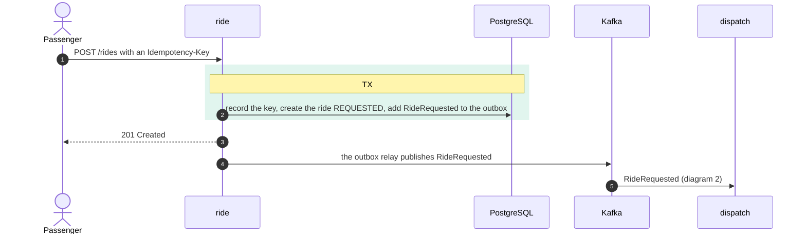
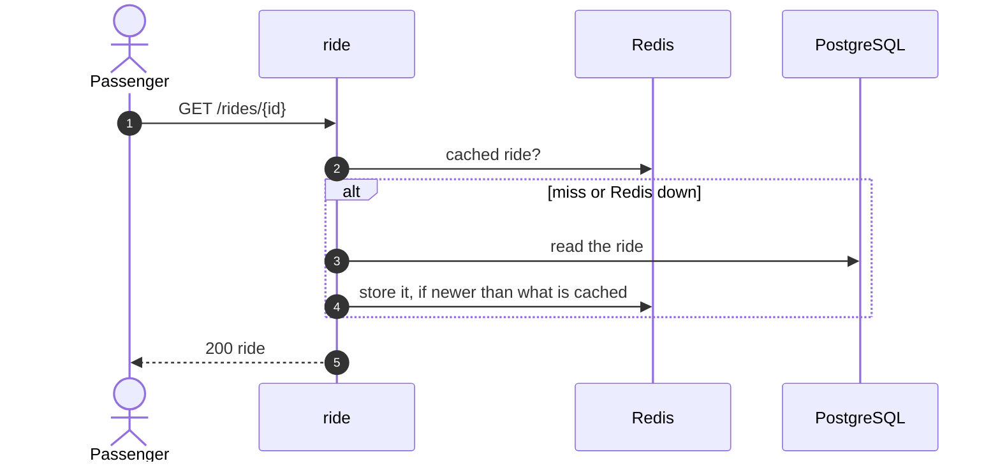
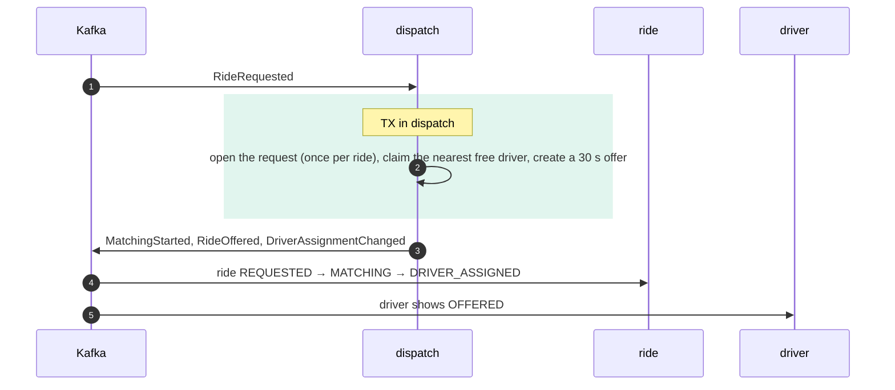
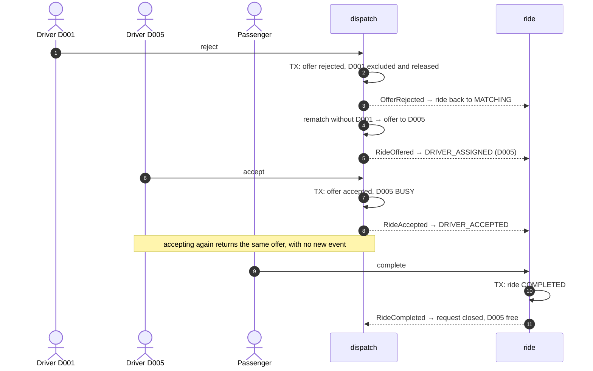
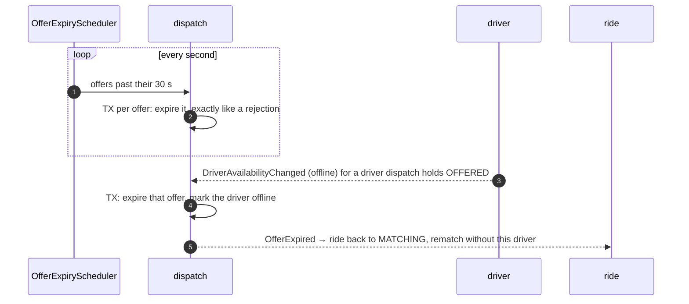
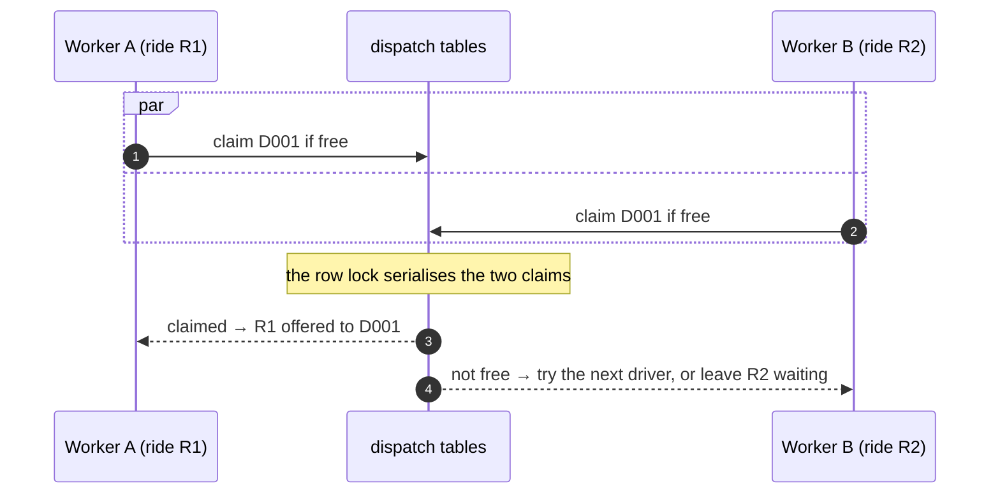
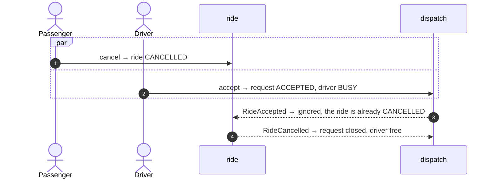
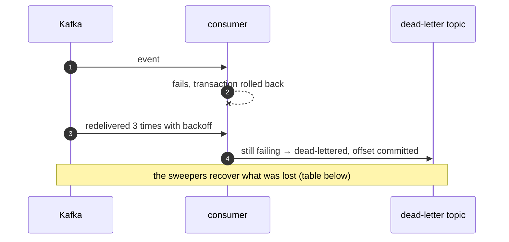

# Sequence diagrams

The main flows, at the level of modules and their transactions. A `TX` box is one Postgres transaction inside **one** module; nothing inside it talks to Kafka or to another module. Modules talk only through events on the owner's topic ([ADR-002](adr/ADR-002-decoupled-contexts.md)). Components are described in [`architecture.md`](architecture.md).

## 1. Create ride (idempotent) → asynchronous dispatch

- **Retries.** The key, the ride and its event commit together, so a crash leaves either nothing or all three. A retry with the same key and body returns the same ride; a different body returns `422`; an unknown passenger returns `400` without consuming the key. A concurrent duplicate waits on the key's unique index, then replays.
- **Cache.** Redis can answer a replay before Postgres is touched, and is written only after commit, so a flushed cache can never create a second ride ([ADR-008](adr/ADR-008-caching.md)).
- **Relay.** The event reaches Kafka at least once and is never lost ([ADR-005](adr/ADR-005-event-driven-dispatch.md) decision 2).

## 1b. Read a ride (polling clients)

Commands (`accept`, `reject`, `cancel`, `complete`) never read the cache; they always run against Postgres.

## 2. Dispatch: open the request, match, offer

- **Duplicates.** A redelivered event, or a second RideRequested for a ride dispatch already opened or already saw end, is skipped in the same transaction.
- **Matching.** Free drivers (online, located, not held) within 2 km, minus those who already rejected or let this ride's offer expire, sorted by distance and then id ([ADR-004](adr/ADR-004-matching.md)). The claim succeeds only if the driver is still free ([ADR-006](adr/ADR-006-concurrency.md)).
- **No driver.** The request stays waiting (the ride shows `MATCHING`), and the sweeper retries later.

## 3. Reject → rematch → accept → complete

With the seed data, as in `make demo`: D001 (0.8 km) is offered first; after it rejects, the next nearest eligible driver is D005 (1.2 km).

Dispatch rematches by consuming its own OfferRejected from dispatch-events.

## 4. Offer timeout, and a driver going offline while offered

A driver can go offline while offered because the driver module checked an older copy of the assignment. An `accept` racing either expiry is resolved by locking the request first: whichever commits first wins, and the other gets `409` or is skipped.

## 5. Two rides compete for the same driver (AC-09)

The claim is one compare-and-set update in dispatch's own tables. Partial unique indexes reject a double assignment even if the code regresses ([ADR-006](adr/ADR-006-concurrency.md)).

## 6. Cancel races accept

If RideCancelled reaches dispatch first, the pending offer is cancelled and the accept returns `409 OFFER_NOT_HELD`. Either order ends with the ride `CANCELLED` and the driver free.

## 7. Processing failure

The retries wait 0.5 s, 1 s and 2 s. A record that cannot be decoded goes to the DLT at once. DLT records are kept for 7 days. What recovers which loss:

| Lost or dead-lettered | Recovered by |
|---|---|
| RideRequested | `UndispatchedRideSweeper` (ride, every 5 s) republishes it for a ride still `REQUESTED` 30 s later; dispatch opens the request at most once, so a repeat is harmless. If the ride was cancelled first, dispatch has already recorded it as `CANCELLED` and skips the late RideRequested. |
| OfferRejected / OfferExpired (dispatch's own rematch trigger) | `MatchingSweeper` (dispatch, every 5 s): the request is back to waiting. |
| An unanswered offer | `OfferExpiryScheduler` after 30 s. |
| A projection event (ride's or driver's copy) | Not reconciled: the copy stays stale until the next event for that ride or driver; dispatch's state is correct and the record waits on the DLT ([ADR-005](adr/ADR-005-event-driven-dispatch.md) § Consequences). |
